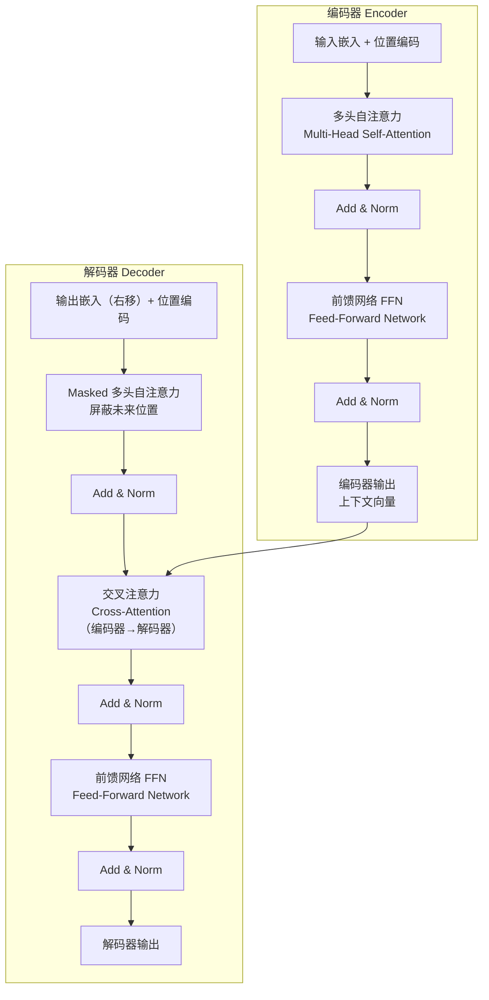

# Transformer

### Transformer 的核心思想

传统 RNN 是**串行**处理序列的，速度慢、长距离依赖弱。Transformer 的创新在于用**注意力机制**完全替代了循环结构，所有位置**并行计算**。

------

### 两大组成部分

**编码器（Encoder）** — 理解输入 把输入序列（如英文句子）压缩成一组上下文向量，捕获每个词与其他词的关系。

**解码器（Decoder）** — 生成输出 根据编码器的上下文，逐步生成输出序列（如翻译后的中文）。

3层结构示意图：

------

### 关键模块

**多头注意力（Multi-Head Attention）** — 核心中的核心，让每个词都能"看到"序列中所有其他词，并计算它们之间的相关性权重。多个"头"并行运行，从不同角度理解关系。

**Masked 自注意力** — 解码器专用，生成时屏蔽未来的位置，防止"偷看答案"。

**交叉注意力（Cross-Attention）** — 解码器用来查询编码器输出的机制，这是两者之间的信息桥梁（图中橙色虚线）。

**FFN + Add & Norm** — 每个注意力层后都跟前馈网络做非线性变换，再用残差连接 + LayerNorm 稳定训练（图中虚线箭头）。

**位置编码（Positional Encoding）** — 注意力本身没有位置感，需要在输入中手动注入位置信息。
