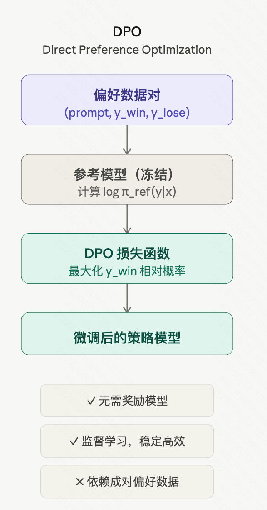
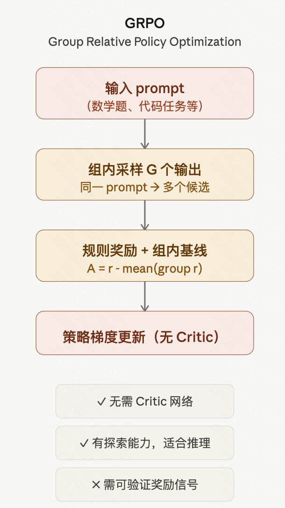
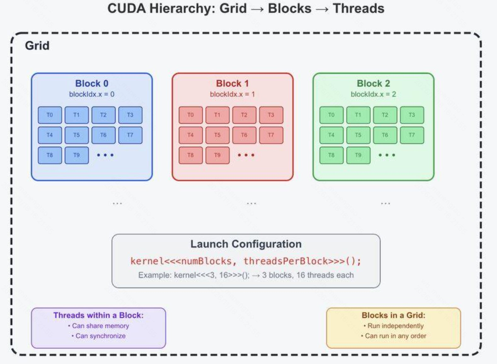
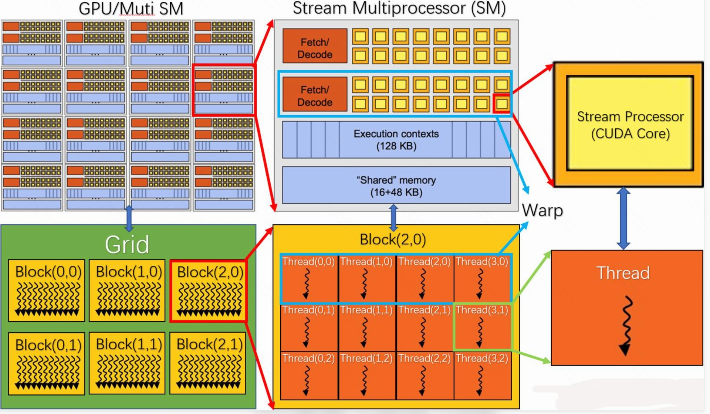
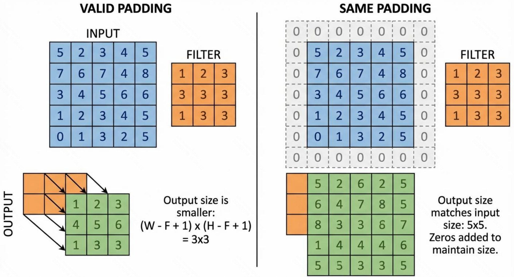
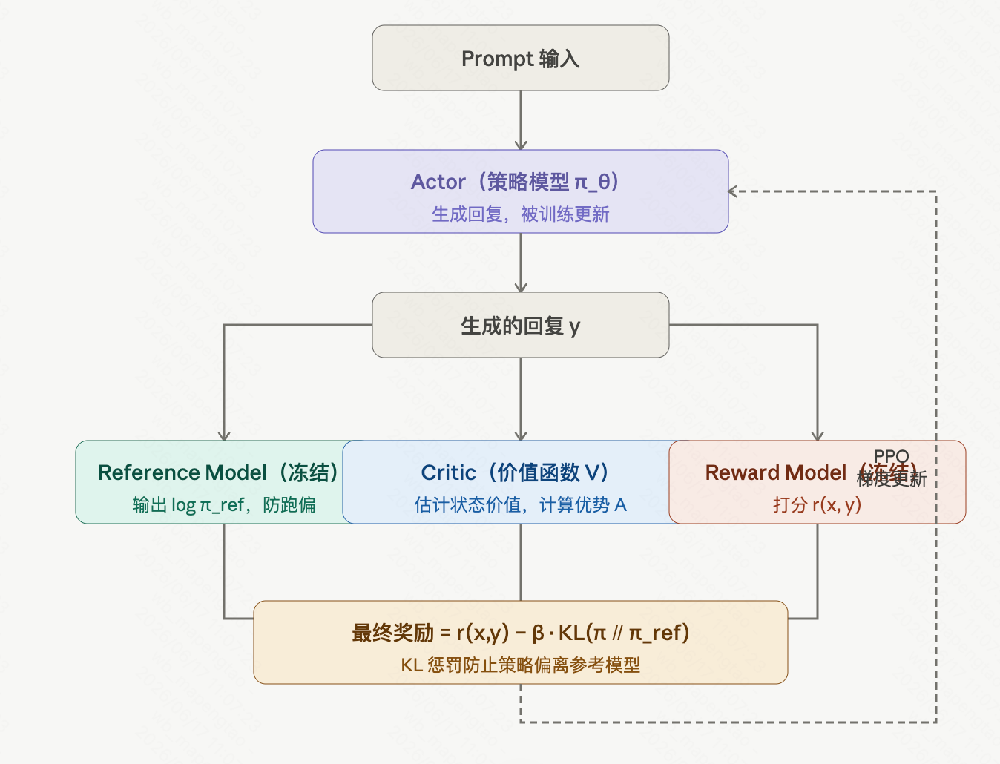
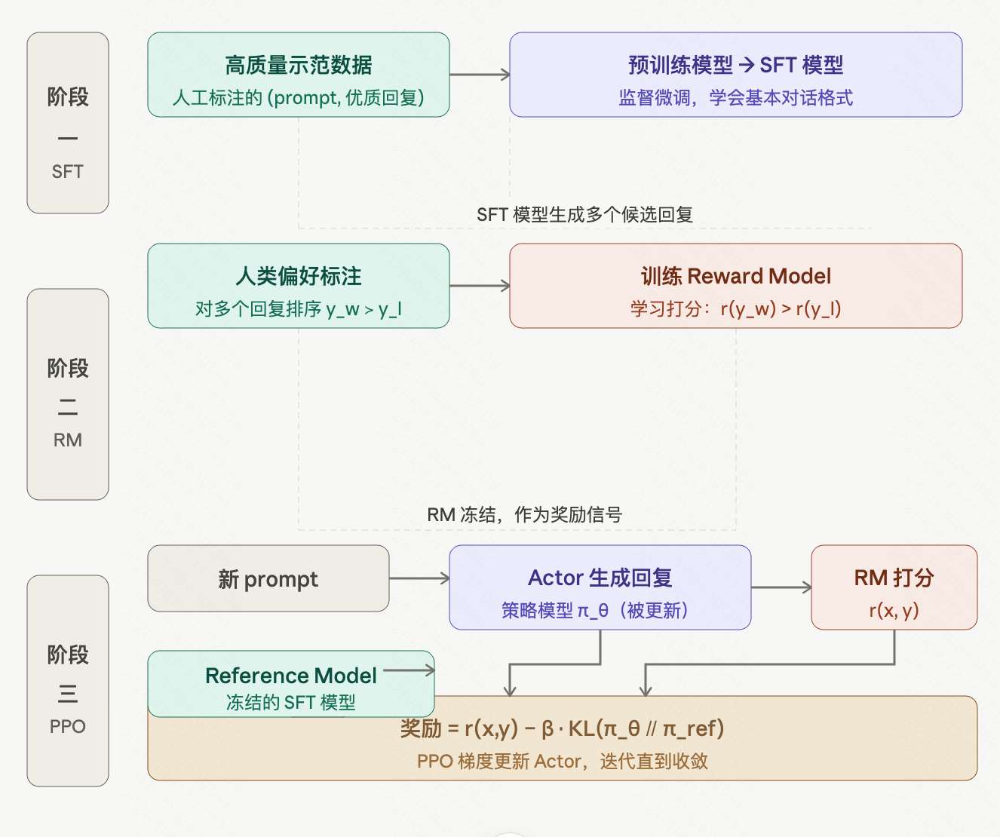

# 名词解释

## Attention

标准 Scaled Dot-Product Attention（缩放点积注意力），这是 Transformer 里最核心的注意力公式，也是所有 Attention 的基础。

### 标准 Attention 公式 

也就是 Single-Head Attention（单头注意力）:
$$
\mathrm{Attention}(Q, K, V) = \mathrm{softmax}\left( \frac{Q K^\top}{\sqrt{d_k}} \right) V
$$
特点：

- 只有**一组** Q、K、V
- 只做**一次**注意力加权
- 模型只能学到**一种全局注意力模式**

缺点：

- 表达能力有限
- 只能关注 “一种语义” 的相关性（比如只关注语法、或只关注语义）

**符号解释**：

- Q：Query（查询），形状 \((N, d_k)\) 
- K：Key（键），形状 \((N, d_k)\)
- V：Value（值），形状 \((N, d_v)\)
- \(d_k\)：Query/Key 的维度
- \(\sqrt{d_k}\)：缩放因子，防止点积过大导致 softmax 饱和
- \(K^\top\)：Key 的转置
- \(\mathrm{softmax}\)：对**每一行**做归一化，得到注意力权重

注：

- N = 序列长度，比如一句话有 10 个词，N = 10，形状里的 N 代表：**有多少个 token（词 / 向量）**
- d = dim = 向量维度。每个词被表示成一个 d 维的向量，比如 Transformer 常用 d_model = 512
- k = key 的维度下标，只是一个名字，用来区分 Value 的维度 \(d_v\)

### 带 Mask 的注意力公式：

$$
\mathrm{Attention}(Q, K, V) = \mathrm{softmax}\left( \frac{Q K^\top + M}{\sqrt{d_k}} \right) V
$$

特点：

1. **强制屏蔽某些位置**

    不让模型看到不该看的信息，比如解码时**看不到未来的词**。

2. **只在 Transformer 解码器用**

    - 编码器：不用 mask，能看全部上下文
    - 解码器自注意力：必须用 **上三角 mask**，只能看当前及之前的词

3. **防止信息泄露**

    避免训练时模型 “作弊” 直接抄答案，保证生成是**从左到右依次预测**。

4. **不改变计算结构**

    只是加了个掩码，其余和普通单头注意力完全一样。

### Multi-Head Attention（多头注意力）公式：

$$
\begin{aligned}
\mathrm{MultiHead}(Q, K, V) &= \mathrm{Concat}(\mathrm{head}_1, \dots, \mathrm{head}_h) W^O \\
\mathrm{head}_i &= \mathrm{Attention}(Q W_i^Q, K W_i^K, V W_i^V)
\end{aligned}
$$

其中，每个头内部仍为：
$$
\mathrm{head}_i = \mathrm{softmax}\left( \frac{(Q W_i^Q)(K W_i^K)^\top}{\sqrt{d_k}} \right) (V W_i^V)
$$
Transformer 原版用的就是这个。

核心思想：把 Q、K、V **沿着维度切分成 h 份**，每份叫一个 “头（head）”，

每个头**独立算一次 Attention**，最后再拼起来。

不同头可以学到不同类型的依赖关系。	


### Flash Attention vs Memory-Efficient Attention

两者目标相同——**解决标准 Attention 的显存瓶颈**——但思路不一样。

### 标准 Attention 为什么慢？

标准 Attention 的计算：

问题在于 **QKᵀ 这个矩阵**，序列长度为 N 时，它是 **N×N** 的：

- 显存占用 O(N²)，序列长 2048 还好，长到 100k 直接爆显存
- 这个矩阵需要**写回 HBM（显存）**，再读回来做 Softmax，**内存带宽成了瓶颈**，GPU 计算单元大部分时间在等数据

### Flash Attention

**核心思想：不把 N×N 矩阵写到显存，分块在 SRAM 里算完**

GPU 的存储层级：

```
SRAM（片上，超快，但很小 ~20MB）
   ↓
HBM 显存（大，但慢）
```

Flash Attention 的做法：

1. 把 Q、K、V 分成小块（tile）
2. 每次只把一小块载入 SRAM
3. **在 SRAM 里完成该块的 Attention 计算**
4. 用数学技巧（online softmax）把分块结果正确合并

**关键：整个过程 N×N 矩阵从未完整出现在显存里**

效果：

- 显存 O(N²) → **O(N)**
- 速度提升 **2~4×**（主要来自减少 HBM 读写次数）
- 数学结果和标准 Attention **完全一致**，不是近似

注：Flash Attention 简称 FA。

### Memory-Efficient Attention

Meta 提出（xFormers 库），思路不同：

**核心思想：用重计算（recomputation）换显存**

标准训练需要保存 N×N 矩阵用于 Backward，Memory-Efficient Attention 的做法是：

- Forward 时**不保存** N×N 矩阵
- Backward 时**重新计算**一遍需要的中间值

本质是一个经典权衡：

> **用计算量换显存**

效果：

- 显存大幅降低
- 速度略慢于 Flash Attention（因为重计算有额外开销）

### 对比

|          | Flash Attention           | Memory-Efficient Attention |
| -------- | ------------------------- | -------------------------- |
| 核心思想 | 分块 tiling，留在 SRAM    | 重计算，不存中间值         |
| 显存     | O(N)                      | 大幅降低但略高于 FA        |
| 速度     | **更快**（减少 HBM 访问） | 略慢                       |
| 数学精度 | 精确                      | 精确                       |
| 实现难度 | 高（需要 Triton/CUDA）    | 相对较低                   |
| 代表库   | flash-attn                | xFormers                   |

**一句话总结**

> Flash Attention = **聪明地安排计算顺序**，让数据尽量留在快速缓存里；Memory-Efficient Attention = **用时间换空间**，需要时再重算。前者更快，后者更容易实现，现在工业界基本都用 Flash Attention。

---

## AUC

​	**AUC** 是机器学习里一个非常常见的评估指标，全称是 **Area Under the Curve**，通常指 **ROC 曲线下的面积**。 

- **背景：**在二分类任务（比如广告点击预测、是否诈骗、是否患病）里，模型会输出一个概率分数 `p ∈ [0,1]`，然后根据阈值（比如 0.5）决定正负类。
     问题是：不同阈值下，模型表现会不同。AUC 就是一个综合指标，衡量模型在**所有可能的阈值**下整体的区分能力。
- **ROC** 曲线：
    - 横轴：**FPR** (False Positive Rate，假正例率)
    - 纵轴：**TPR** (True Positive Rate，真正例率 = Recall)
    - **ROC** 曲线：改变阈值，从 (0,0) 画到 (1,1)，得到一条曲线。

​	**AUC** 就是这条曲线下的面积，范围在 `[0,1]` 之间。

- **AUC** 的直观意义：

    - **AUC = 0.5**：模型跟随机猜差不多（区分不了）。
    - **AUC = 1.0**：模型完美区分正负样本。
    - **AUC > 0.9**：一般认为模型区分能力很强。

    另一个等价的解释：**AUC** 表示“从所有正样本、负样本对里，随机抽一对，模型给正样本的分数比负样本高的概率”。

    比如 **AUC**=0.8，就意味着 80% 的情况下，模型能把正样本排在负样本前面。

- 为什么推荐系统/**CTR** 预估喜欢用 **AUC**：

    - 业务目标通常是排序（把点击概率高的 item 排在前面），而不是一个固定阈值的分类。
    - AUC 衡量的正是“排序正确的概率”，比单纯的准确率 (Accuracy) 更合理。

---

## Batch

​	一组**样本（[Sample](# Sample)）**的集合，用来一次性输入模型。

- 举例：
    - batch size = 32 → 意味着你一次前向/反向会处理 32 张图片 / 32 条样本。
- **为什么要 batch**：
    - 硬件效率：GPU 更适合大块矩阵运算，不适合单个样本。
    - 稳定性：批量梯度是对真实梯度的近似，方差更小。

👉 **batch = [sample, sample, ..., sample]**。

## Batch Normalization & Layer Normalization

**Batch Normalization**: 批归一化

**Layer Normalization**: 层归一化

两者目的一样——稳定训练、加速收敛——但**归一化的维度不同**。

### BN & LN 公式？

BN 对**同一个 batch 里所有样本的同一个特征维度**求均值和方差：

> 比如一个 batch 有 32 张图，第 5 个神经元的激活值，跨这 32 个样本做归一化

$$
BN(x) = \gamma \cdot \frac{x - \mu_{\text{batch}}}{\sigma_{\text{batch}}} + \beta
$$

LN 对单个样本内部指定维度做归一化，不依赖 batch 统计量：

$$
LN(x) = \gamma \cdot \frac{x - \mu}{\sqrt{\sigma^2 + \epsilon}} + \beta
$$

区别：BN 是 μ 和 σ 是**跨样本**算的，而 LN 是**跨特征维度**算的。

### BN vs LayerNorm 直觉对比

```
一个 batch，形状 [样本数, 特征数]

BN：  ↓ 对每一列（每个特征）归一化，跨样本
LN：  → 对每一行（每个样本）归一化，跨特征
```

### BN 的问题

**依赖 batch size** — batch 太小时，均值和方差估计不准，效果变差

**推理时需要"运行统计量"** — 训练时会维护一个全局的移动均值和方差，推理时用这个替代 batch 统计，引入了额外状态

**不适合序列模型** — 序列长度不固定，batch 内样本差异大，BN 效果很差，所以 Transformer 用 LayerNorm 而不是 BN

## BM25 算法

**BM25（Best Matching 25）是一种经典的信息检索算法，主要用于计算查询（Query）和文档（Document）之间的相关性得分。**

简单来说：用户输入一个搜索词，BM25 根据搜索词和文档的匹配程度，为每篇文档打分，最后按照分数从高到低排序。

它广泛应用于：

- 搜索引擎：根据关键词检索网页。
- RAG：从知识库中召回与问题相关的文本片段。
- 文档检索：从大量文档中查找相关内容。
- 搜广推：作为关键词检索、倒排索引召回中的相关性排序方法。

BM25 可以理解为 **TF-IDF 的改进版本**，它不仅考虑关键词出现的频率，还考虑词语的稀有程度以及文档长度。

### 1. BM25 的核心思想

假设用户搜索：

> CUDA 显存优化

现在有三篇文档：

| 文档 | 内容                        |
| -- | ------------------------- |
| D1 | CUDA 显存优化方法，包括显存分配、内存复用   |
| D2 | CUDA 编程入门，介绍线程、Block、Grid |
| D3 | 深度学习显存优化，介绍 GPU 内存管理      |

BM25 要做的事情就是：

1. 判断查询词在文档中出现了多少次。
2. 判断查询词是不是一个常见词。
3. 考虑文档长度，避免长文档因为包含更多词而天然占优。
4. 综合计算得分。

其中有三个核心概念：

- TF（Term Frequency）：词频。
- IDF（Inverse Document Frequency）：逆文档频率。
- 文档长度归一化（Length Normalization）。

### 2. BM25 数学公式

BM25 的标准评分公式：

$$
\mathrm{BM25}(Q,D)=\sum_{t\in Q} IDF(t)\cdot\frac{TF(t,D)\,(k_1+1)}{TF(t,D)+k_1\left(1-b+b\,\dfrac{|D|}{avgdl}\right)}
$$

我们拆开来看。

#### 2.1 IDF：逆文档频率

$$
IDF(t)=\log\frac{N-df(t)+0.5}{df(t)+0.5}
$$

这里：

- $N$：语料库中的文档总数。
- $df(t)$：包含关键词 $t$ 的文档数量。
- $0.5$：平滑常数，避免极端情况。

它表达的意思是：

**一个词越少出现在文档中，它对区分文档的价值就越大。**

例如：

假设知识库有 10000 篇文档：

| 关键词    | 出现于多少篇文档 | IDF 特征 |
| ------ | -------- | ------ |
| GPU    | 5000     | 较低     |
| CUDA   | 1000     | 中等     |
| NCCL   | 100      | 较高     |
| NVLink | 10       | 很高     |

因此，搜索 NCCL 时，一篇包含 NCCL 的文档通常比仅仅包含 GPU 的文档更有区分价值。

注意：不同 BM25 实现采用的 IDF 公式可能不同。有些实现会对 IDF 做额外平滑，甚至调整为非负形式。

#### 2.2 TF：词频饱和

BM25 没有直接使用原始 TF，而是使用一个经过变换的 TF：

$$
TF'=\frac{TF\,(k_1+1)}{TF+k_1}
$$

这里先暂时忽略文档长度归一化。

为什么要这样做？

假设搜索词是 CUDA：

| 文档 | CUDA 出现次数 |
| -- | --------- |
| D1 | 1         |
| D2 | 5         |
| D3 | 20        |
| D4 | 100       |

如果直接使用 TF，那么 D4 的得分是 D1 的 100 倍。

但关键词出现 100 次，并不代表文档相关性就是出现 1 次的文档的 100 倍。

BM25 引入了**词频饱和机制**：

- 第一次出现，增加的得分比较明显。
- 第二次、第三次出现，仍然增加得分。
- 出现次数越来越多，新增得分越来越少。
- 最终得分趋近于一个上限。

<div class="bm25-fig">
<div class="fig-head">TF 与 BM25 词频权重的区别</div>
<div class="fig-sub">示意图，取 k₁ = 1.2，暂不考虑 IDF 和文档长度；横轴为词频，鼠标移到任一虚线处查看该点的数值。</div>
<div class="bm25-chart">
<svg viewBox="0 0 680 306" role="img" aria-label="原始 TF 与 BM25 TF 随词频变化的对比">
<line x1="56.0" y1="232.0" x2="656.0" y2="232.0" stroke="var(--border)" stroke-width="1"/>
<text x="42.0" y="236.0" text-anchor="end" font-size="12" fill="var(--text-mute)">0</text>
<line x1="56.0" y1="180.0" x2="656.0" y2="180.0" stroke="var(--border)" stroke-width="1" stroke-dasharray="3 6"/>
<text x="42.0" y="184.0" text-anchor="end" font-size="12" fill="var(--text-mute)">30</text>
<line x1="56.0" y1="128.0" x2="656.0" y2="128.0" stroke="var(--border)" stroke-width="1" stroke-dasharray="3 6"/>
<text x="42.0" y="132.0" text-anchor="end" font-size="12" fill="var(--text-mute)">60</text>
<line x1="56.0" y1="76.0" x2="656.0" y2="76.0" stroke="var(--border)" stroke-width="1" stroke-dasharray="3 6"/>
<text x="42.0" y="80.0" text-anchor="end" font-size="12" fill="var(--text-mute)">90</text>
<line x1="56.0" y1="24.0" x2="656.0" y2="24.0" stroke="var(--border)" stroke-width="1" stroke-dasharray="3 6"/>
<text x="42.0" y="28.0" text-anchor="end" font-size="12" fill="var(--text-mute)">120</text>
<text x="56.0" y="254.0" text-anchor="middle" font-size="12" fill="var(--text-mute)">1</text>
<text x="141.7" y="254.0" text-anchor="middle" font-size="12" fill="var(--text-mute)">2</text>
<text x="227.4" y="254.0" text-anchor="middle" font-size="12" fill="var(--text-mute)">3</text>
<text x="313.1" y="254.0" text-anchor="middle" font-size="12" fill="var(--text-mute)">5</text>
<text x="398.9" y="254.0" text-anchor="middle" font-size="12" fill="var(--text-mute)">10</text>
<text x="484.6" y="254.0" text-anchor="middle" font-size="12" fill="var(--text-mute)">20</text>
<text x="570.3" y="254.0" text-anchor="middle" font-size="12" fill="var(--text-mute)">50</text>
<text x="656.0" y="254.0" text-anchor="middle" font-size="12" fill="var(--text-mute)">100</text>
<polyline points="56.0,230.3 141.7,228.5 227.4,226.8 313.1,223.3 398.9,214.7 484.6,197.3 570.3,145.3 656.0,58.7" fill="none" stroke="#22c55e" stroke-width="2.2" stroke-linecap="round" stroke-linejoin="round"/>
<polyline points="56.0,230.3 141.7,229.6 227.4,229.3 313.1,228.9 398.9,228.6 484.6,228.4 570.3,228.3 656.0,228.2" fill="none" stroke="#f59e0b" stroke-width="2.2" stroke-linecap="round" stroke-linejoin="round"/>
<circle cx="56.0" cy="230.3" r="4" fill="#22c55e"/>
<circle cx="141.7" cy="228.5" r="4" fill="#22c55e"/>
<circle cx="227.4" cy="226.8" r="4" fill="#22c55e"/>
<circle cx="313.1" cy="223.3" r="4" fill="#22c55e"/>
<circle cx="398.9" cy="214.7" r="4" fill="#22c55e"/>
<circle cx="484.6" cy="197.3" r="4" fill="#22c55e"/>
<circle cx="570.3" cy="145.3" r="4" fill="#22c55e"/>
<circle cx="656.0" cy="58.7" r="4" fill="#22c55e"/>
<circle cx="56.0" cy="230.3" r="4" fill="#f59e0b"/>
<circle cx="141.7" cy="229.6" r="4" fill="#f59e0b"/>
<circle cx="227.4" cy="229.3" r="4" fill="#f59e0b"/>
<circle cx="313.1" cy="228.9" r="4" fill="#f59e0b"/>
<circle cx="398.9" cy="228.6" r="4" fill="#f59e0b"/>
<circle cx="484.6" cy="228.4" r="4" fill="#f59e0b"/>
<circle cx="570.3" cy="228.3" r="4" fill="#f59e0b"/>
<circle cx="656.0" cy="228.2" r="4" fill="#f59e0b"/>
<g class="hit">
<rect class="band" x="22.0" y="24.0" width="76.9" height="208.0" fill="transparent"/>
<line class="vline" x1="56.0" y1="24.0" x2="56.0" y2="232.0" stroke="var(--text-mute)" stroke-width="1" stroke-dasharray="4 4" opacity="0.45"/>
<foreignObject class="tip" x="70.0" y="130.3" width="160" height="86"><div xmlns="http://www.w3.org/1999/xhtml" class="bm25-tip"><div class="t-x">1</div><div class="t-row"><i style="background:#22c55e"></i><span>原始 TF</span><b>1</b></div><div class="t-row"><i style="background:#f59e0b"></i><span>BM25 TF</span><b>1</b></div></div></foreignObject>
</g>
<g class="hit">
<rect class="band" x="98.9" y="24.0" width="85.7" height="208.0" fill="transparent"/>
<line class="vline" x1="141.7" y1="24.0" x2="141.7" y2="232.0" stroke="var(--text-mute)" stroke-width="1" stroke-dasharray="4 4" opacity="0.45"/>
<foreignObject class="tip" x="155.7" y="128.5" width="160" height="86"><div xmlns="http://www.w3.org/1999/xhtml" class="bm25-tip"><div class="t-x">2</div><div class="t-row"><i style="background:#22c55e"></i><span>原始 TF</span><b>2</b></div><div class="t-row"><i style="background:#f59e0b"></i><span>BM25 TF</span><b>1.4</b></div></div></foreignObject>
</g>
<g class="hit">
<rect class="band" x="184.6" y="24.0" width="85.7" height="208.0" fill="transparent"/>
<line class="vline" x1="227.4" y1="24.0" x2="227.4" y2="232.0" stroke="var(--text-mute)" stroke-width="1" stroke-dasharray="4 4" opacity="0.45"/>
<foreignObject class="tip" x="241.4" y="126.8" width="160" height="86"><div xmlns="http://www.w3.org/1999/xhtml" class="bm25-tip"><div class="t-x">3</div><div class="t-row"><i style="background:#22c55e"></i><span>原始 TF</span><b>3</b></div><div class="t-row"><i style="background:#f59e0b"></i><span>BM25 TF</span><b>1.6</b></div></div></foreignObject>
</g>
<g class="hit">
<rect class="band" x="270.3" y="24.0" width="85.7" height="208.0" fill="transparent"/>
<line class="vline" x1="313.1" y1="24.0" x2="313.1" y2="232.0" stroke="var(--text-mute)" stroke-width="1" stroke-dasharray="4 4" opacity="0.45"/>
<foreignObject class="tip" x="327.1" y="123.3" width="160" height="86"><div xmlns="http://www.w3.org/1999/xhtml" class="bm25-tip"><div class="t-x">5</div><div class="t-row"><i style="background:#22c55e"></i><span>原始 TF</span><b>5</b></div><div class="t-row"><i style="background:#f59e0b"></i><span>BM25 TF</span><b>1.8</b></div></div></foreignObject>
</g>
<g class="hit">
<rect class="band" x="356.0" y="24.0" width="85.7" height="208.0" fill="transparent"/>
<line class="vline" x1="398.9" y1="24.0" x2="398.9" y2="232.0" stroke="var(--text-mute)" stroke-width="1" stroke-dasharray="4 4" opacity="0.45"/>
<foreignObject class="tip" x="412.9" y="114.7" width="160" height="86"><div xmlns="http://www.w3.org/1999/xhtml" class="bm25-tip"><div class="t-x">10</div><div class="t-row"><i style="background:#22c55e"></i><span>原始 TF</span><b>10</b></div><div class="t-row"><i style="background:#f59e0b"></i><span>BM25 TF</span><b>2</b></div></div></foreignObject>
</g>
<g class="hit">
<rect class="band" x="441.7" y="24.0" width="85.7" height="208.0" fill="transparent"/>
<line class="vline" x1="484.6" y1="24.0" x2="484.6" y2="232.0" stroke="var(--text-mute)" stroke-width="1" stroke-dasharray="4 4" opacity="0.45"/>
<foreignObject class="tip" x="498.6" y="97.3" width="160" height="86"><div xmlns="http://www.w3.org/1999/xhtml" class="bm25-tip"><div class="t-x">20</div><div class="t-row"><i style="background:#22c55e"></i><span>原始 TF</span><b>20</b></div><div class="t-row"><i style="background:#f59e0b"></i><span>BM25 TF</span><b>2.1</b></div></div></foreignObject>
</g>
<g class="hit">
<rect class="band" x="527.4" y="24.0" width="85.7" height="208.0" fill="transparent"/>
<line class="vline" x1="570.3" y1="24.0" x2="570.3" y2="232.0" stroke="var(--text-mute)" stroke-width="1" stroke-dasharray="4 4" opacity="0.45"/>
<foreignObject class="tip" x="396.3" y="45.3" width="160" height="86"><div xmlns="http://www.w3.org/1999/xhtml" class="bm25-tip"><div class="t-x">50</div><div class="t-row"><i style="background:#22c55e"></i><span>原始 TF</span><b>50</b></div><div class="t-row"><i style="background:#f59e0b"></i><span>BM25 TF</span><b>2.1</b></div></div></foreignObject>
</g>
<g class="hit">
<rect class="band" x="613.1" y="24.0" width="58.9" height="208.0" fill="transparent"/>
<line class="vline" x1="656.0" y1="24.0" x2="656.0" y2="232.0" stroke="var(--text-mute)" stroke-width="1" stroke-dasharray="4 4" opacity="0.45"/>
<foreignObject class="tip" x="482.0" y="6.0" width="160" height="86"><div xmlns="http://www.w3.org/1999/xhtml" class="bm25-tip"><div class="t-x">100</div><div class="t-row"><i style="background:#22c55e"></i><span>原始 TF</span><b>100</b></div><div class="t-row"><i style="background:#f59e0b"></i><span>BM25 TF</span><b>2.2</b></div></div></foreignObject>
</g>
<foreignObject x="0" y="266" width="680" height="34"><div xmlns="http://www.w3.org/1999/xhtml" class="bm25-legend"><span><i style="background:#22c55e"></i>原始 TF</span><span><i style="background:#f59e0b"></i>BM25 TF</span></div></foreignObject>
</svg>
</div>
<div class="fig-note">BM25 的词频权重逐渐趋近于 k₁ + 1 = 2.2，而原始 TF 线性增长。</div>
</div>

其中 $k_1$ 控制饱和速度：

- $k_1$ 越大，词频增长的影响越明显。
- $k_1$ 越小，越接近只关心关键词是否出现。

通常取 1.2～2.0。

#### 2.3 文档长度归一化

这是 BM25 的另一个重要改进。

假设有两篇文档：

- D1：100 个词，其中 CUDA 出现 3 次。
- D2：1000 个词，其中 CUDA 出现 3 次。

虽然两篇文档的 CUDA 出现次数一样，但 CUDA 在 D1 中显然更加集中。

所以 BM25 引入文档长度归一化：

$$
K(D)=k_1\left(1-b+b\,\frac{|D|}{avgdl}\right)
$$

其中：

- $|D|$：当前文档长度。
- $avgdl$：整个语料库的平均文档长度。
- $b$：长度归一化系数，通常取 0.75。

可以这样理解：

| 文档长度   | 对得分的影响   |
| ------ | -------- |
| 短于平均长度 | 相对提高词频权重 |
| 等于平均长度 | 不额外调整    |
| 长于平均长度 | 相对降低词频权重 |

$b$ 控制长度惩罚的程度：

- $b=0$：完全不考虑文档长度。
- $b=1$：完全按照文档长度进行归一化。
- $b=0.75$：比较常用的折中值。

最终，将 TF 饱和和长度归一化结合起来，就得到了 BM25 的完整公式。

### 3. BM25 的完整计算流程

<div class="doc-flow">
<div class="node tone-d">
<div class="t">用户输入 Query</div>
<div class="v strong">CUDA 显存优化</div>
</div>
<div class="arrow">↓</div>
<div class="node">
<div class="t">分词 / Tokenization</div>
<div class="v">CUDA、显存、优化</div>
</div>
<div class="arrow">↓</div>
<div class="node">
<div class="t">倒排索引检索</div>
<div class="v">找出包含这些关键词的候选文档</div>
</div>
<div class="arrow">↓</div>
<div class="cols">
<div class="node tone-a">
<div class="t">IDF</div>
<div class="v">关键词稀有程度</div>
</div>
<div class="node tone-a">
<div class="t">TF</div>
<div class="v">词频饱和 + 长度归一化</div>
</div>
</div>
<div class="arrow">↓</div>
<div class="node">
<div class="t">计算 BM25 Score</div>
<div class="v">对每个查询词的得分求和</div>
</div>
<div class="arrow">↓</div>
<div class="node tone-s">
<div class="t">按照 Score 降序排序</div>
<div class="v">返回 Top-K 文档</div>
</div>
</div>

注意，BM25 本身是评分函数，不负责构建倒排索引，也不负责分词。实际搜索系统通常使用倒排索引快速找到候选文档，再计算 BM25 分数。

### 4. BM25 和 TF-IDF 有什么区别？

两者都是基于关键词匹配的检索算法，但 BM25 对 TF 和文档长度做了进一步优化。

| 对比维度  | TF-IDF       | BM25                |
| ----- | ------------ | ------------------- |
| 词频 TF | 通常直接使用词频或其对数 | 词频饱和                |
| IDF   | 逆文档频率        | 逆文档频率，常带平滑          |
| 文档长度  | 常通过向量归一化处理   | 显式长度归一化             |
| 参数    | 相对简单         | $k_1$、$b$ 等 |
| 排序效果  | 基础关键词检索      | 通常更适合相关性排序          |

BM25 可以看作对传统 TF-IDF 检索模型的一种改进，但并不是所有场景下都必然优于 TF-IDF。

### 5. BM25 在 RAG 中的应用

这是 BM25 目前非常重要的应用场景。

假设你有一个包含 10 万个文本 Chunk 的知识库。

用户提问：

> TensorFlow 中 NCCL 初始化失败应该怎么排查？

RAG 的检索阶段可以使用 BM25：

1. 对用户问题进行分词。
2. 从倒排索引中找到包含 TensorFlow、NCCL、初始化等关键词的 Chunk。
3. 计算每个 Chunk 的 BM25 分数。
4. 按分数排序，选出 Top-K。
5. 将检索到的 Chunk 交给大语言模型生成答案。

但是，BM25 有一个明显的局限：

**它主要依赖词语匹配，不理解语义。**

例如：

用户搜索：

> GPU 内存不足

文档内容：

> CUDA out of memory

这两个表达在语义上非常接近，但是关键词并不完全相同，BM25 可能无法很好地召回这篇文档。

这就引出了另一种检索方式：向量检索。

#### BM25 vs 向量检索

| 对比     | BM25        | 向量检索              |
| ------ | ----------- | ----------------- |
| 检索依据   | 关键词匹配       | 向量语义相似度           |
| 主要技术   | TF、IDF、倒排索引 | Embedding、向量距离    |
| 擅长     | 专有名词、精确关键词  | 同义词、语义表达          |
| 弱点     | 不理解语义       | 可能忽略精确关键词         |
| 是否需要模型 | 不需要深度学习模型   | 通常需要 Embedding 模型 |

实际 RAG 系统中，经常采用 **Hybrid Search（混合检索）**：

<div class="doc-flow">
<div class="node tone-d">
<div class="t">用户 Query</div>
</div>
<div class="arrow">↓</div>
<div class="cols">
<div class="node">
<div class="t">BM25</div>
<div class="v">关键词检索</div>
<div class="arrow">↓</div>
<span class="pill">Top-K</span>
</div>
<div class="node">
<div class="t">Embedding</div>
<div class="v">向量检索</div>
<div class="arrow">↓</div>
<span class="pill">Top-K</span>
</div>
</div>
<div class="arrow">↓</div>
<div class="node">
<div class="t">结果融合（RRF 等）</div>
</div>
<div class="arrow">↓</div>
<div class="node tone-s">
<div class="t">最终 Top-K 文档</div>
</div>
</div>

这种方式既能利用 BM25 对精确关键词的匹配能力，也能利用向量检索的语义理解能力。

### 6. 总结

BM25 最核心的三个思想：

1. **IDF：** 越稀有的关键词，区分文档的价值越大。
2. **TF 饱和：** 关键词出现次数越多，增加的收益逐渐降低。
3. **长度归一化：** 避免长文档仅仅因为包含更多词而获得不合理的高分。

可以记住这个公式：

\[ \boxed{\mathrm{BM25} = IDF \times TF_{\text{饱和} + \text{长度归一化}}} \]

如果想进一步理解，我建议下一步了解 **倒排索引（Inverted Index）**。它是 BM25 实际落地时非常重要的数据结构：BM25 负责计算相关性分数，倒排索引负责高效找到候选文档。

参考资料：

- [Stanford — Introduction to Information Retrieval](https://web.stanford.edu/class/cs276/19handouts/lecture7-probir-1per.pdf)
- [Speech and Language Processing — Information Retrieval and RAG](https://web.stanford.edu/~jurafsky/slp3/ed3bookaug20_2024.pdf)

---

## ckpt/checkpoint

在深度学习框架语境里，**`ckpt` = checkpoint（检查点）** 的缩写。它指的是：

👉 **在训练过程中，把模型的参数（weights）、优化器状态、甚至训练进度保存到磁盘的文件**。

> 总结：一个文件

1. **为什么要有 ckpt**
    - **断点续训**：训练几天的模型，不能因为断电/进程挂了就从头来；从最近的 ckpt 继续训练。
    - **持久化模型**：把某一时刻的参数保存下来，用于推理/部署。
    - **回溯/对比**：保存不同阶段的 ckpt，可以比较效果。
2. **ckpt 文件里一般包含什么**
    - **模型参数（weights）**：神经网络各层的权重矩阵、偏置。
    - **优化器状态（optimizer states）**：如 Adam 的动量项 (m, v)。
    - **训练进度信息**：当前 epoch、step，方便恢复训练。
    - **其他元信息**：随机数种子、配置。​

---

## CTR（点击率）

​	在推荐系统语境里，**CTR = Click-Through Rate（点击率）**。

- 什么是 **CTR**：

    - 定义：**点击数 ÷ 展示数**。
    - 举例：广告被展示 100 次，有 5 次点击 → CTR = 5%。

    它衡量了一个广告、推荐位、搜索结果 **对用户的吸引力**。

- **CTR** 预估 (**CTR prediction**)：

    在推荐系统/广告排序中，核心问题就是：
     👉 **给定用户和候选物品，预测这条内容被点击的概率是多少？**

    - 输入特征：用户画像（年龄、性别、兴趣）、上下文（时间、位置）、物品属性（类别、价格）等。
    - 模型输出：一个 [0,1] 的概率值 `p(click | user, item, context)`。
    - 训练目标：用历史点击日志做监督学习，最小化 loss（通常是二分类交叉熵）。

- 为什么 **CTR** 预测重要？

    - **广告系统**：出价 * CTR = 预期收益，CTR 是排序的核心因子。
    - **推荐系统**：高 CTR = 推荐更相关，能提升用户留存。
    - **搜索排序**：CTR 作为点击反馈信号，用来学习排序函数。

- **CTR** 和 **AUC** 的关系：

    ​	CTR 模型训练时常用的 **loss**：logloss（交叉熵）。但业务方更关心 **排序效果**：给用户推送的内容，点击概率高的是否真的排在前面？AUC（ROC 曲线下面积）正好度量了 **正样本打分比负样本高的概率**，所以在 CTR 任务里很常见。

## dim

**dim** 表示的是一个 tensor 中的第几维。

tensor 的维度索引从 0 开始，比如：
- 一维 tensor（形状[5]）：只有dim=0这一个维度；
- 二维 tensor（形状[3,4]）：dim=0代表行维度，dim=1代表列维度；
- 三维 tensor（形状[2,3,4]）：dim=0是第一个维度，dim=1是第二个，dim=2是第三个。

**ndim** 表示的是一个 Tensor 有几维（一般是只读属性）

---
## DPO（直接偏好优化）

**DPO**（Direct Preference Optimization，直接偏好优化）

DPO 是 2023 年由 Stanford 提出的方法，核心思想是**绕开强化学习，直接用偏好数据来优化语言模型**。

传统 **RLHF** 的流程是：收集偏好数据 → 训练奖励模型 → 用 PPO 强化学习微调。DPO 发现这个过程可以被"短路"——奖励模型和策略模型之间存在一个封闭形式的解析关系，因此可以直接把偏好数据转换成一个监督学习目标。

**DPO 的损失函数**本质上是一个二元分类损失：让模型在"偏好回答 $y_w$"和"被拒绝回答 $y_l$"之间，学会给 $y_w$ 更高的相对概率。它用参考模型（reference model）来做隐式的正则化，防止模型跑偏太远。

优点：实现简单，不需要奖励模型，训练稳定。
缺点：依赖于高质量的成对偏好数据；没有显式的探索机制，容易受数据分布限制。



## Dropout

本身是为了防止过拟合，作用在训练过程，方式：随机丢神经元。防止过拟合的方式还有：`Weight Decay`

训练时随机把一部分神经元的输出**置为 0**：

```
正常：  [0.5, 0.3, 0.8, 0.2]
Dropout：[0.5, 0.0, 0.8, 0.0]  ← 随机丢掉
```

**为什么有效？**

强迫网络不能依赖某几个神经元，每次都要用不同的子网络完成任务，相当于同时训练了很多个不同的网络，最终集成在一起。

**注意：推理时关掉 Dropout**，并且把输出乘以保留概率，保持数值scale一致。

## Embedding

​	在深度学习框架里，**embedding** 这个词就是 **“把离散的符号（ID、单词、类别等）映射到连续的稠密向量空间”**。

- 为什么要 **embedding **？

    - 在推荐/NLP 任务里，特征往往是 **离散的**：

        - user_id=12345
        - item_id=67890
        - word="apple"

        如果直接用 one-hot 编码：

        - 维度会非常大（几百万、几亿个 ID）。
        - 大多数维度都是 0，计算和存储都很浪费。

        **embedding 的思路**：给每个离散 ID 学一个低维稠密向量，既节省空间，又能学习到语义关系。

- **embedding** 的定义：

    - 一个 embedding 表就是一个 **矩阵** `E ∈ R^(V × d)`：

        - V = 词表/ID 空间大小（可能是 1e6 甚至 1e9）。
        - d = embedding 维度（比如 32, 64, 128）。

        给定一个 ID `i`，embedding lookup 的结果就是：

        ```
        embedding_vector = E[i]  // 第 i 行向量
        ```

## Epoch

​	**轮次**，把整个训练集的所有样本都训练一遍，叫做 1 个 epoch。

## Expand
这里介绍的是深度学习中常见的 PyTorch `Tensor.expand()` 操作。

`expand` 的作用是：扩展 Tensor 的维度大小，让原本只有一个元素的维度变成多个元素，但不实际复制数据。

它经常用于 Tensor 形状调整、广播计算以及模型中的特征拼接。

### 1. 基本用法

假设有一个二维 Tensor：

```python
import torch
x = torch.tensor([ [1], [2], [3] ])
print(x.shape)
# torch.Size([3, 1])
```

现在希望将它扩展成 `[3, 4]`：

```python
y = x.expand(3, 4)
print(y)
```

结果：

```
tensor([
    [1, 1, 1, 1],
    [2, 2, 2, 2],
    [3, 3, 3, 3]
])
```

原来的 Shape：

\[ (3,1) \]

扩展后的 Shape：

\[ (3,4) \]

注意：第二个维度从 1 变成了 4，但并没有真正复制四份数据。

### 2. expand 的核心：Stride = 0

这是理解 `expand` 最重要的地方。

PyTorch Tensor 底层可以通过几个核心属性描述：

- `shape`：每个维度的大小。
- `stride`：沿着每个维度移动一个元素，需要跨过多少个存储元素。
- `storage`：底层实际存储的数据。

看一下：

```python
x = torch.tensor([ [1], [2], [3] ])
print(x.stride())
# (1, 1)

y = x.expand(3, 4)
print(y.stride())
# (1, 0)
```

为什么第二个 stride 变成了 0？

因为对于扩展后的第二个维度：

```
[1, 1, 1, 1]
```

这四个位置实际上都指向同一个内存地址。

<div style="border:1px solid #e7e9ef;border-radius:12px;background:#fff;padding:16px 18px 14px;margin:20px 0;line-height:1.5">
<div style="font-weight:600;margin-bottom:12px">底层存储示意</div>
<div style="font-size:12px;color:#8a8f98;margin-bottom:6px">原始 Tensor：3 × 1</div>
<div style="display:grid;grid-template-columns:repeat(3,1fr);gap:10px"><div style="background:#dde3f7;border-radius:8px;padding:11px 0;text-align:center;font-family:ui-monospace,SFMono-Regular,Menlo,Consolas,monospace;font-size:13px">1</div><div style="background:#dde3f7;border-radius:8px;padding:11px 0;text-align:center;font-family:ui-monospace,SFMono-Regular,Menlo,Consolas,monospace;font-size:13px">2</div><div style="background:#dde3f7;border-radius:8px;padding:11px 0;text-align:center;font-family:ui-monospace,SFMono-Regular,Menlo,Consolas,monospace;font-size:13px">3</div></div>
<div style="text-align:center;color:#9aa0a6;font-size:15px;margin:10px 0 6px">↓</div>
<div style="text-align:center;margin-bottom:12px"><span style="display:inline-block;background:#e6f4ea;color:#2f7d4f;border-radius:999px;padding:3px 10px;font-size:12px">expand，不复制数据</span></div>
<div style="font-size:12px;color:#8a8f98;margin-bottom:6px">逻辑上的 Tensor：3 × 4</div>
<div style="display:grid;grid-template-columns:repeat(4,1fr);gap:10px"><div style="background:#dde3f7;border-radius:8px;padding:11px 0;text-align:center;font-family:ui-monospace,SFMono-Regular,Menlo,Consolas,monospace;font-size:13px">1</div><div style="background:#dde3f7;border-radius:8px;padding:11px 0;text-align:center;font-family:ui-monospace,SFMono-Regular,Menlo,Consolas,monospace;font-size:13px">1</div><div style="background:#dde3f7;border-radius:8px;padding:11px 0;text-align:center;font-family:ui-monospace,SFMono-Regular,Menlo,Consolas,monospace;font-size:13px">1</div><div style="background:#dde3f7;border-radius:8px;padding:11px 0;text-align:center;font-family:ui-monospace,SFMono-Regular,Menlo,Consolas,monospace;font-size:13px">1</div></div>
<div style="height:10px"></div>
<div style="display:grid;grid-template-columns:repeat(4,1fr);gap:10px"><div style="background:#dde3f7;border-radius:8px;padding:11px 0;text-align:center;font-family:ui-monospace,SFMono-Regular,Menlo,Consolas,monospace;font-size:13px">2</div><div style="background:#dde3f7;border-radius:8px;padding:11px 0;text-align:center;font-family:ui-monospace,SFMono-Regular,Menlo,Consolas,monospace;font-size:13px">2</div><div style="background:#dde3f7;border-radius:8px;padding:11px 0;text-align:center;font-family:ui-monospace,SFMono-Regular,Menlo,Consolas,monospace;font-size:13px">2</div><div style="background:#dde3f7;border-radius:8px;padding:11px 0;text-align:center;font-family:ui-monospace,SFMono-Regular,Menlo,Consolas,monospace;font-size:13px">2</div></div>
<div style="height:10px"></div>
<div style="display:grid;grid-template-columns:repeat(4,1fr);gap:10px"><div style="background:#dde3f7;border-radius:8px;padding:11px 0;text-align:center;font-family:ui-monospace,SFMono-Regular,Menlo,Consolas,monospace;font-size:13px">3</div><div style="background:#dde3f7;border-radius:8px;padding:11px 0;text-align:center;font-family:ui-monospace,SFMono-Regular,Menlo,Consolas,monospace;font-size:13px">3</div><div style="background:#dde3f7;border-radius:8px;padding:11px 0;text-align:center;font-family:ui-monospace,SFMono-Regular,Menlo,Consolas,monospace;font-size:13px">3</div><div style="background:#dde3f7;border-radius:8px;padding:11px 0;text-align:center;font-family:ui-monospace,SFMono-Regular,Menlo,Consolas,monospace;font-size:13px">3</div></div>
<div style="font-size:12px;color:#8a8f98;margin-top:12px">每一行的四个元素共享同一个底层存储位置。</div>
</div>

因此，虽然 `y` 的逻辑形状是 `[3,4]`，但底层仍然只需要存储 3 个元素。

这也是 `expand` 非常节省内存的原因。

### 3. expand 的使用规则

#### 规则一：只能扩展大小为 1 的维度

例如：

```python
x = torch.randn(3, 1, 5)
y = x.expand(3, 4, 5)  # 正确
```

但：

```python
y = x.expand(3, 4, 10)  # 错误
```

因为第三个维度原本是 5，不能直接扩展到 10。

#### 规则二：使用 -1 表示维度保持不变

```python
x = torch.randn(3, 1, 5)
y = x.expand(-1, 4, -1)
print(y.shape)
# torch.Size([3, 4, 5])
```

#### 规则三：可以增加维度

例如：

```python
x = torch.tensor([1, 2, 3])
y = x.expand(2, 3)
```

原始 Shape：

\[ (3) \]

扩展后的 Shape：

\[ (2,3) \]

相当于在最前面增加一个维度，并将它扩展到 2。

### 4. expand 和 repeat 有什么区别？

这是非常容易混淆的两个操作。

假设：

```python
x = torch.tensor([[1], [2], [3]])
```

使用 expand：

```python
a = x.expand(3, 4)
```

使用 repeat：

```python
b = x.repeat(1, 4)
```

两者得到的逻辑结果完全一样：

```
[[1, 1, 1, 1],
 [2, 2, 2, 2],
 [3, 3, 3, 3]]
```

但底层实现不同：

| 对比            | expand | repeat  |
| ------------- | ------ | ------- |
| 是否分配新数据存储     | 否      | 是       |
| 是否复制数据        | 否      | 是       |
| 是否使用 stride=0 | 是      | 否       |
| 内存占用          | 很小     | 随输出大小增长 |
| 是否适合原地修改      | 不适合    | 可以      |

一般来说，如果只是为了参与后续计算，优先考虑 `expand`。

如果确实需要独立的数据副本，可以使用 `repeat`。

### 5. expand 在反向传播中怎么处理？

这个地方比较有意思。

假设：

```python
x = torch.tensor([[2.0]], requires_grad=True)
y = x.expand(3, 4)
z = y.sum()
z.backward()
print(x.grad)
```

输出：

```
tensor([[12.]])
```

为什么梯度是 12？

因为：

\[ y= \begin{bmatrix} 2&2&2&2\\ 2&2&2&2\\ 2&2&2&2 \end{bmatrix} \]

求和：

\[ z=12x \]

所以：

\[ \frac{\partial z}{\partial x}=12 \]

也就是说，虽然前向传播没有复制数据，但是反向传播需要将多个共享位置产生的梯度累加起来。

这也是理解 Tensor 广播反向传播的一个重要知识点。

### 6. expand 和广播（Broadcasting）的关系

两者关系非常密切。

例如：

```python
a = torch.randn(3, 1)
b = torch.randn(1, 4)
c = a + b
```

两个 Tensor 的 Shape：

\[ a:(3,1) \]

\[ b:(1,4) \]

通过广播机制，逻辑上变成：

\[ a:(3,4) \]

\[ b:(3,4) \]

最终：

\[ c:(3,4) \]

可以把广播理解为一种自动进行的维度扩展机制，而 `expand` 是显式地创建这种扩展视图的方式。

不过要注意：广播不一定真的调用 `expand`，底层算子也可以直接利用 stride 实现广播计算。

### 7. 实际使用中的注意事项

> **容易踩坑**
>
> 不要直接对 expand 的结果进行原地修改。

例如：

```python
x = torch.tensor([[1], [2], [3]])
y = x.expand(3, 4)
y[0, 0] = 100
```

由于同一行的四个元素共享内存，修改一个位置可能影响其他位置。PyTorch 也会对部分原地操作直接报错。

如果需要修改：

```python
y = x.expand(3, 4).clone()
```

这样就会创建独立存储空间。

总结：
1. `expand` 只能扩展大小为 1 的维度。
2. `expand` 不复制数据，而是通过修改 stride（设置为 0）实现视图扩展。
3. 反向传播时，共享位置对应的梯度需要累加。

官方文档：[PyTorch Tensor.expand](https://docs.pytorch.org/docs/stable/generated/torch.Tensor.expand.html)


## FFN（前馈网络）

Feed-Forward Network

Transformer 每层除了 Attention，还有一个 FFN，作用是**对每个位置独立地做非线性变换**，增强表达能力。

结构非常简单，就是两层线性变换 + 一个激活函数：

```
FFN(x) = Linear₂( ReLU( Linear₁(x) ) )
```

- 第一层把维度从 d_model（如 512）扩大到 d_ff（如 2048，4倍）
- 激活函数引入非线性（现代模型常用 GeLU、SwiGLU）
- 第二层再压回 d_model

关键特点：**每个 token 位置独立计算，互不干扰**（Attention 负责位置间的交互，FFN 负责每个位置自身的深度变换）。

---

## FP16 和 BF16

两者都是**16位浮点数**，相比标准的 FP32（32位）省一半显存，但表示方式不同。

三种格式对比：

|      | 总位数 | 符号 | 指数 | 尾数 |
| ---- | ------ | ---- | ---- | ---- |
| FP32 | 32     | 1    | 8    | 23   |
| FP16 | 16     | 1    | 5    | 10   |
| BF16 | 16     | 1    | 8    | 7    |

### 关键区别

**FP16** — 砍了指数位，保留了较多尾数位

- 精度更高
- 但**表示范围小**，容易溢出（数值太大直接变 inf）
- 训练时需要额外的 **Loss Scaling** 技巧防止溢出

**BF16** — 保留了和 FP32 一样的指数位，砍了尾数位

- 精度略低
- 但**表示范围和 FP32 完全一样**，不容易溢出
- 训练时不需要 Loss Scaling，更省心

现在大模型训练基本都用 BF16。

**混合精度训练**

实际训练不是全程 BF16，而是**混合使用**：

```
前向 + 反向：BF16（快、省显存）
优化器状态、主权重：FP32（精度高，更新稳定）
```

这样既享受了低精度的速度优势，又保证了参数更新的精度。

## FSDP（完全分片数据并行）

FSDP(Fully Sharded Data Parallel): 参数，梯度，优化器状态，统统分片(shard)到各张卡上。
也就是说：

- 单卡 不再拥有完整模型
- 每张卡只存自己那一小片参数
- 真正用到某层时，临时把参数 **AllGather** 过来
- 用完立刻丢掉（或重新 shard）

缺点：

- 通信 pattern 复杂，容易被 NCCL 拖后腿。
- 对模型结构有隐含要求(参数必须可重构)。
- Debug 难度高。

## GAUC（**分组 AUC**）

**GAUC = Group AUC**，即 **分组 AUC**。

- 推荐/广告场景里，样本天然是“分用户 (user) 或分 session”的。
- 如果直接算全局 AUC：
    - 大用户（有很多曝光、点击）会主导指标。
    - 小用户的体验被忽视。
- **GAUC 的思路**：
    1. 按用户 (user_id) 把样本分组。
    2. 每个用户内部算一次 AUC。
    3. 再做加权平均（常用按该用户的样本数加权）。

公式：
$$
\mathrm{GAUC} = \frac{\sum_i \left( \mathrm{num\_samples}_i \times \mathrm{AUC}_i \right)}{\sum_i \mathrm{num\_samples}_i}
$$
其中 i 表示第 i 个用户。

---

## GRPO（组相对策略优化）

GRPO（Group Relative Policy Optimization） 是 DeepSeek 团队于2024年2月在论文《DeepSeekMath: Pushing the Limits of Mathematical Reasoning in Open Language Models》中提出的方法，专门为**推理型任务**（如数学、代码）设计。

### 设计动机

统 RLHF-PPO 采用 **Actor + 独立 Critic 价值网络 + 奖励模型 RM + 参考模型 Ref** 四套网络，存在明显缺陷：

1. **显存开销翻倍**：Critic 模型参数量与 Actor 接近，7B/70B 大模型训练显存成本极高；
2. **奖励方差大、训练震荡**：单样本绝对奖励无对比基准，稀疏奖励（数学 / 代码仅末尾给分）下梯度不稳定；
3. **调参复杂**：Critic 需要单独训练、GAE 优势估计引入超参 λ，工程落地门槛高；
4. **多候选样本利用差**：同一 prompt 下生成多条回答时，PPO 只能独立打分，无法利用组内排序信息。

GRPO 是 PPO 的改进版，核心改动有两点：

1. **用组内相对奖励代替价值函数（Critic）**：对同一个问题采样一组（group）输出，以这组输出的平均奖励作为基线，每个输出的优势值（advantage）就是它的奖励减去组内均值。这样完全不需要训练一个独立的 Critic 网络，大幅降低了计算成本。
2. **结合规则型奖励**：奖励信号通常来自可验证的规则（如数学答案是否正确），而不是人类标注的偏好，更适合有明确对错的任务。

优点：比 PPO 更高效（省去 Critic），比 DPO 有探索能力，适合推理任务。
缺点：需要能自动验证的奖励信号，对开放式生成任务适用性有限。



## GSU

​	**Gradient Sum / Gradient Synchronization Unit**，即 **梯度累加与同步单元**。

- **出现场景**：在分布式训练（Data Parallel 或 Parameter Server 模式）里，每个 worker 都会算自己 batch 的梯度。为了更新全局参数，需要把不同 worker 的梯度 **聚合 (sum / average)**。这个“聚合模块”在不少框架里被叫做 **GSU**。
- **GSU的作用**：
    - **收集 (gather)**：收集来自多个 GPU/worker 的梯度。
    - **累加 (sum)**：把梯度加起来，得到全局梯度。
    - **规约 (reduce / average)**：除以 worker 数，得到平均梯度。
    - **分发 (scatter)**：把同步好的梯度广播/推回给各个 worker。

- **为什么要单独抽象GSU**：
    - **性能优化**：不同通信 backend（NCCL, MPI, PS RPC）都可以挂在 GSU 接口下。
    - **灵活性**：可以支持同步/异步模式。
    - **模块化**：优化器不用管分布式细节，只管调用 GSU 拿到全局梯度。

## H2D & Gloo 交换

这里的 H2D 和 Gloo 交换，涉及两个不同层面的概念：

- H2D（Host to Device）：数据从 CPU 内存拷贝到 GPU 显存。
- Gloo：分布式训练中的通信后端，负责不同进程、不同机器之间的数据交换。

接下来以在搜广推训练为背景，将这两个词放在数据传输链路中介绍。

### 1. H2D：CPU 到 GPU 的数据传输

H2D 是 Host to Device 的缩写。

这里：

- Host：CPU 及其管理的主机内存（RAM）。
- Device：GPU 及其显存（VRAM）。

例如，训练时数据通常经历：

<div style="margin:24px 0;padding:22px 24px;border:1px solid var(--border);border-radius:14px;background:var(--bg-elev)">
  <div style="padding:16px 18px;border-radius:10px;background:rgba(79,70,229,.08);border:1px solid rgba(79,70,229,.16);text-align:center">
    <div style="font-size:16px;font-weight:700;color:var(--text)">CPU 内存（Host）</div>
    <div style="margin-top:4px;font-size:13px;color:var(--text-soft)">输入数据、Batch、Tensor</div>
  </div>
  <div style="margin:10px 0 8px;text-align:center;font-size:18px;line-height:1;color:rgba(34,197,94,.9)">↓</div>
  <div style="margin-bottom:10px;text-align:center">
    <span style="display:inline-block;padding:3px 12px;border-radius:999px;background:rgba(79,70,229,.10);color:var(--accent-text);font-size:12px">H2D Copy</span>
  </div>
  <div style="padding:16px 18px;border-radius:10px;background:rgba(34,197,94,.10);border:1px solid rgba(34,197,94,.20);text-align:center">
    <div style="font-size:16px;font-weight:700;color:var(--text)">GPU 显存（Device）</div>
    <div style="margin-top:4px;font-size:13px;color:var(--text-soft)">输入 Tensor、模型计算数据</div>
  </div>
  <div style="margin:10px 0;text-align:center;font-size:18px;line-height:1;color:rgba(34,197,94,.9)">↓</div>
  <div style="padding:16px 18px;border-radius:10px;background:rgba(120,130,150,.10);border:1px solid rgba(120,130,150,.18);text-align:center">
    <div style="font-size:16px;font-weight:700;color:var(--text)">GPU Kernel</div>
    <div style="margin-top:4px;font-size:13px;color:var(--text-soft)">Forward / Backward / Optimizer</div>
  </div>
</div>

PyTorch 中最常见的操作：

```python
x = torch.randn(1024, 1024)   # CPU
x_gpu = x.to("cuda")          # H2D
```

反过来：

```python
x_cpu = x_gpu.to("cpu")       # D2H
```

常见的传输类型：

| 名称  | 含义        |
| --- | --------- |
| H2D | CPU → GPU |
| D2H | GPU → CPU |
| D2D | GPU → GPU |
| H2H | CPU → CPU |

H2D 的性能会受到 PCIe 带宽、数据大小、内存是否 pinned、传输是否异步等因素影响。

### 2. Gloo：分布式通信后端

Gloo 是 Meta 开源的分布式通信库，PyTorch 的 `torch.distributed` 就支持使用它作为通信 Backend。

它主要提供：

- Broadcast：广播。
- AllReduce：规约并同步结果。
- AllGather：收集各个进程的数据。
- Reduce：规约到指定进程。
- Send / Recv：点对点发送和接收。

假设有两台机器，每台机器运行一个训练进程：

<div style="margin:24px 0;padding:22px 24px;border:1px solid var(--border);border-radius:14px;background:var(--bg-elev)">
  <div style="display:grid;grid-template-columns:repeat(auto-fit,minmax(190px,1fr));gap:14px">
    <div style="padding:16px 18px;border-radius:10px;background:rgba(79,70,229,.08);border:1px solid rgba(79,70,229,.16);text-align:center">
      <div style="font-size:16px;font-weight:700;color:var(--text)">机器 A</div>
      <div style="margin-top:2px;font-size:13px;color:var(--text-soft)">Rank 0</div>
      <div style="margin-top:9px">
        <span style="display:inline-block;padding:3px 12px;border-radius:999px;background:rgba(79,70,229,.10);color:var(--accent-text);font-size:12px">Worker 0</span>
      </div>
    </div>
    <div style="padding:16px 18px;border-radius:10px;background:rgba(34,197,94,.10);border:1px solid rgba(34,197,94,.20);text-align:center">
      <div style="font-size:16px;font-weight:700;color:var(--text)">机器 B</div>
      <div style="margin-top:2px;font-size:13px;color:var(--text-soft)">Rank 1</div>
      <div style="margin-top:9px">
        <span style="display:inline-block;padding:3px 12px;border-radius:999px;background:rgba(34,197,94,.14);color:#2f9e5f;font-size:12px">Worker 1</span>
      </div>
    </div>
  </div>
  <div style="margin:16px 0 10px;text-align:center;font-size:22px;line-height:1;color:var(--text-soft)">⇄</div>
  <div style="text-align:center;font-size:15px;font-weight:700;color:var(--text)">Gloo 通信</div>
  <div style="margin-top:4px;text-align:center;font-size:13px;color:var(--text-soft)">通过网络传输数据</div>
  <div style="margin-top:14px;padding-top:12px;border-top:1px solid var(--border-soft);text-align:center;font-size:13px;color:var(--text-soft)">两个进程可以通过 Gloo 执行 AllReduce、Broadcast 等通信操作。</div>
</div>

例如，两个 Worker 分别计算出梯度：

\[ g_0=[1,2,3] \]

\[ g_1=[3,4,5] \]

执行 AllReduce SUM：

\[ g=g_0+g_1=[4,6,8] \]

两个 Worker 最终都能得到相同的结果。

注意，Gloo 是通信后端，不是某一种具体的数据交换操作。

### 3. H2D 和 Gloo 是什么关系？

两者不是竞争关系，而是可以出现在同一条数据传输链路中。

假设一个训练任务需要从机器 A 向机器 B 传输数据，使用 CPU 内存作为 Gloo 通信缓冲区：

<div style="margin:24px 0;padding:22px 24px;border:1px solid var(--border);border-radius:14px;background:var(--bg-elev)">
  <div style="margin-bottom:12px;font-size:15px;font-weight:700;color:var(--text)">机器 A</div>
  <div style="padding:14px;border-radius:10px;background:rgba(79,70,229,.08);border:1px solid rgba(79,70,229,.16);text-align:center;font-size:15px;color:var(--text)">GPU 显存</div>
  <div style="margin:7px 0;text-align:center;font-size:15px;line-height:1;color:rgba(34,197,94,.9)">↓</div>
  <div style="margin:7px 0;text-align:center">
    <span style="display:inline-block;padding:3px 12px;border-radius:999px;background:rgba(79,70,229,.10);color:var(--accent-text);font-size:12px">D2H</span>
  </div>
  <div style="margin:7px 0;text-align:center;font-size:15px;line-height:1;color:rgba(34,197,94,.9)">↓</div>
  <div style="padding:14px;border-radius:10px;background:rgba(79,70,229,.08);border:1px solid rgba(79,70,229,.16);text-align:center;font-size:15px;color:var(--text)">CPU 内存</div>
  <div style="margin:7px 0;text-align:center;font-size:15px;line-height:1;color:rgba(34,197,94,.9)">↓</div>
  <div style="margin:7px 0;text-align:center">
    <span style="display:inline-block;padding:3px 12px;border-radius:999px;background:rgba(34,197,94,.14);color:#2f9e5f;font-size:12px">Gloo 网络通信</span>
  </div>
  <div style="margin:7px 0;text-align:center;font-size:15px;line-height:1;color:rgba(34,197,94,.9)">↓</div>
  <div style="margin:14px 0 12px;font-size:15px;font-weight:700;color:var(--text)">机器 B</div>
  <div style="padding:14px;border-radius:10px;background:rgba(34,197,94,.10);border:1px solid rgba(34,197,94,.20);text-align:center;font-size:15px;color:var(--text)">CPU 内存</div>
  <div style="margin:7px 0;text-align:center;font-size:15px;line-height:1;color:rgba(34,197,94,.9)">↓</div>
  <div style="margin:7px 0;text-align:center">
    <span style="display:inline-block;padding:3px 12px;border-radius:999px;background:rgba(79,70,229,.10);color:var(--accent-text);font-size:12px">H2D</span>
  </div>
  <div style="margin:7px 0;text-align:center;font-size:15px;line-height:1;color:rgba(34,197,94,.9)">↓</div>
  <div style="padding:14px;border-radius:10px;background:rgba(34,197,94,.10);border:1px solid rgba(34,197,94,.20);text-align:center;font-size:15px;color:var(--text)">GPU 显存</div>
</div>

这条链路可以理解为：

1. 机器 A 将 GPU 数据拷贝到 CPU 内存（D2H）。
2. Gloo 将数据通过网络发送到机器 B。
3. 机器 B 接收数据到 CPU 内存。
4. 机器 B 将数据拷贝到 GPU 显存（H2D）。

这里的 H2D 和 D2H 是内存拷贝，Gloo 是机器间通信。

但需要注意：这只是常见的 CPU 缓冲区通信路径，并不是 Gloo 必然采用的唯一实现。 Gloo 也有针对 GPU 内存的实现，具体是否发生额外拷贝取决于后端实现和传输方式。

### 4. Gloo 和 NCCL 有什么区别？

这两个经常一起出现。

| 对比          | Gloo              | NCCL          |
| ----------- | ----------------- | ------------- |
| 定位          | 通信库               | GPU 集合通信库     |
| 主要使用场景      | CPU 通信            | GPU 通信        |
| CPU Tensor  | 支持                | 不支持           |
| CUDA Tensor | 部分操作支持            | 支持            |
| GPU 通信优化    | 相对有限              | 专门优化          |
| 网络传输        | TCP 等，也支持 IB/RoCE | TCP、IB/RoCE 等 |
| GPUDirect   | 特定实现支持            | 支持            |

一般来说：

- CPU 分布式训练：Gloo。
- GPU 分布式训练：NCCL。
- NCCL 遇到问题时，Gloo 有时可以作为备用方案，但性能通常较差。

### 5. 放到搜广推训练中怎么理解？

你可以把训练过程中的通信分成三个层面：

| 层面     | 典型操作                              | 解决的问题           |
| ------ | --------------------------------- | --------------- |
| 设备内存传输 | H2D / D2H                         | CPU 和 GPU 之间传数据 |
| 节点间通信  | Gloo / NCCL                       | 不同进程、机器之间交换数据   |
| 通信语义   | AllReduce / AllGather / Broadcast | 数据具体如何交换        |

例如：

- DataLoader 将 Batch 从 CPU 加载到 GPU：H2D。
- 多个 Worker 同步梯度：NCCL AllReduce。
- Worker 之间交换一些 CPU 元数据：Gloo。
- CPU 上的参数或状态在不同节点间传输：可能使用 Gloo。


## JIT
**JIT = Just-In-Time Compilation，即时编译**，是一种**运行时编译技术**，介于解释执行和提前编译（AOT）之间，兼顾开发效率与运行速度。

1. 核心原理
    - 程序启动时先用**解释器快速执行**，不等待完整编译
    - 运行过程中**监控热点代码**（频繁执行的函数/循环）
    - 对热点代码**即时编译成机器码**，直接由 CPU 执行
    - 缓存编译结果，后续直接复用，越跑越快
2. 典型特点
    - **启动速度快**：不用等全量编译
    - **运行效率高**：热点代码接近原生编译速度
    - **可做运行时优化**：根据实际数据做内联、逃逸分析、去虚拟化等
    - **占用额外内存**：需要存储编译后的机器码
3. 总结
    JIT 就是：
    **先解释跑起来，再把高频代码偷偷编译成机器码，让程序越跑越快。**

## kernel

Kernel 是理解 GPU 计算、CUDA、PyTorch、TensorFlow、Triton、TorchInductor 的一个核心概念。

先说结论：

**Kernel 是 GPU 上实际执行计算任务的函数。框架中的算子（Operator）通常需要通过一个或多个 Kernel 来完成实际计算。**

### 1. Kernel 到底是什么？

先看一个简单的计算：

$$
C=A+B
$$

假设 A、B 都是长度为 1024 的 Tensor。

在 PyTorch 中：

```python
import torch

a = torch.randn(1024, device="cuda")
b = torch.randn(1024, device="cuda")
c = a + b
```

这里的 `a + b` 是一个 Tensor 运算。

但是 GPU 并不会直接理解 Python 的 `+`。

整个过程大致是：

<div style="border:1px solid #e7e9ef;border-radius:12px;background:#fff;padding:16px 18px 14px;margin:20px 0;line-height:1.5">
<div style="background:#eef2fc;border:1px solid #dfe6fa;border-radius:10px;padding:12px 16px;text-align:center"><div style="font-weight:600;color:#1f2430">Python 层</div><div style="font-family:ui-monospace,SFMono-Regular,Menlo,Consolas,monospace;font-size:13px;color:#5b6270;margin-top:4px">c = a + b</div></div>
<div style="text-align:center;color:#9aa0a6;font-size:15px;margin:6px 0">↓</div>
<div style="background:#eef2fc;border:1px solid #dfe6fa;border-radius:10px;padding:12px 16px;text-align:center"><div style="font-weight:600;color:#1f2430">PyTorch Operator</div><div style="font-size:13px;color:#5b6270;margin-top:4px">Tensor Add</div></div>
<div style="text-align:center;color:#9aa0a6;font-size:15px;margin:6px 0">↓</div>
<div style="background:#eef2fc;border:1px solid #dfe6fa;border-radius:10px;padding:12px 16px;text-align:center"><div style="font-weight:600;color:#1f2430">CUDA Kernel</div><div style="font-size:13px;color:#5b6270;margin-top:4px">执行逐元素加法</div></div>
<div style="text-align:center;color:#9aa0a6;font-size:15px;margin:6px 0">↓</div>
<div style="background:#e8f5ec;border:1px solid #d8ecdf;border-radius:10px;padding:12px 16px;text-align:center"><div style="font-weight:600;color:#1f2430">GPU 硬件</div><div style="font-size:13px;color:#5b6270;margin-top:4px">CUDA Cores 执行计算</div></div>
</div>

这里的 CUDA Kernel 就是真正执行 `A[i] + B[i]` 的 GPU 函数。

### 2. 一个 CUDA Kernel 示例

来看一段简单的 CUDA C++ 代码：

```cpp
__global__ void addKernel(
    const float* a,
    const float* b,
    float* c,
    int n
) {
    int idx = blockIdx.x * blockDim.x + threadIdx.x;

    if (idx < n) {
        c[idx] = a[idx] + b[idx];
    }
}
```

这就是一个 CUDA Kernel。

其中：

- `__global__`：表示这是一个 GPU Kernel，可以从 CPU 端启动。
- `threadIdx.x`：当前线程在 Block 内的索引。
- `blockIdx.x`：当前 Block 在 Grid 内的索引。
- `blockDim.x`：一个 Block 中的线程数量。

假设我们有 1024 个元素：

```cpp
int threads = 256;
int blocks = (1024 + threads - 1) / threads;

addKernel<<<blocks, threads>>>(a, b, c, 1024);
```

这里：

```
Grid
 ├── Block 0：256 Threads
 ├── Block 1：256 Threads
 ├── Block 2：256 Threads
 └── Block 3：256 Threads
```

每个线程负责计算一个元素。

例如：

```
Block 0:
Thread 0 -> c[0]
Thread 1 -> c[1]
Thread 2 -> c[2]
...
Thread 255 -> c[255]

Block 1:
Thread 0 -> c[256]
...
```



这就是 CUDA 最基本的执行模型：

$$
\text{Grid} \rightarrow \text{Block} \rightarrow \text{Thread}
$$

注意：一个 CUDA Kernel 并不等于一个 GPU Core。一个 Kernel 可以启动成千上万个线程，由 GPU 的多个 SM 分批调度执行。

### 3. Kernel、Operator、API 有什么区别？

这三个概念很容易混淆。

| 概念       | 含义        | 示例                |
| -------- | --------- | ----------------- |
| API      | 用户调用的接口   | `torch.add()`     |
| Operator | 框架定义的计算操作 | Add、MatMul、Conv2D |
| Kernel   | 实际执行计算的实现 | CUDA Add Kernel   |

举个矩阵乘法的例子：

```
c = torch.matmul(a, b)
```

这是一个 API 调用，对应 MatMul Operator。

但实际执行时，可能调用：

- cuBLAS 中的矩阵乘法 Kernel
- PyTorch 自己的 CUDA Kernel
- Triton 生成的 Kernel
- TorchInductor 编译生成的 Kernel

所以：

**一个 Operator 不一定只对应一个 Kernel，一个 Kernel 也不一定只实现一个 Operator。**

例如 LayerNorm 可能包含多个计算步骤，也可以通过 Kernel Fusion 将多个步骤融合到一个 Kernel 中。

### 4. 为什么需要 Kernel Fusion？

这是 GPU 性能优化中非常重要的技术。

假设有以下计算：

$$
Y=\mathrm{ReLU}(XW+b)
$$

如果不进行融合，可能拆成三个 Kernel：

```
Kernel 1：MatMul
    |
Kernel 2：Add Bias
    |
Kernel 3：ReLU
```

每个 Kernel 都需要：

1. 启动 Kernel。
2. 读取 GPU 显存中的数据。
3. 执行计算。
4. 写回结果。

中间结果可能还需要写入和读取显存。

如果进行 Kernel Fusion：

```
Kernel 1：MatMul + Bias + ReLU
```

就可以减少 Kernel Launch 次数和中间数据的显存读写。

<div style="border:1px solid #e7e9ef;border-radius:12px;background:#fff;padding:16px 18px 14px;margin:20px 0;line-height:1.5">
<div style="font-weight:600;margin-bottom:12px">未融合</div>
<div style="display:flex;align-items:stretch;gap:10px"><div style="flex:1;min-width:0;background:#dde3f7;border-radius:8px;padding:12px 10px;text-align:center"><div style="font-weight:600;color:#1f2430">MatMul</div><div style="font-size:12px;color:#7b8494;margin-top:4px">Kernel 1</div></div><div style="flex:0 0 auto;align-self:center;color:#9aa0a6;font-size:15px">→</div><div style="flex:1;min-width:0;background:#dde3f7;border-radius:8px;padding:12px 10px;text-align:center"><div style="font-weight:600;color:#1f2430">Add</div><div style="font-size:12px;color:#7b8494;margin-top:4px">Kernel 2</div></div><div style="flex:0 0 auto;align-self:center;color:#9aa0a6;font-size:15px">→</div><div style="flex:1;min-width:0;background:#dde3f7;border-radius:8px;padding:12px 10px;text-align:center"><div style="font-weight:600;color:#1f2430">ReLU</div><div style="font-size:12px;color:#7b8494;margin-top:4px">Kernel 3</div></div></div>
<div style="height:1px;background:#eef0f4;margin:16px 0"></div>
<div style="font-weight:600;margin-bottom:12px">融合后</div>
<div style="background:#e6f4ea;border-radius:8px;padding:14px 10px;text-align:center"><div style="font-weight:600;color:#1f2430">MatMul + Add + ReLU</div><div style="font-size:12px;color:#7b8494;margin-top:4px">一个融合后的计算 Kernel（示意）</div></div>
</div>

不过，实际的 MatMul 往往由高度优化的独立矩阵乘法 Kernel 执行，融合 Bias 和 ReLU 不一定总能带来更好的性能，需要考虑寄存器、共享内存和计算资源。

### 5. Kernel 和 GPU 硬件的关系

这里需要认识几个概念：

| 概念     | 作用                                 |
| ------ | ---------------------------------- |
| Kernel | GPU 执行的计算程序                        |
| Grid   | 一次 Kernel 启动的所有 Block              |
| Block  | 一组协同执行的线程                          |
| Thread | 最小的软件执行单位                          |
| Warp   | NVIDIA GPU 上通常由 32 个线程组成的调度单位      |
| SM     | Streaming Multiprocessor，GPU 的计算单元 |

一个简单的执行关系：



可以这样理解：

- CPU 负责发起 Kernel Launch。
- GPU 将 Grid 中的 Block 分配给 SM。
- SM 调度 Warp 执行。
- Warp 中的线程执行 Kernel 中的指令。

补充一个容易混淆的地方：

**CUDA Core 是硬件计算资源，Thread 是软件执行实体，Kernel 是执行程序。**

三者不是一一对应关系。

### 6. Kernel 与 Triton、TorchInductor、XLA 的关系

| 技术            | 与 Kernel 的关系                                     |
| ------------- | ------------------------------------------------ |
| CUDA C++      | 手动编写 CUDA Kernel                                 |
| cuBLAS        | 提供高度优化的 GPU 数学运算实现                               |
| Triton        | 使用 Python 风格 DSL 编写 GPU Kernel                   |
| CuTe          | 提供 CUDA 中面向 Tensor 的布局与计算抽象，用于编写高性能 Kernel       |
| TorchInductor | 将 PyTorch 计算图编译成优化后的代码，常使用 Triton 或 C++/CUDA 等后端 |
| XLA           | 编译计算图，针对目标硬件生成可执行代码，可能包含 GPU Kernel              |

举个例子：

```python
@triton.jit
def add_kernel(
    X, Y, Z,
    N: tl.constexpr,
    BLOCK_SIZE: tl.constexpr,
):
    pid = tl.program_id(0)
    offsets = pid * BLOCK_SIZE + tl.arange(0, BLOCK_SIZE)
    mask = offsets < N
    x = tl.load(X + offsets, mask=mask)
    y = tl.load(Y + offsets, mask=mask)
    tl.store(Z + offsets, x + y, mask=mask)
```

这也是一个 GPU Kernel，只不过使用 Triton 编写，而不是 CUDA C++。

Triton 会负责将它编译成 GPU 可以执行的代码。

### 7. 为什么训练时要关注 Kernel？

在实际训练中，GPU 利用率低、训练速度慢，并不一定是 GPU 算力不足。

很多时候问题出在 Kernel 层面。

常见的性能问题：

| 问题                | 可能的原因               |
| ----------------- | ------------------- |
| Kernel Launch 开销高 | Kernel 太碎，计算量太小     |
| GPU 利用率低          | 并行度不足，Grid 太小       |
| 显存带宽利用率低          | 访存不连续、访问效率低         |
| SM 利用率低           | Occupancy 不足、资源占用过高 |
| Kernel 执行时间长      | 计算量大或访存瓶颈           |
| 重复编译              | Shape 特化、编译缓存等问题    |

以后看训练性能日志时，建议重点关注：

- Kernel Launch 数量
- 单个 Kernel 的执行时间
- Kernel Fusion 情况
- GPU Memory Throughput
- SM Utilization
- Occupancy


## KTO

KTO（Kahneman-Tversky Optimization）于 2024 年提出，基于诺贝尔经济学奖得主 Kahneman 和 Tversky 的**前景理论（Prospect Theory）**，将人类对损失和收益的非对称感知引入 LLM 对齐训练。

### 核心思想

前景理论的关键洞察：

- 人类对**损失的敏感度**远大于对等量收益的满足感
- 决策参考点（Reference Point）决定了人们如何评估结果
- 价值函数是非线性的、非对称的

KTO 将这一心理学模型转化为 LLM 的训练目标：**不只是让模型生成"好"输出，而是让模型对"坏"输出产生更强的规避动机。**

### 与 RLHF / DPO 的对比

| 对比维度         | RLHF                      | DPO                    | KTO                        |
| ---------------- | ------------------------- | ---------------------- | -------------------------- |
| 数据格式         | 成对偏好 (x, y_w, y_l)    | 成对偏好 (x, y_w, y_l) | **单条标注** (x, y, label) |
| 训练复杂度       | 高（需训练 Reward Model） | 中                     | **低**                     |
| 数据效率         | 低                        | 中                     | **高**                     |
| 理论基础         | 强化学习                  | 最大似然               | **前景理论**               |
| 是否需要配对数据 | 是                        | 是                     | **否**                     |

### 技术公式

KTO 的损失函数形式为：
$$
\mathcal{L}_{\text{KTO}} = \mathbb{E}\left[
    \lambda_w \cdot \bigl(1 - v(x,y)\bigr) \cdot \mathbb{1}\left[y\text{是好输出}\right]
    + \lambda_l \cdot v(x,y) \cdot \mathbb{1}\left[y\text{是坏输出}\right]
\right]
$$
其中 `v(x,y)` 是基于参考模型的价值函数，$λ_w$ 和 $λ_l$ 分别控制收益与损失的权重（通常 $λ_l > λ_w$，体现损失厌恶）。

### 主要优势

1. **数据获取更容易** — 只需对单条回复打好/坏标签，无需配对比较
2. **更符合人类心理** — 损失厌恶机制让模型更积极地避免有害或低质量输出
3. **训练更稳定** — 不依赖配对数据，减少数据分布偏差
4. **效果有竞争力** — 在多个 benchmark 上与 DPO 持平甚至更优

### 适用场景

- 已有大量**单条质量标注**数据（如用户点赞/踩）
- 希望模型**更强烈地规避有害内容**
- 资源有限，想要**简化对齐流程**

KTO 是当前对齐研究的重要方向之一，尤其在工业界有较强的实用价值。

注：目前并没有广泛的投入商业使用。

## KL 散度

### 一、KL 散度是什么
**KL 散度（Kullback–Leibler Divergence）**，全称**相对熵**，用来衡量**两个概率分布 P 和 Q 之间的“差异程度”**。

在深度学习里：
- **P**：真实分布 / 目标分布（label、teacher 模型、真实数据分布）
- **Q**：模型学到的分布 / 预测分布

KL 散度告诉我们：
> 用 Q 去近似 P，会损失多少信息。

它不是距离，不满足对称性：
**KL(P||Q) ≠ KL(Q||P)**

---

### 二、数学定义（训练视角）
离散形式：
\[
D_{KL}(P \parallel Q) = \sum_x P(x)\log\frac{P(x)}{Q(x)}
\]

连续形式：
\[
D_{KL}(P \parallel Q) = \int P(x)\log\frac{P(x)}{Q(x)} dx
\]

拆开来理解：
\[
D_{KL}(P\parallel Q) = \mathbb{E}_P\left[\log P(x) - \log Q(x)\right]
\]

也就是：
**P 的熵 − P 和 Q 的交叉熵**
\[
D_{KL}(P\parallel Q) = H(P,Q) - H(P)
\]

因为 H(P) 是固定常数，所以：
> **最小化 KL(P||Q) ≡ 最小化交叉熵 H(P,Q)**

这就是为什么分类任务用交叉熵，本质上就是在做**极大似然 + 最小 KL 散度**。

---

### 三、核心性质
1. **非负性**
   \(D_{KL}(P\parallel Q) \ge 0\)
   当且仅当 P=Q 时等于 0。

2. **不对称**
   KL(P||Q) 是“用 Q 编码 P 的代价”
   KL(Q||P) 是“用 P 编码 Q 的代价”
   训练时顺序不能乱换。

3. **对低概率区域敏感**
   KL(P||Q) 会**严厉惩罚 Q 低估 P 有概率的地方**。
   这在生成模型里非常重要。

4. **不变于单调变换**
   对概率分布做缩放、softmax 不改变相对差异。

---

### 四、为什么深度学习离不开 KL 散度？
因为深度学习本质上就是：
**让模型分布 Q 尽可能逼近真实数据分布 P**

而 KL 是最常用、最稳定、最容易求导的**分布匹配损失**。

---

### 五、KL 散度在模型训练中的典型应用

#### 1. 分类任务：交叉熵 = KL + 常数
多分类：
- P：one-hot 标签
- Q：模型 softmax 输出

\[
Loss = H(P,Q) = D_{KL}(P\parallel Q) + H(P)
\]
H(P)=0，所以等价于最小化 KL。

#### 2. 知识蒸馏（Knowledge Distillation）
核心就是让学生模型拟合教师模型的 logits 分布：

\[
Loss = D_{KL}(P_{teacher} \parallel P_{student})
\]

用 KL 而不是 MSE 的原因：
- KL 对概率分布更合理
- 能保留类别间的关系信息
- 梯度更稳定

#### 3. 变分自编码器 VAE（最经典场景）
VAE 的损失 = 重建损失 + KL 散度项

\[
Loss = \underbrace{-\mathbb{E}_{z\sim q}[logp(x|z)]}_{重建损失}
+ \underbrace{D_{KL}(q(z|x) \parallel p(z))}_{KL 正则}
\]

- q(z|x)：编码器输出的近似后验
- p(z)：标准正态先验

KL 项强迫隐空间接近标准正态，防止过拟合、保证生成能力。

#### 4. GAN 中的分布匹配
虽然 GAN 用判别器，但很多改进版（如 WGAN、InfoGAN）会引入 KL / JS 散度做约束：
- 保证隐空间信息不坍缩
- 稳定训练
- 提高多样性

#### 5. 贝叶斯深度学习
用来衡量**近似后验**与**真实后验**的差距：
\[
Loss = D_{KL}(q(\theta) \parallel p(\theta|D))
\]

#### 6. 序列模型 / NLP
- 语言模型的 perplexity 本质就是交叉熵 → KL
- 机器翻译、文本生成常用 KL 做分布平滑、对抗训练
- 对齐两个句子的隐态分布

---

### 六、KL 散度 vs 其他常见损失
#### 1. KL vs MSE
- MSE：适合欧式空间、连续值
- KL：适合**概率分布**，更关注“概率结构”

MSE 会过度放大大概率差异，KL 更平滑。

#### 2. KL vs JS 散度
JS 是对称版本：
\[
JS(P||Q) = \frac12 KL(P||M) + \frac12 KL(Q||M),\quad M=(P+Q)/2
\]
优点：对称、梯度稳定
缺点：表达能力弱一点

#### 3. KL vs 交叉熵
训练时几乎等价，因为 H(P) 固定。
但在**分布对齐、蒸馏、VAE**中必须显式写 KL。

---

### 七、训练中的实践要点（非常重要）
1. **顺序不能反**
   几乎永远是 KL(真实分布 || 模型分布)
   反过来会导致训练不稳定。

2. **避免 log(0)**
   实际代码会加 epsilon：
   ```
   log(q + 1e-8)
   ```

3. **softmax 之前不要随便缩放**
   温度系数 T 会改变 KL 强度（蒸馏常用）。

4. **KL 可以作为正则项**
   防止分布坍缩、模式崩溃（VAE、GAN 都靠它）。

5. **梯度计算简单**
   KL 对模型参数可微，适合反向传播。

---

### 八、一句话总结
KL 散度是衡量两个概率分布差异的相对熵，在深度学习中用于**分布匹配、极大似然学习、知识蒸馏、VAE 隐空间约束、概率模型训练**，最小化 KL 等价于最小化交叉熵，是现代深度概率模型的核心损失之一。

## KV Cache

**问题：推理时 Attention 在重复计算**

自回归生成时，每生成一个新 token，都要对**所有历史 token** 重新算一遍 K 和 V：

```
生成第1个词：计算 K,V for [token1]
生成第2个词：计算 K,V for [token1, token2]
生成第3个词：计算 K,V for [token1, token2, token3]
```

历史 token 的 K、V 每次都重算，纯粹是浪费。

**解决方法很简单：把算过的 K、V 缓存起来**

```
生成第1个词：计算并缓存 K,V for [token1]
生成第2个词：复用缓存，只计算新 token2 的 K,V
生成第3个词：复用缓存，只计算新 token3 的 K,V
```

效果是推理速度大幅提升，代价是**显存占用随序列长度增长**，这也是为什么长序列推理很吃显存。

PagedAttention（vLLM）就是专门来管理 KV Cache 显存的。

## label

在深度学习中，**label（标签）**是指样本对应的**真实答案**或**期望输出**。
 模型的目标，就是在输入（features）给定的情况下，让输出尽可能接近 label。

我们可以从三类典型任务里看出 label 的不同含义：

**1. 分类任务（classification）**
 比如识别图片里的猫狗。

- 输入（feature）：图片的像素矩阵
- label：类别编号，比如 `0` 表示猫，`1` 表示狗
     训练时，模型预测出一个概率分布（如 `[0.8, 0.2]`），再和真实 label（如 `1`）算 loss（常见是交叉熵）。
     换句话说，label 告诉模型「这张图其实是狗，不是猫」。

**2. 回归任务（regression）**
 比如预测房价。

- 输入：房子的面积、位置、朝向等特征
- label：真实价格，比如 `320000`
     模型输出一个实数，loss 常用均方误差（MSE），用来衡量预测值和 label 的差距。

**3. 序列或生成任务（seq2seq / generation）**
 比如机器翻译。

- 输入：英文句子
- label：正确的中文翻译
     模型需要逐词预测输出句子，让预测的 token 序列逼近 label 序列。

更底层地看：
 label 是**损失函数的监督信号**，即梯度的“方向指示器”。没有 label，模型就不知道「预测得好不好」，也无法调整权重。

换句话说：
 **features 告诉模型要“看什么”，label 告诉模型要“学到什么”。**

---

## lag（延迟）

​	**lag** 在深度学习/分布式训练框架语境下，确实通常就是 **延迟 (latency, delay)** 的意思。

- **训练里的梯度延迟（gradient lag / staleness）**

    - 在 **异步参数服务器 (async PS)** 模式下，不同 worker 速度不一样。
    - 有的 worker 已经 push 新梯度，有的 worker 还在用旧参数。
    - 这会导致 **梯度延迟 (lag)**：模型在更新时用的不是最新的全局参数，而是落后若干 step 的版本。
    - 相关概念：**stale gradient**。

    👉 在论文里经常看到 *“lag of k steps”*，就是参数延迟了 k 个迭代才更新上去。

- **系统通信/计算延迟 (system lag)**

    - 分布式训练时，通信（allreduce / remote_gsu）需要时间。
    - 如果通信没和计算 overlap，就会出现 **同步等待的 lag**。
    - 类似：某个 GPU 算完了，却要等别的 GPU → 训练整体卡住。

- **数据管道的延迟 (data lag)**

    - 数据读取/预处理速度跟不上训练速度，GPU 等不到 batch。
    - 这时也叫 lag（数据延迟）。
    - 解决方法：多线程/异步加载，或者 `mio/shuffle2` 优化。

---

## Layer Normalization(层归一化)

和 `BatchNrom` 目的一样——稳定训练、加速收敛——但**归一化的维度不同**。

**目的：** 稳定训练，加速收敛，防止内部协变量偏移。

**做法：** 对**同一样本的所有特征维度**做归一化（均值→0，方差→1），再用可学习参数 γ、β 缩放和平移：
$$
\text{LayerNorm}(x) = \gamma \cdot \frac{x - \mu}{\sigma} + \beta
$$
对比 Batch Norm（对一批样本的同一维度归一化），LayerNorm **不依赖 batch size**，对序列模型更友好。

在 Transformer 里，残差 + LayerNorm 组合成固定搭配：

```
输出 = LayerNorm(x + SubLayer(x))
```

---

## logits

一般是指：**模型最后一层输出的“原始分数（raw score）”**，还没有经过 `sigmoid`。

也就是说，`logits` 的取值范围为 **(-∞, +∞)** 

`sigmoid(logits)` 才会变成概率。

---

## LoRA（低秩适配）

**Low-Rank Adaptation**

LoRA 由 **微软** 团队提出，论文于 **2021 年 6 月 17 日** 首次发布在  [arXiv](https://arxiv.org/abs/2106.09685) 上。

LoRA 是一种**参数高效微调**方法，核心思想：不直接修改原始权重矩阵 $W$，而是在旁边注入一个低秩分解的"增量矩阵"。

**数学表达：**
$$
W' = W + \Delta W = W + BA
$$
其中 $B \in \mathbb{R}^{d \times r}$，$A \in \mathbb{R}^{r \times k}$，秩 $r \ll \min(d, k)$

- 原始权重 $W$ **冻结不动**
- 只训练参数量极少的 $A$、$B$ 矩阵
- 推理时直接合并：$W' = W + BA$，零额外延迟

**参数量对比示例：**

| 方式       | 需训练参数 | 显存占用 |
| ---------- | ---------- | -------- |
| 全量 SFT   | 100%       | 很高     |
| LoRA (r=8) | ~0.1–1%    | 大幅降低 |

## metric

1. **metric 的定义**
- **metric**（评估指标）：用来评价模型在训练集 / 验证集 / 测试集上的表现。
  
- 它通常是**和业务目标更接近的指标**，比如准确率、AUC、F1。
  
- 不参与反向传播（梯度更新），只用于**监控和报告**。


2. **metric vs loss**

- **loss**：训练目标函数，用来算梯度，指导模型更新。
    - 比如交叉熵 (cross-entropy loss)。
- **metric**：用来监控训练进度/模型效果，判断是否收敛、是否过拟合。
    - 比如 accuracy、precision、recall、AUC。

👉 举个例子：

- 你训练 CTR 预估模型：
    - **loss** = logloss (二分类交叉熵)
    - **metric** = AUC、Accuracy
- 优化器只关心 logloss；
- 你和业务方更关心 AUC（排序效果）。

---

## MCP

MCP（Model Context Protocol）是 Anthropic 推出的开放协议，旨在标准化 AI 模型与外部工具、数据源之间的连接方式。

### 核心概念

可以把 MCP 理解为 AI 世界的"USB 接口"——有了统一标准，任何工具只要实现这个协议，就能即插即用地接入 AI 模型，而不需要为每个模型单独开发集成。

### 解决了什么问题

传统方式下，每当你想让 AI 访问一个外部系统（比如数据库、GitHub、Slack），开发者需要为每个 AI 模型单独写一套连接代码。MCP 统一了这套接口，一次实现，到处可用。

### 架构组成

**三个角色：**

- **Host（宿主）**：运行 AI 的应用，如 Claude Desktop、IDE 插件
- **Client（客户端）**：宿主内部负责与 MCP Server 通信的模块
- **Server（服务端）**：对外暴露工具和数据的独立进程，比如"GitHub MCP Server"

**Server 能提供三类能力：**

- **Tools（工具）**：可执行的操作，如搜索、创建文件、发送消息
- **Resources（资源）**：可读取的数据，如文件内容、数据库记录
- **Prompts（提示）**：预定义的提示模板

### 典型使用场景

- 让 Claude 直接读写你的 Google Drive 文件
- 在 IDE 中让 AI 助手查询 Jira 工单
- 连接本地数据库，让模型直接查询数据
- 集成 Slack、GitHub、Notion 等常用工具

## MFU（模型浮点运算利用率）

👉 **MFU = Model FLOPs Utilization（模型浮点运算利用率）**

1. **MFU是什么**

    - 衡量一个训练/推理任务 **实际执行的算力** 和 **理论峰值算力** 的比例。
    - 通常用来描述 GPU/TPU 在训练大模型时的 **计算效率**。

    公式大致是：
    $$
    MFU = \frac{\text{实际完成的 FLOPs}}{\text{理论峰值 FLOPs}}
    $$

2. **FLOPs 是什么**

    - FLOPs（**Floating Point Operations**，浮点运算次数）是衡量模型**计算量**的核心指标，
    - 用来表示模型前向 / 反向传播需要做多少次加减乘除。
    - 不同层的 FLOPs 的计算公式不同。

3. **举个例子**

    假设一张 A100 GPU：

    - 理论峰值：312 TFLOPs (FP16 TensorCore) （ps：这个数据是硬件参数信息）

    - 你跑一个大模型，统计下来实际只用了 156 TFLOPs

    - 那么：
        $$
        MFU = 156 / 312 = 50\%
        $$

    说明硬件只跑出了 50% 的算力。

4. 为什么会低

    MFU 不可能一直接近 100%，原因有：

    - **显存带宽不足**：大量时间花在搬数据。
    - **通信开销**：分布式 allreduce、remote_gsu、参数同步。
    - **kernel launch 开销**：小 op 太多，GPU 没法高效利用。
    - **稀疏计算**：embedding lookup、稀疏梯度更新，算力利用率先天不足。

---

## MoE（Mixture of Experts）

该操作发生在 forward 阶段。

**核心思想：不是每次都用全部参数**

普通 Dense 模型，每个 token 过每一层时，**所有参数都参与计算**。

MoE 把 FFN 层替换成多个"专家"（Expert），每次只激活其中几个：

```
普通 FFN：
token → 一个大 FFN → 输出

MoE：
token → Router（路由器）→ 选2个Expert → 加权合并 → 输出
        ↗ Expert 1 ↘
        → Expert 2 →
        ↘ Expert 3 ↗
          Expert 4
          ...
          Expert N
```

**Router** 是一个小网络，决定每个 token 该去哪几个 Expert。

------

### MoE 的好处

**参数多但计算量不变**

比如有 8 个 Expert，每次只激活 2 个：

- 总参数量是 Dense 模型的 **8倍**（模型更有表达力）
- 实际计算量只有 **2/8 = 25%** 的 Expert 参与

所以 MoE 能用**更少的计算量**达到**更大模型**的效果。

------

### MoE 的问题

**负载均衡** — Router 容易偷懒，总把 token 发给同几个 Expert，其他 Expert 闲置，训练时需要加辅助 loss 强制均衡

**显存大** — 虽然计算量小，但所有 Expert 的参数都要加载到显存，所以部署成本高

**通信开销** — 分布式训练时，不同 Expert 可能在不同 GPU 上，token 路由涉及大量跨卡通信

## MPI

**MPI（Message Passing Interface）** 是一个**并行计算的通信标准**，专门用于让多个进程之间互相传递消息、协同完成计算任务。

它不是一个软件，而是一套**规范/接口标准**，有多种实现：

- **OpenMPI** — 最常用的开源实现
- **MPICH** — 另一个主流开源实现
- **Intel MPI** — Intel 提供的高性能实现

**典型使用场景：**

- 科学计算（气候模拟、物理仿真）
- 机器学习分布式训练
- 高性能计算（HPC）集群
- 大规模矩阵运算

------

### mpirun 是什么

`mpirun` 是 MPI 的**启动器命令**，用来同时启动多个并行进程来运行你的程序。

bash

```bash
mpirun -np 4 ./my_program
#        ↑
#     启动 4 个进程并行运行
```

**常用参数：**

| 参数                   | 含义               |
| ---------------------- | ------------------ |
| `-np 4`                | 启动 4 个进程      |
| `-host node1,node2`    | 在指定机器上运行   |
| `--hostfile hosts.txt` | 从文件读取节点列表 |
| `-mca ...`             | 传递组件配置参数   |

## MTP 

MTP（Multi-Token Prediction，多令牌预测）
MTP 是 **DeepSeek-V3** 提出的技术，**既是预训练目标，又是推理阶段原生内置的投机解码（Speculative Decoding）草稿器（drafter）**。

> 传统LLM训练目标叫 **NTP / STP（Next Token Prediction，下一个token预测）**：每个位置只学预测 `t+1`；MTP 让模型同时学习预测 `t+1, t+2, t+3 … t+D` 共D个未来token。

### 训练阶段：MTP 作为预训练目标
架构（DeepSeek版MTP）
主干MoE模型输出隐藏态 `h_t`；后面串联**D个顺序MTP轻量模块**：
第k个MTP模块：

1. 拼接主模型隐藏态 + 前一步预测token的embedding
2. 小型Transformer Block做因果推理，保持自回归链式依赖
3. 共享输出头，预测 `t+k` token logits

总损失：
$$
L = L_{\text{main}} + \sum_{k=1}^{D}\lambda_k L_k
$$
- $L_{\text{main}}$：主头t+1标准LM loss
- $L_k$：第k个MTP分支，预测t+k的交叉熵损失
- $\lambda_k$ 是权重，一般随k增大衰减（远处token权重更低，典型0.05~0.2）

### 训练收益
1. **训练信号更稠密，提升数据效率**：同一段文本一次性提供多个监督信号，模型学会“提前规划”未来序列，提升长程逻辑、数学、代码推理能力；
2. 学到的MTP模块**天然可以当草稿器**，不需要额外独立小draft模型，这是MTP最大亮点；
3. 缺点：训练计算量上升；**不支持packed sequence做SFT微调**，是工程限制。

### 推理阶段：MTP 原生投机解码（重点）
传统投机解码：主模型 + 独立小草稿模型。
MTP投机解码：**同一个大模型自带MTP分支做draft，不需要额外小模型**。

流程：
1. 主模型前向，算出当前隐状态，交给MTP模块一次性生成D个候选draft token；
2. 把「已生成序列 + D个draft token」一起送入**主模型并行验证**；
3. 从前往后逐个校验：遇到第一个不匹配token就停止；前面全部匹配的token**一次性全部接受**，追加到输出；
4. 未通过的丢弃，回到最后合法位置继续下一轮。

> 举例：D=3，MTP草稿输出A B C；主模型验证发现A、B对，C错 → 直接输出A、B，下一轮从B继续，**一轮前向拿到2个token**，而不是1个。

### 关键指标
- **Acceptance Rate（接受率）**：一轮能accept多少draft token；DeepSeek实测D=3时接受率大约2.8左右，TPS提速约2.2~2.8倍；D>3后收益边际递减，KV Cache开销上升，所以工程上常用D=2/3。
- 优点：**不降低输出质量**；不需要加载独立小模型，减少显存占用；适合vLLM、TensorRT-LLM、昇腾FusionSpec等推理引擎原生支持。
- 缺点：
  - MTP模块会增加模型权重、显存占用；
  - 验证阶段KV Cache会变长，内存压力上升；
  - 生成长推理链时接受率会下降，提速打折。

### 工程实践要点
- 参数：`mtp_num_layers=D`，D就是最多预测的未来token数量，常用D=2、3；
- 推理引擎：TensorRT-LLM、vLLM、MLX、LiteRT-LM都支持MTP投机；
- 权衡：D越大理论上限越高，但显存、验证开销上升，接受率下降，一般D=3是性价比甜点；
- 量化：MTP模块也需要一起量化，否则会出现draft和主模型分布不一致，接受率暴跌。

一句话总结
MTP（Multi-Token Prediction）是**预训练时增加多步未来token监督，同时训练出内置草稿分支；推理阶段复用该分支做投机解码，在不损伤输出质量前提下成倍提升token生成吞吐**的LLM技术。

## NCCL 支持的通信原语

### NCCL 支持的通信原语图解

#### 1. AllReduce：规约并同步到所有 GPU

**数据流向**：多对多 · 规约 + 广播

每个 GPU 提供一份数据，所有 GPU 对应位置的数据进行规约，最后每个 GPU 都得到相同的结果。

以 Sum 为例：

| GPU  | 输入 |
| ---- | ---- |
| GPU0 | 1 |
| GPU1 | 2 |
| GPU2 | 3 |
| GPU3 | 4 |

最终所有 GPU 都得到 10。

<div>
<svg viewBox="0 0 880 266" xmlns="http://www.w3.org/2000/svg" style="display:block;width:100%;max-width:880px;height:auto;margin:22px auto;font-family:-apple-system,BlinkMacSystemFont,'PingFang SC','Microsoft YaHei',sans-serif">
  <defs>
  <marker id="arw0" viewBox="0 0 10 10" refX="9.5" refY="5" markerWidth="8" markerHeight="8" orient="auto">
  <path d="M0,0 L10,5 L0,10 z" fill="var(--text-mute,#8a93a2)"/>
  </marker>
  </defs>
  <rect x="0.5" y="0.5" width="879" height="265" rx="12" fill="var(--bg-elev,#fff)" stroke="var(--border,#e6e8ee)"/>
  <rect x="61.0" y="14.0" width="176.0" height="56" rx="10" fill="var(--bg-inset,#f2f4f7)" stroke="var(--border,#e6e8ee)" stroke-width="1"/>
  <text x="149.0" y="41.5" text-anchor="middle" font-size="13" font-weight="650" fill="var(--text,#16181d)">GPU 0</text>
  <text x="149.0" y="53.5" text-anchor="middle" font-size="12" fill="var(--text-soft,#4d5563)">输入：1</text>
  <rect x="255.0" y="14.0" width="176.0" height="56" rx="10" fill="var(--bg-inset,#f2f4f7)" stroke="var(--border,#e6e8ee)" stroke-width="1"/>
  <text x="343.0" y="41.5" text-anchor="middle" font-size="13" font-weight="650" fill="var(--text,#16181d)">GPU 1</text>
  <text x="343.0" y="53.5" text-anchor="middle" font-size="12" fill="var(--text-soft,#4d5563)">输入：2</text>
  <rect x="449.0" y="14.0" width="176.0" height="56" rx="10" fill="var(--bg-inset,#f2f4f7)" stroke="var(--border,#e6e8ee)" stroke-width="1"/>
  <text x="537.0" y="41.5" text-anchor="middle" font-size="13" font-weight="650" fill="var(--text,#16181d)">GPU 2</text>
  <text x="537.0" y="53.5" text-anchor="middle" font-size="12" fill="var(--text-soft,#4d5563)">输入：3</text>
  <rect x="643.0" y="14.0" width="176.0" height="56" rx="10" fill="var(--bg-inset,#f2f4f7)" stroke="var(--border,#e6e8ee)" stroke-width="1"/>
  <text x="731.0" y="41.5" text-anchor="middle" font-size="13" font-weight="650" fill="var(--text,#16181d)">GPU 3</text>
  <text x="731.0" y="53.5" text-anchor="middle" font-size="12" fill="var(--text-soft,#4d5563)">输入：4</text>
  <rect x="379.0" y="116.0" width="122.0" height="34" rx="17" fill="var(--accent-soft,#eef1ff)" stroke="var(--accent-line,#c7cdf5)" stroke-width="1"/>
  <text x="440.0" y="137.5" text-anchor="middle" font-size="13" font-weight="600" fill="var(--accent-text,#4338ca)">Sum = 10</text>
  <rect x="61.0" y="196.0" width="176.0" height="56" rx="10" fill="var(--cmp-s-bg,#eef6f0)" stroke="var(--cmp-s-line,#dbeade)" stroke-width="1"/>
  <text x="149.0" y="223.5" text-anchor="middle" font-size="13" font-weight="650" fill="var(--text,#16181d)">GPU 0</text>
  <text x="149.0" y="235.5" text-anchor="middle" font-size="12" fill="var(--cmp-s-fg,#15803d)">10</text>
  <rect x="255.0" y="196.0" width="176.0" height="56" rx="10" fill="var(--cmp-s-bg,#eef6f0)" stroke="var(--cmp-s-line,#dbeade)" stroke-width="1"/>
  <text x="343.0" y="223.5" text-anchor="middle" font-size="13" font-weight="650" fill="var(--text,#16181d)">GPU 1</text>
  <text x="343.0" y="235.5" text-anchor="middle" font-size="12" fill="var(--cmp-s-fg,#15803d)">10</text>
  <rect x="449.0" y="196.0" width="176.0" height="56" rx="10" fill="var(--cmp-s-bg,#eef6f0)" stroke="var(--cmp-s-line,#dbeade)" stroke-width="1"/>
  <text x="537.0" y="223.5" text-anchor="middle" font-size="13" font-weight="650" fill="var(--text,#16181d)">GPU 2</text>
  <text x="537.0" y="235.5" text-anchor="middle" font-size="12" fill="var(--cmp-s-fg,#15803d)">10</text>
  <rect x="643.0" y="196.0" width="176.0" height="56" rx="10" fill="var(--cmp-s-bg,#eef6f0)" stroke="var(--cmp-s-line,#dbeade)" stroke-width="1"/>
  <text x="731.0" y="223.5" text-anchor="middle" font-size="13" font-weight="650" fill="var(--text,#16181d)">GPU 3</text>
  <text x="731.0" y="235.5" text-anchor="middle" font-size="12" fill="var(--cmp-s-fg,#15803d)">10</text>
  <path d="M149.0,71.0 C149.0,105.0 396.0,80.5 396.0,114.5" fill="none" stroke="var(--text-mute,#8a93a2)" stroke-width="1.25" marker-end="url(#arw0)"/>
  <path d="M343.0,71.0 C343.0,105.0 425.3,80.5 425.3,114.5" fill="none" stroke="var(--text-mute,#8a93a2)" stroke-width="1.25" marker-end="url(#arw0)"/>
  <path d="M537.0,71.0 C537.0,105.0 454.7,80.5 454.7,114.5" fill="none" stroke="var(--text-mute,#8a93a2)" stroke-width="1.25" marker-end="url(#arw0)"/>
  <path d="M731.0,71.0 C731.0,105.0 484.0,80.5 484.0,114.5" fill="none" stroke="var(--text-mute,#8a93a2)" stroke-width="1.25" marker-end="url(#arw0)"/>
  <path d="M396.0,151.5 C396.0,185.5 149.0,161.0 149.0,195.0" fill="none" stroke="var(--text-mute,#8a93a2)" stroke-width="1.25" marker-end="url(#arw0)"/>
  <path d="M425.3,151.5 C425.3,185.5 343.0,161.0 343.0,195.0" fill="none" stroke="var(--text-mute,#8a93a2)" stroke-width="1.25" marker-end="url(#arw0)"/>
  <path d="M454.7,151.5 C454.7,185.5 537.0,161.0 537.0,195.0" fill="none" stroke="var(--text-mute,#8a93a2)" stroke-width="1.25" marker-end="url(#arw0)"/>
  <path d="M484.0,151.5 C484.0,185.5 731.0,161.0 731.0,195.0" fill="none" stroke="var(--text-mute,#8a93a2)" stroke-width="1.25" marker-end="url(#arw0)"/>
  </svg>
</div>

**接口**：

```c
ncclAllReduce(
    sendbuff, recvbuff, count,
    ncclFloat, ncclSum, comm, stream
);
```

**典型用途**：DDP 梯度同步。

每张 GPU 计算自己的梯度，然后通过 AllReduce 聚合梯度，使各 GPU 获得一致的梯度结果。

#### 2. Broadcast：广播

**数据流向**：一对多

由一个指定的 GPU（Root）将数据发送给所有其他 GPU。

以 GPU0 为 Root、持有参数 W 为例：

<div>
<svg viewBox="0 0 880 266" xmlns="http://www.w3.org/2000/svg" style="display:block;width:100%;max-width:880px;height:auto;margin:22px auto;font-family:-apple-system,BlinkMacSystemFont,'PingFang SC','Microsoft YaHei',sans-serif">
  <defs>
  <marker id="arw1" viewBox="0 0 10 10" refX="9.5" refY="5" markerWidth="8" markerHeight="8" orient="auto">
  <path d="M0,0 L10,5 L0,10 z" fill="var(--text-mute,#8a93a2)"/>
  </marker>
  </defs>
  <rect x="0.5" y="0.5" width="879" height="265" rx="12" fill="var(--bg-elev,#fff)" stroke="var(--border,#e6e8ee)"/>
  <rect x="352.0" y="14.0" width="176.0" height="56" rx="10" fill="var(--bg-inset,#f2f4f7)" stroke="var(--border,#e6e8ee)" stroke-width="1"/>
  <text x="440.0" y="41.5" text-anchor="middle" font-size="13" font-weight="650" fill="var(--text,#16181d)">GPU 0</text>
  <text x="440.0" y="53.5" text-anchor="middle" font-size="12" fill="var(--text-soft,#4d5563)">Root：W</text>
  <rect x="359.5" y="116.0" width="161.0" height="34" rx="17" fill="var(--accent-soft,#eef1ff)" stroke="var(--accent-line,#c7cdf5)" stroke-width="1"/>
  <text x="440.0" y="137.5" text-anchor="middle" font-size="13" font-weight="600" fill="var(--accent-text,#4338ca)">Broadcast</text>
  <rect x="158.0" y="196.0" width="176.0" height="56" rx="10" fill="var(--cmp-s-bg,#eef6f0)" stroke="var(--cmp-s-line,#dbeade)" stroke-width="1"/>
  <text x="246.0" y="223.5" text-anchor="middle" font-size="13" font-weight="650" fill="var(--text,#16181d)">GPU 1</text>
  <text x="246.0" y="235.5" text-anchor="middle" font-size="12" fill="var(--cmp-s-fg,#15803d)">获得 W</text>
  <rect x="352.0" y="196.0" width="176.0" height="56" rx="10" fill="var(--cmp-s-bg,#eef6f0)" stroke="var(--cmp-s-line,#dbeade)" stroke-width="1"/>
  <text x="440.0" y="223.5" text-anchor="middle" font-size="13" font-weight="650" fill="var(--text,#16181d)">GPU 2</text>
  <text x="440.0" y="235.5" text-anchor="middle" font-size="12" fill="var(--cmp-s-fg,#15803d)">获得 W</text>
  <rect x="546.0" y="196.0" width="176.0" height="56" rx="10" fill="var(--cmp-s-bg,#eef6f0)" stroke="var(--cmp-s-line,#dbeade)" stroke-width="1"/>
  <text x="634.0" y="223.5" text-anchor="middle" font-size="13" font-weight="650" fill="var(--text,#16181d)">GPU 3</text>
  <text x="634.0" y="235.5" text-anchor="middle" font-size="12" fill="var(--cmp-s-fg,#15803d)">获得 W</text>
  <path d="M440.0,71.0 C440.0,105.0 440.0,80.5 440.0,114.5" fill="none" stroke="var(--text-mute,#8a93a2)" stroke-width="1.25" marker-end="url(#arw1)"/>
  <path d="M394.0,151.5 C394.0,185.5 246.0,161.0 246.0,195.0" fill="none" stroke="var(--text-mute,#8a93a2)" stroke-width="1.25" marker-end="url(#arw1)"/>
  <path d="M440.0,151.5 C440.0,185.5 440.0,161.0 440.0,195.0" fill="none" stroke="var(--text-mute,#8a93a2)" stroke-width="1.25" marker-end="url(#arw1)"/>
  <path d="M486.0,151.5 C486.0,185.5 634.0,161.0 634.0,195.0" fill="none" stroke="var(--text-mute,#8a93a2)" stroke-width="1.25" marker-end="url(#arw1)"/>
  </svg>
</div>

**接口**：

```c
ncclBroadcast(
    sendbuff, recvbuff, count,
    ncclFloat, root, comm, stream
);
```

**典型用途**：模型参数初始化、参数同步。

例如训练开始时，将一份初始化参数从 Root GPU 分发给其他 GPU。

#### 3. Reduce：规约到指定 GPU

**数据流向**：多对一

和 AllReduce 很像，但有一个关键区别：**只有 Root GPU 会收到规约结果。**

以 Sum 为例，Root 设为 GPU0：

| GPU  | 输入 |
| ---- | ---- |
| GPU0 | 1 |
| GPU1 | 2 |
| GPU2 | 3 |
| GPU3 | 4 |

最终只有 GPU0 得到 10，其余 GPU 保持原值。

<div>
<svg viewBox="0 0 880 266" xmlns="http://www.w3.org/2000/svg" style="display:block;width:100%;max-width:880px;height:auto;margin:22px auto;font-family:-apple-system,BlinkMacSystemFont,'PingFang SC','Microsoft YaHei',sans-serif">
  <defs>
  <marker id="arw2" viewBox="0 0 10 10" refX="9.5" refY="5" markerWidth="8" markerHeight="8" orient="auto">
  <path d="M0,0 L10,5 L0,10 z" fill="var(--text-mute,#8a93a2)"/>
  </marker>
  </defs>
  <rect x="0.5" y="0.5" width="879" height="265" rx="12" fill="var(--bg-elev,#fff)" stroke="var(--border,#e6e8ee)"/>
  <rect x="61.0" y="14.0" width="176.0" height="56" rx="10" fill="var(--bg-inset,#f2f4f7)" stroke="var(--border,#e6e8ee)" stroke-width="1"/>
  <text x="149.0" y="41.5" text-anchor="middle" font-size="13" font-weight="650" fill="var(--text,#16181d)">GPU 0</text>
  <text x="149.0" y="53.5" text-anchor="middle" font-size="12" fill="var(--text-soft,#4d5563)">1</text>
  <rect x="255.0" y="14.0" width="176.0" height="56" rx="10" fill="var(--bg-inset,#f2f4f7)" stroke="var(--border,#e6e8ee)" stroke-width="1"/>
  <text x="343.0" y="41.5" text-anchor="middle" font-size="13" font-weight="650" fill="var(--text,#16181d)">GPU 1</text>
  <text x="343.0" y="53.5" text-anchor="middle" font-size="12" fill="var(--text-soft,#4d5563)">2</text>
  <rect x="449.0" y="14.0" width="176.0" height="56" rx="10" fill="var(--bg-inset,#f2f4f7)" stroke="var(--border,#e6e8ee)" stroke-width="1"/>
  <text x="537.0" y="41.5" text-anchor="middle" font-size="13" font-weight="650" fill="var(--text,#16181d)">GPU 2</text>
  <text x="537.0" y="53.5" text-anchor="middle" font-size="12" fill="var(--text-soft,#4d5563)">3</text>
  <rect x="643.0" y="14.0" width="176.0" height="56" rx="10" fill="var(--bg-inset,#f2f4f7)" stroke="var(--border,#e6e8ee)" stroke-width="1"/>
  <text x="731.0" y="41.5" text-anchor="middle" font-size="13" font-weight="650" fill="var(--text,#16181d)">GPU 3</text>
  <text x="731.0" y="53.5" text-anchor="middle" font-size="12" fill="var(--text-soft,#4d5563)">4</text>
  <rect x="379.0" y="116.0" width="122.0" height="34" rx="17" fill="var(--accent-soft,#eef1ff)" stroke="var(--accent-line,#c7cdf5)" stroke-width="1"/>
  <text x="440.0" y="137.5" text-anchor="middle" font-size="13" font-weight="600" fill="var(--accent-text,#4338ca)">Sum = 10</text>
  <rect x="352.0" y="196.0" width="176.0" height="56" rx="10" fill="var(--cmp-s-bg,#eef6f0)" stroke="var(--cmp-s-line,#dbeade)" stroke-width="1"/>
  <text x="440.0" y="223.5" text-anchor="middle" font-size="13" font-weight="650" fill="var(--text,#16181d)">GPU 0</text>
  <text x="440.0" y="235.5" text-anchor="middle" font-size="12" fill="var(--cmp-s-fg,#15803d)">10 · Root</text>
  <path d="M149.0,71.0 C149.0,105.0 396.0,80.5 396.0,114.5" fill="none" stroke="var(--text-mute,#8a93a2)" stroke-width="1.25" marker-end="url(#arw2)"/>
  <path d="M343.0,71.0 C343.0,105.0 425.3,80.5 425.3,114.5" fill="none" stroke="var(--text-mute,#8a93a2)" stroke-width="1.25" marker-end="url(#arw2)"/>
  <path d="M537.0,71.0 C537.0,105.0 454.7,80.5 454.7,114.5" fill="none" stroke="var(--text-mute,#8a93a2)" stroke-width="1.25" marker-end="url(#arw2)"/>
  <path d="M731.0,71.0 C731.0,105.0 484.0,80.5 484.0,114.5" fill="none" stroke="var(--text-mute,#8a93a2)" stroke-width="1.25" marker-end="url(#arw2)"/>
  <path d="M440.0,151.5 C440.0,185.5 440.0,161.0 440.0,195.0" fill="none" stroke="var(--text-mute,#8a93a2)" stroke-width="1.25" marker-end="url(#arw2)"/>
  </svg>
</div>

**接口**：

```c
ncclReduce(
    sendbuff, recvbuff, count,
    ncclFloat, ncclSum, root, comm, stream
);
```

**典型用途**：集中汇总统计数据。

例如多个 GPU 计算局部统计量，最后汇总到指定 GPU。

#### 4. AllGather：收集所有 GPU 的数据

**数据流向**：多对多 · 数据收集

每个 GPU 提供自己的数据，最终所有 GPU 都得到完整的数据集合。

以每个 GPU 持有一个字母为例：

| GPU  | 输入 |
| ---- | ---- |
| GPU0 | A |
| GPU1 | B |
| GPU2 | C |
| GPU3 | D |

最终每张 GPU 都得到 `[A, B, C, D]`。

<div>
<svg viewBox="0 0 880 266" xmlns="http://www.w3.org/2000/svg" style="display:block;width:100%;max-width:880px;height:auto;margin:22px auto;font-family:-apple-system,BlinkMacSystemFont,'PingFang SC','Microsoft YaHei',sans-serif">
  <defs>
  <marker id="arw3" viewBox="0 0 10 10" refX="9.5" refY="5" markerWidth="8" markerHeight="8" orient="auto">
  <path d="M0,0 L10,5 L0,10 z" fill="var(--text-mute,#8a93a2)"/>
  </marker>
  </defs>
  <rect x="0.5" y="0.5" width="879" height="265" rx="12" fill="var(--bg-elev,#fff)" stroke="var(--border,#e6e8ee)"/>
  <rect x="61.0" y="14.0" width="176.0" height="56" rx="10" fill="var(--bg-inset,#f2f4f7)" stroke="var(--border,#e6e8ee)" stroke-width="1"/>
  <text x="149.0" y="41.5" text-anchor="middle" font-size="13" font-weight="650" fill="var(--text,#16181d)">GPU 0</text>
  <text x="149.0" y="53.5" text-anchor="middle" font-size="12" fill="var(--text-soft,#4d5563)">A</text>
  <rect x="255.0" y="14.0" width="176.0" height="56" rx="10" fill="var(--bg-inset,#f2f4f7)" stroke="var(--border,#e6e8ee)" stroke-width="1"/>
  <text x="343.0" y="41.5" text-anchor="middle" font-size="13" font-weight="650" fill="var(--text,#16181d)">GPU 1</text>
  <text x="343.0" y="53.5" text-anchor="middle" font-size="12" fill="var(--text-soft,#4d5563)">B</text>
  <rect x="449.0" y="14.0" width="176.0" height="56" rx="10" fill="var(--bg-inset,#f2f4f7)" stroke="var(--border,#e6e8ee)" stroke-width="1"/>
  <text x="537.0" y="41.5" text-anchor="middle" font-size="13" font-weight="650" fill="var(--text,#16181d)">GPU 2</text>
  <text x="537.0" y="53.5" text-anchor="middle" font-size="12" fill="var(--text-soft,#4d5563)">C</text>
  <rect x="643.0" y="14.0" width="176.0" height="56" rx="10" fill="var(--bg-inset,#f2f4f7)" stroke="var(--border,#e6e8ee)" stroke-width="1"/>
  <text x="731.0" y="41.5" text-anchor="middle" font-size="13" font-weight="650" fill="var(--text,#16181d)">GPU 3</text>
  <text x="731.0" y="53.5" text-anchor="middle" font-size="12" fill="var(--text-soft,#4d5563)">D</text>
  <rect x="379.0" y="116.0" width="122.0" height="34" rx="17" fill="var(--accent-soft,#eef1ff)" stroke="var(--accent-line,#c7cdf5)" stroke-width="1"/>
  <text x="440.0" y="137.5" text-anchor="middle" font-size="13" font-weight="600" fill="var(--accent-text,#4338ca)">收集所有数据</text>
  <rect x="61.0" y="196.0" width="176.0" height="56" rx="10" fill="var(--cmp-s-bg,#eef6f0)" stroke="var(--cmp-s-line,#dbeade)" stroke-width="1"/>
  <text x="149.0" y="223.5" text-anchor="middle" font-size="13" font-weight="650" fill="var(--text,#16181d)">GPU 0</text>
  <text x="149.0" y="235.5" text-anchor="middle" font-size="12" fill="var(--cmp-s-fg,#15803d)">[A, B, C, D]</text>
  <rect x="255.0" y="196.0" width="176.0" height="56" rx="10" fill="var(--cmp-s-bg,#eef6f0)" stroke="var(--cmp-s-line,#dbeade)" stroke-width="1"/>
  <text x="343.0" y="223.5" text-anchor="middle" font-size="13" font-weight="650" fill="var(--text,#16181d)">GPU 1</text>
  <text x="343.0" y="235.5" text-anchor="middle" font-size="12" fill="var(--cmp-s-fg,#15803d)">[A, B, C, D]</text>
  <rect x="449.0" y="196.0" width="176.0" height="56" rx="10" fill="var(--cmp-s-bg,#eef6f0)" stroke="var(--cmp-s-line,#dbeade)" stroke-width="1"/>
  <text x="537.0" y="223.5" text-anchor="middle" font-size="13" font-weight="650" fill="var(--text,#16181d)">GPU 2</text>
  <text x="537.0" y="235.5" text-anchor="middle" font-size="12" fill="var(--cmp-s-fg,#15803d)">[A, B, C, D]</text>
  <rect x="643.0" y="196.0" width="176.0" height="56" rx="10" fill="var(--cmp-s-bg,#eef6f0)" stroke="var(--cmp-s-line,#dbeade)" stroke-width="1"/>
  <text x="731.0" y="223.5" text-anchor="middle" font-size="13" font-weight="650" fill="var(--text,#16181d)">GPU 3</text>
  <text x="731.0" y="235.5" text-anchor="middle" font-size="12" fill="var(--cmp-s-fg,#15803d)">[A, B, C, D]</text>
  <path d="M149.0,71.0 C149.0,105.0 396.0,80.5 396.0,114.5" fill="none" stroke="var(--text-mute,#8a93a2)" stroke-width="1.25" marker-end="url(#arw3)"/>
  <path d="M343.0,71.0 C343.0,105.0 425.3,80.5 425.3,114.5" fill="none" stroke="var(--text-mute,#8a93a2)" stroke-width="1.25" marker-end="url(#arw3)"/>
  <path d="M537.0,71.0 C537.0,105.0 454.7,80.5 454.7,114.5" fill="none" stroke="var(--text-mute,#8a93a2)" stroke-width="1.25" marker-end="url(#arw3)"/>
  <path d="M731.0,71.0 C731.0,105.0 484.0,80.5 484.0,114.5" fill="none" stroke="var(--text-mute,#8a93a2)" stroke-width="1.25" marker-end="url(#arw3)"/>
  <path d="M396.0,151.5 C396.0,185.5 149.0,161.0 149.0,195.0" fill="none" stroke="var(--text-mute,#8a93a2)" stroke-width="1.25" marker-end="url(#arw3)"/>
  <path d="M425.3,151.5 C425.3,185.5 343.0,161.0 343.0,195.0" fill="none" stroke="var(--text-mute,#8a93a2)" stroke-width="1.25" marker-end="url(#arw3)"/>
  <path d="M454.7,151.5 C454.7,185.5 537.0,161.0 537.0,195.0" fill="none" stroke="var(--text-mute,#8a93a2)" stroke-width="1.25" marker-end="url(#arw3)"/>
  <path d="M484.0,151.5 C484.0,185.5 731.0,161.0 731.0,195.0" fill="none" stroke="var(--text-mute,#8a93a2)" stroke-width="1.25" marker-end="url(#arw3)"/>
  </svg>
</div>

**接口**：

```c
ncclAllGather(
    sendbuff, recvbuff, sendcount,
    ncclFloat, comm, stream
);
```

**典型用途**：FSDP 参数聚合。

参数在多个 GPU 上分片存储，计算某一层时，可以通过 AllGather 将所需参数收集起来。

#### 5. ReduceScatter：规约后分片分发

**数据流向**：多对多 · 规约 + 分片

可以理解为 AllReduce 的一个变体：先进行规约，再把结果切成多个分片，每个 GPU 只获得自己对应的那一份。

以 Sum 为例，每个 GPU 持有一个长度为 4 的数组：

| GPU  | 输入 |
| ---- | ---- |
| GPU0 | [1, 2, 3, 4] |
| GPU1 | [10, 20, 30, 40] |
| GPU2 | [100, 200, 300, 400] |
| GPU3 | [1000, 2000, 3000, 4000] |

逐元素 Sum 得到：

```
[1111, 2222, 3333, 4444]
```

再把结果切成 4 份：

<div>
<svg viewBox="0 0 880 266" xmlns="http://www.w3.org/2000/svg" style="display:block;width:100%;max-width:880px;height:auto;margin:22px auto;font-family:-apple-system,BlinkMacSystemFont,'PingFang SC','Microsoft YaHei',sans-serif">
  <defs>
  <marker id="arw4" viewBox="0 0 10 10" refX="9.5" refY="5" markerWidth="8" markerHeight="8" orient="auto">
  <path d="M0,0 L10,5 L0,10 z" fill="var(--text-mute,#8a93a2)"/>
  </marker>
  </defs>
  <rect x="0.5" y="0.5" width="879" height="265" rx="12" fill="var(--bg-elev,#fff)" stroke="var(--border,#e6e8ee)"/>
  <rect x="61.0" y="14.0" width="176.0" height="56" rx="10" fill="var(--bg-inset,#f2f4f7)" stroke="var(--border,#e6e8ee)" stroke-width="1"/>
  <text x="149.0" y="41.5" text-anchor="middle" font-size="13" font-weight="650" fill="var(--text,#16181d)">GPU 0</text>
  <text x="149.0" y="53.5" text-anchor="middle" font-size="12" fill="var(--text-soft,#4d5563)">[1, 2, 3, 4]</text>
  <rect x="255.0" y="14.0" width="176.0" height="56" rx="10" fill="var(--bg-inset,#f2f4f7)" stroke="var(--border,#e6e8ee)" stroke-width="1"/>
  <text x="343.0" y="41.5" text-anchor="middle" font-size="13" font-weight="650" fill="var(--text,#16181d)">GPU 1</text>
  <text x="343.0" y="53.5" text-anchor="middle" font-size="12" fill="var(--text-soft,#4d5563)">[10, 20, 30, 40]</text>
  <rect x="449.0" y="14.0" width="176.0" height="56" rx="10" fill="var(--bg-inset,#f2f4f7)" stroke="var(--border,#e6e8ee)" stroke-width="1"/>
  <text x="537.0" y="41.5" text-anchor="middle" font-size="13" font-weight="650" fill="var(--text,#16181d)">GPU 2</text>
  <text x="537.0" y="53.5" text-anchor="middle" font-size="12" fill="var(--text-soft,#4d5563)">[100, 200, 300, 400]</text>
  <rect x="643.0" y="14.0" width="176.0" height="56" rx="10" fill="var(--bg-inset,#f2f4f7)" stroke="var(--border,#e6e8ee)" stroke-width="1"/>
  <text x="731.0" y="41.5" text-anchor="middle" font-size="13" font-weight="650" fill="var(--text,#16181d)">GPU 3</text>
  <text x="731.0" y="53.5" text-anchor="middle" font-size="12" fill="var(--text-soft,#4d5563)">[1000, 2000, 3000, 4000]</text>
  <rect x="379.0" y="116.0" width="122.0" height="34" rx="17" fill="var(--accent-soft,#eef1ff)" stroke="var(--accent-line,#c7cdf5)" stroke-width="1"/>
  <text x="440.0" y="137.5" text-anchor="middle" font-size="13" font-weight="600" fill="var(--accent-text,#4338ca)">逐元素 Sum</text>
  <rect x="61.0" y="196.0" width="176.0" height="56" rx="10" fill="var(--cmp-s-bg,#eef6f0)" stroke="var(--cmp-s-line,#dbeade)" stroke-width="1"/>
  <text x="149.0" y="223.5" text-anchor="middle" font-size="13" font-weight="650" fill="var(--text,#16181d)">GPU 0</text>
  <text x="149.0" y="235.5" text-anchor="middle" font-size="12" fill="var(--cmp-s-fg,#15803d)">[1111]</text>
  <rect x="255.0" y="196.0" width="176.0" height="56" rx="10" fill="var(--cmp-s-bg,#eef6f0)" stroke="var(--cmp-s-line,#dbeade)" stroke-width="1"/>
  <text x="343.0" y="223.5" text-anchor="middle" font-size="13" font-weight="650" fill="var(--text,#16181d)">GPU 1</text>
  <text x="343.0" y="235.5" text-anchor="middle" font-size="12" fill="var(--cmp-s-fg,#15803d)">[2222]</text>
  <rect x="449.0" y="196.0" width="176.0" height="56" rx="10" fill="var(--cmp-s-bg,#eef6f0)" stroke="var(--cmp-s-line,#dbeade)" stroke-width="1"/>
  <text x="537.0" y="223.5" text-anchor="middle" font-size="13" font-weight="650" fill="var(--text,#16181d)">GPU 2</text>
  <text x="537.0" y="235.5" text-anchor="middle" font-size="12" fill="var(--cmp-s-fg,#15803d)">[3333]</text>
  <rect x="643.0" y="196.0" width="176.0" height="56" rx="10" fill="var(--cmp-s-bg,#eef6f0)" stroke="var(--cmp-s-line,#dbeade)" stroke-width="1"/>
  <text x="731.0" y="223.5" text-anchor="middle" font-size="13" font-weight="650" fill="var(--text,#16181d)">GPU 3</text>
  <text x="731.0" y="235.5" text-anchor="middle" font-size="12" fill="var(--cmp-s-fg,#15803d)">[4444]</text>
  <path d="M149.0,71.0 C149.0,105.0 396.0,80.5 396.0,114.5" fill="none" stroke="var(--text-mute,#8a93a2)" stroke-width="1.25" marker-end="url(#arw4)"/>
  <path d="M343.0,71.0 C343.0,105.0 425.3,80.5 425.3,114.5" fill="none" stroke="var(--text-mute,#8a93a2)" stroke-width="1.25" marker-end="url(#arw4)"/>
  <path d="M537.0,71.0 C537.0,105.0 454.7,80.5 454.7,114.5" fill="none" stroke="var(--text-mute,#8a93a2)" stroke-width="1.25" marker-end="url(#arw4)"/>
  <path d="M731.0,71.0 C731.0,105.0 484.0,80.5 484.0,114.5" fill="none" stroke="var(--text-mute,#8a93a2)" stroke-width="1.25" marker-end="url(#arw4)"/>
  <path d="M396.0,151.5 C396.0,185.5 149.0,161.0 149.0,195.0" fill="none" stroke="var(--text-mute,#8a93a2)" stroke-width="1.25" marker-end="url(#arw4)"/>
  <path d="M425.3,151.5 C425.3,185.5 343.0,161.0 343.0,195.0" fill="none" stroke="var(--text-mute,#8a93a2)" stroke-width="1.25" marker-end="url(#arw4)"/>
  <path d="M454.7,151.5 C454.7,185.5 537.0,161.0 537.0,195.0" fill="none" stroke="var(--text-mute,#8a93a2)" stroke-width="1.25" marker-end="url(#arw4)"/>
  <path d="M484.0,151.5 C484.0,185.5 731.0,161.0 731.0,195.0" fill="none" stroke="var(--text-mute,#8a93a2)" stroke-width="1.25" marker-end="url(#arw4)"/>
  </svg>
</div>

**接口**：

```c
ncclReduceScatter(
    sendbuff, recvbuff, recvcount,
    ncclFloat, ncclSum, comm, stream
);
```

**典型用途**：FSDP 梯度分片。

各 GPU 的梯度进行规约，但不需要每张 GPU 都保存完整梯度，只需要保留自己负责的那部分。

#### 6. AllToAll：所有 GPU 之间相互交换数据

**数据流向**：多对多 · 数据重分配

和前面几个有明显区别：每个 GPU 将数据拆成 N 份，分别发送给 N 个 GPU。

以 4 卡为例，GPU0 持有：

```
[A0, A1, A2, A3]
```

其中：

- A0 发给 GPU0。
- A1 发给 GPU1。
- A2 发给 GPU2。
- A3 发给 GPU3。

其他 GPU 同理。通信完成后：

| 接收 GPU | 收到的数据 |
| ---- | ---- |
| GPU0 | A0、B0、C0、D0 |
| GPU1 | A1、B1、C1、D1 |
| GPU2 | A2、B2、C2、D2 |
| GPU3 | A3、B3、C3、D3 |

<div>
<svg viewBox="0 0 880 414" xmlns="http://www.w3.org/2000/svg" style="display:block;width:100%;max-width:880px;height:auto;margin:22px auto;font-family:-apple-system,BlinkMacSystemFont,'PingFang SC','Microsoft YaHei',sans-serif">
  <defs>
  <marker id="arw5" viewBox="0 0 10 10" refX="9.5" refY="5" markerWidth="8" markerHeight="8" orient="auto">
  <path d="M0,0 L10,5 L0,10 z" fill="var(--text-mute,#8a93a2)"/>
  </marker>
  </defs>
  <rect x="0.5" y="0.5" width="879" height="413" rx="12" fill="var(--bg-elev,#fff)" stroke="var(--border,#e6e8ee)"/>
  <text x="61.0" y="19" font-size="11.5" fill="var(--text-mute,#8a93a2)">发送前：每张 GPU 切成 4 份</text>
  <rect x="61.0" y="30.0" width="176.0" height="62" rx="10" fill="var(--bg-inset,#f2f4f7)" stroke="var(--border,#e6e8ee)" stroke-width="1"/>
  <text x="149.0" y="60.5" text-anchor="middle" font-size="13" font-weight="650" fill="var(--text,#16181d)">GPU 0</text>
  <text x="149.0" y="72.5" text-anchor="middle" font-size="12" fill="var(--text-soft,#4d5563)">A0 A1 A2 A3</text>
  <rect x="255.0" y="30.0" width="176.0" height="62" rx="10" fill="var(--bg-inset,#f2f4f7)" stroke="var(--border,#e6e8ee)" stroke-width="1"/>
  <text x="343.0" y="60.5" text-anchor="middle" font-size="13" font-weight="650" fill="var(--text,#16181d)">GPU 1</text>
  <text x="343.0" y="72.5" text-anchor="middle" font-size="12" fill="var(--text-soft,#4d5563)">B0 B1 B2 B3</text>
  <rect x="449.0" y="30.0" width="176.0" height="62" rx="10" fill="var(--bg-inset,#f2f4f7)" stroke="var(--border,#e6e8ee)" stroke-width="1"/>
  <text x="537.0" y="60.5" text-anchor="middle" font-size="13" font-weight="650" fill="var(--text,#16181d)">GPU 2</text>
  <text x="537.0" y="72.5" text-anchor="middle" font-size="12" fill="var(--text-soft,#4d5563)">C0 C1 C2 C3</text>
  <rect x="643.0" y="30.0" width="176.0" height="62" rx="10" fill="var(--bg-inset,#f2f4f7)" stroke="var(--border,#e6e8ee)" stroke-width="1"/>
  <text x="731.0" y="60.5" text-anchor="middle" font-size="13" font-weight="650" fill="var(--text,#16181d)">GPU 3</text>
  <text x="731.0" y="72.5" text-anchor="middle" font-size="12" fill="var(--text-soft,#4d5563)">D0 D1 D2 D3</text>
  <rect x="61.0" y="322.0" width="176.0" height="62" rx="10" fill="var(--cmp-s-bg,#eef6f0)" stroke="var(--cmp-s-line,#dbeade)" stroke-width="1"/>
  <text x="149.0" y="352.5" text-anchor="middle" font-size="13" font-weight="650" fill="var(--text,#16181d)">GPU 0</text>
  <text x="149.0" y="364.5" text-anchor="middle" font-size="12" fill="var(--cmp-s-fg,#15803d)">A0 B0 C0 D0</text>
  <rect x="255.0" y="322.0" width="176.0" height="62" rx="10" fill="var(--cmp-s-bg,#eef6f0)" stroke="var(--cmp-s-line,#dbeade)" stroke-width="1"/>
  <text x="343.0" y="352.5" text-anchor="middle" font-size="13" font-weight="650" fill="var(--text,#16181d)">GPU 1</text>
  <text x="343.0" y="364.5" text-anchor="middle" font-size="12" fill="var(--cmp-s-fg,#15803d)">A1 B1 C1 D1</text>
  <rect x="449.0" y="322.0" width="176.0" height="62" rx="10" fill="var(--cmp-s-bg,#eef6f0)" stroke="var(--cmp-s-line,#dbeade)" stroke-width="1"/>
  <text x="537.0" y="352.5" text-anchor="middle" font-size="13" font-weight="650" fill="var(--text,#16181d)">GPU 2</text>
  <text x="537.0" y="364.5" text-anchor="middle" font-size="12" fill="var(--cmp-s-fg,#15803d)">A2 B2 C2 D2</text>
  <rect x="643.0" y="322.0" width="176.0" height="62" rx="10" fill="var(--cmp-s-bg,#eef6f0)" stroke="var(--cmp-s-line,#dbeade)" stroke-width="1"/>
  <text x="731.0" y="352.5" text-anchor="middle" font-size="13" font-weight="650" fill="var(--text,#16181d)">GPU 3</text>
  <text x="731.0" y="364.5" text-anchor="middle" font-size="12" fill="var(--cmp-s-fg,#15803d)">A3 B3 C3 D3</text>
  <marker id="arw5_0" viewBox="0 0 10 10" refX="9.5" refY="5" markerWidth="8" markerHeight="8" orient="auto">
  <path d="M0,0 L10,5 L0,10 z" fill="#6366f1"/>
  </marker>
  <marker id="arw5_1" viewBox="0 0 10 10" refX="9.5" refY="5" markerWidth="8" markerHeight="8" orient="auto">
  <path d="M0,0 L10,5 L0,10 z" fill="#0ea5e9"/>
  </marker>
  <marker id="arw5_2" viewBox="0 0 10 10" refX="9.5" refY="5" markerWidth="8" markerHeight="8" orient="auto">
  <path d="M0,0 L10,5 L0,10 z" fill="#f59e0b"/>
  </marker>
  <marker id="arw5_3" viewBox="0 0 10 10" refX="9.5" refY="5" markerWidth="8" markerHeight="8" orient="auto">
  <path d="M0,0 L10,5 L0,10 z" fill="#10b981"/>
  </marker>
  <path d="M83.0,93.0 C83.0,185.0 83.0,229.0 83.0,321.0" fill="none" stroke="#6366f1" stroke-width="1.15" stroke-opacity="0.85" marker-end="url(#arw5_0)"/>
  <path d="M127.0,93.0 C127.0,185.0 277.0,229.0 277.0,321.0" fill="none" stroke="#6366f1" stroke-width="1.15" stroke-opacity="0.85" marker-end="url(#arw5_0)"/>
  <path d="M171.0,93.0 C171.0,185.0 471.0,229.0 471.0,321.0" fill="none" stroke="#6366f1" stroke-width="1.15" stroke-opacity="0.85" marker-end="url(#arw5_0)"/>
  <path d="M215.0,93.0 C215.0,185.0 665.0,229.0 665.0,321.0" fill="none" stroke="#6366f1" stroke-width="1.15" stroke-opacity="0.85" marker-end="url(#arw5_0)"/>
  <path d="M277.0,93.0 C277.0,185.0 127.0,229.0 127.0,321.0" fill="none" stroke="#0ea5e9" stroke-width="1.15" stroke-opacity="0.85" marker-end="url(#arw5_1)"/>
  <path d="M321.0,93.0 C321.0,185.0 321.0,229.0 321.0,321.0" fill="none" stroke="#0ea5e9" stroke-width="1.15" stroke-opacity="0.85" marker-end="url(#arw5_1)"/>
  <path d="M365.0,93.0 C365.0,185.0 515.0,229.0 515.0,321.0" fill="none" stroke="#0ea5e9" stroke-width="1.15" stroke-opacity="0.85" marker-end="url(#arw5_1)"/>
  <path d="M409.0,93.0 C409.0,185.0 709.0,229.0 709.0,321.0" fill="none" stroke="#0ea5e9" stroke-width="1.15" stroke-opacity="0.85" marker-end="url(#arw5_1)"/>
  <path d="M471.0,93.0 C471.0,185.0 171.0,229.0 171.0,321.0" fill="none" stroke="#f59e0b" stroke-width="1.15" stroke-opacity="0.85" marker-end="url(#arw5_2)"/>
  <path d="M515.0,93.0 C515.0,185.0 365.0,229.0 365.0,321.0" fill="none" stroke="#f59e0b" stroke-width="1.15" stroke-opacity="0.85" marker-end="url(#arw5_2)"/>
  <path d="M559.0,93.0 C559.0,185.0 559.0,229.0 559.0,321.0" fill="none" stroke="#f59e0b" stroke-width="1.15" stroke-opacity="0.85" marker-end="url(#arw5_2)"/>
  <path d="M603.0,93.0 C603.0,185.0 753.0,229.0 753.0,321.0" fill="none" stroke="#f59e0b" stroke-width="1.15" stroke-opacity="0.85" marker-end="url(#arw5_2)"/>
  <path d="M665.0,93.0 C665.0,185.0 215.0,229.0 215.0,321.0" fill="none" stroke="#10b981" stroke-width="1.15" stroke-opacity="0.85" marker-end="url(#arw5_3)"/>
  <path d="M709.0,93.0 C709.0,185.0 409.0,229.0 409.0,321.0" fill="none" stroke="#10b981" stroke-width="1.15" stroke-opacity="0.85" marker-end="url(#arw5_3)"/>
  <path d="M753.0,93.0 C753.0,185.0 603.0,229.0 603.0,321.0" fill="none" stroke="#10b981" stroke-width="1.15" stroke-opacity="0.85" marker-end="url(#arw5_3)"/>
  <path d="M797.0,93.0 C797.0,185.0 797.0,229.0 797.0,321.0" fill="none" stroke="#10b981" stroke-width="1.15" stroke-opacity="0.85" marker-end="url(#arw5_3)"/>
  <text x="61.0" y="409" font-size="11.5" fill="var(--text-mute,#8a93a2)">接收后：第 i 份一律进入 GPU i（同一张 GPU 出去的线同色）</text>
  </svg>
</div>

**接口**：

```c
ncclAlltoAll(
    sendbuff, recvbuff, count,
    datatype, comm, stream
);
```

**典型用途**：

- 搜广推分布式 Embedding 数据交换。
- MoE 模型中的 Token 分发和结果回传。
- 分布式矩阵转置、数据重分布。

注意：AllToAll 的基本接口使用固定大小的数据块；变长数据交换需要额外的长度管理和适当的通信方案。

#### 7. Gather：收集数据到指定 GPU

**数据流向**：多对一 · 不规约

和 AllGather 很相似，区别在于 Gather 只将结果放到指定的 Root GPU，而不是所有 GPU。

以每个 GPU 持有一个字母为例：

| GPU  | 输入 |
| ---- | ---- |
| GPU0 | A |
| GPU1 | B |
| GPU2 | C |
| GPU3 | D |

最后只有 GPU0 得到 `[A, B, C, D]`。

<div>
<svg viewBox="0 0 880 266" xmlns="http://www.w3.org/2000/svg" style="display:block;width:100%;max-width:880px;height:auto;margin:22px auto;font-family:-apple-system,BlinkMacSystemFont,'PingFang SC','Microsoft YaHei',sans-serif">
  <defs>
  <marker id="arw6" viewBox="0 0 10 10" refX="9.5" refY="5" markerWidth="8" markerHeight="8" orient="auto">
  <path d="M0,0 L10,5 L0,10 z" fill="var(--text-mute,#8a93a2)"/>
  </marker>
  </defs>
  <rect x="0.5" y="0.5" width="879" height="265" rx="12" fill="var(--bg-elev,#fff)" stroke="var(--border,#e6e8ee)"/>
  <rect x="61.0" y="14.0" width="176.0" height="56" rx="10" fill="var(--bg-inset,#f2f4f7)" stroke="var(--border,#e6e8ee)" stroke-width="1"/>
  <text x="149.0" y="41.5" text-anchor="middle" font-size="13" font-weight="650" fill="var(--text,#16181d)">GPU 0</text>
  <text x="149.0" y="53.5" text-anchor="middle" font-size="12" fill="var(--text-soft,#4d5563)">A</text>
  <rect x="255.0" y="14.0" width="176.0" height="56" rx="10" fill="var(--bg-inset,#f2f4f7)" stroke="var(--border,#e6e8ee)" stroke-width="1"/>
  <text x="343.0" y="41.5" text-anchor="middle" font-size="13" font-weight="650" fill="var(--text,#16181d)">GPU 1</text>
  <text x="343.0" y="53.5" text-anchor="middle" font-size="12" fill="var(--text-soft,#4d5563)">B</text>
  <rect x="449.0" y="14.0" width="176.0" height="56" rx="10" fill="var(--bg-inset,#f2f4f7)" stroke="var(--border,#e6e8ee)" stroke-width="1"/>
  <text x="537.0" y="41.5" text-anchor="middle" font-size="13" font-weight="650" fill="var(--text,#16181d)">GPU 2</text>
  <text x="537.0" y="53.5" text-anchor="middle" font-size="12" fill="var(--text-soft,#4d5563)">C</text>
  <rect x="643.0" y="14.0" width="176.0" height="56" rx="10" fill="var(--bg-inset,#f2f4f7)" stroke="var(--border,#e6e8ee)" stroke-width="1"/>
  <text x="731.0" y="41.5" text-anchor="middle" font-size="13" font-weight="650" fill="var(--text,#16181d)">GPU 3</text>
  <text x="731.0" y="53.5" text-anchor="middle" font-size="12" fill="var(--text-soft,#4d5563)">D</text>
  <rect x="379.0" y="116.0" width="122.0" height="34" rx="17" fill="var(--accent-soft,#eef1ff)" stroke="var(--accent-line,#c7cdf5)" stroke-width="1"/>
  <text x="440.0" y="137.5" text-anchor="middle" font-size="13" font-weight="600" fill="var(--accent-text,#4338ca)">Gather</text>
  <rect x="352.0" y="196.0" width="176.0" height="56" rx="10" fill="var(--cmp-s-bg,#eef6f0)" stroke="var(--cmp-s-line,#dbeade)" stroke-width="1"/>
  <text x="440.0" y="223.5" text-anchor="middle" font-size="13" font-weight="650" fill="var(--text,#16181d)">GPU 0</text>
  <text x="440.0" y="235.5" text-anchor="middle" font-size="12" fill="var(--cmp-s-fg,#15803d)">A B C D · Root</text>
  <path d="M149.0,71.0 C149.0,105.0 396.0,80.5 396.0,114.5" fill="none" stroke="var(--text-mute,#8a93a2)" stroke-width="1.25" marker-end="url(#arw6)"/>
  <path d="M343.0,71.0 C343.0,105.0 425.3,80.5 425.3,114.5" fill="none" stroke="var(--text-mute,#8a93a2)" stroke-width="1.25" marker-end="url(#arw6)"/>
  <path d="M537.0,71.0 C537.0,105.0 454.7,80.5 454.7,114.5" fill="none" stroke="var(--text-mute,#8a93a2)" stroke-width="1.25" marker-end="url(#arw6)"/>
  <path d="M731.0,71.0 C731.0,105.0 484.0,80.5 484.0,114.5" fill="none" stroke="var(--text-mute,#8a93a2)" stroke-width="1.25" marker-end="url(#arw6)"/>
  <path d="M440.0,151.5 C440.0,185.5 440.0,161.0 440.0,195.0" fill="none" stroke="var(--text-mute,#8a93a2)" stroke-width="1.25" marker-end="url(#arw6)"/>
  </svg>
</div>

**接口**：

```c
ncclGather(
    sendbuff, recvbuff, sendcount,
    datatype, root, comm, stream
);
```

**典型用途**：将各 GPU 的局部结果汇总到一个 GPU。

#### 8. Scatter：将数据分发到所有 GPU

**数据流向**：一对多 · 数据分片

和 Gather 可以看作相反的操作：Root GPU 持有完整数据，然后将其分成多个部分发送给其他 GPU。

以 GPU0 为 Root、持有 `[A, B, C, D]` 为例，分发后：

| GPU  | 收到的数据 |
| ---- | ---- |
| GPU0 | A |
| GPU1 | B |
| GPU2 | C |
| GPU3 | D |

<div>
<svg viewBox="0 0 880 266" xmlns="http://www.w3.org/2000/svg" style="display:block;width:100%;max-width:880px;height:auto;margin:22px auto;font-family:-apple-system,BlinkMacSystemFont,'PingFang SC','Microsoft YaHei',sans-serif">
  <defs>
  <marker id="arw7" viewBox="0 0 10 10" refX="9.5" refY="5" markerWidth="8" markerHeight="8" orient="auto">
  <path d="M0,0 L10,5 L0,10 z" fill="var(--text-mute,#8a93a2)"/>
  </marker>
  </defs>
  <rect x="0.5" y="0.5" width="879" height="265" rx="12" fill="var(--bg-elev,#fff)" stroke="var(--border,#e6e8ee)"/>
  <rect x="352.0" y="14.0" width="176.0" height="56" rx="10" fill="var(--bg-inset,#f2f4f7)" stroke="var(--border,#e6e8ee)" stroke-width="1"/>
  <text x="440.0" y="41.5" text-anchor="middle" font-size="13" font-weight="650" fill="var(--text,#16181d)">GPU 0</text>
  <text x="440.0" y="53.5" text-anchor="middle" font-size="12" fill="var(--text-soft,#4d5563)">A B C D · Root</text>
  <rect x="372.5" y="116.0" width="135.0" height="34" rx="17" fill="var(--accent-soft,#eef1ff)" stroke="var(--accent-line,#c7cdf5)" stroke-width="1"/>
  <text x="440.0" y="137.5" text-anchor="middle" font-size="13" font-weight="600" fill="var(--accent-text,#4338ca)">Scatter</text>
  <rect x="61.0" y="196.0" width="176.0" height="56" rx="10" fill="var(--cmp-s-bg,#eef6f0)" stroke="var(--cmp-s-line,#dbeade)" stroke-width="1"/>
  <text x="149.0" y="223.5" text-anchor="middle" font-size="13" font-weight="650" fill="var(--text,#16181d)">GPU 0</text>
  <text x="149.0" y="235.5" text-anchor="middle" font-size="12" fill="var(--cmp-s-fg,#15803d)">A</text>
  <rect x="255.0" y="196.0" width="176.0" height="56" rx="10" fill="var(--cmp-s-bg,#eef6f0)" stroke="var(--cmp-s-line,#dbeade)" stroke-width="1"/>
  <text x="343.0" y="223.5" text-anchor="middle" font-size="13" font-weight="650" fill="var(--text,#16181d)">GPU 1</text>
  <text x="343.0" y="235.5" text-anchor="middle" font-size="12" fill="var(--cmp-s-fg,#15803d)">B</text>
  <rect x="449.0" y="196.0" width="176.0" height="56" rx="10" fill="var(--cmp-s-bg,#eef6f0)" stroke="var(--cmp-s-line,#dbeade)" stroke-width="1"/>
  <text x="537.0" y="223.5" text-anchor="middle" font-size="13" font-weight="650" fill="var(--text,#16181d)">GPU 2</text>
  <text x="537.0" y="235.5" text-anchor="middle" font-size="12" fill="var(--cmp-s-fg,#15803d)">C</text>
  <rect x="643.0" y="196.0" width="176.0" height="56" rx="10" fill="var(--cmp-s-bg,#eef6f0)" stroke="var(--cmp-s-line,#dbeade)" stroke-width="1"/>
  <text x="731.0" y="223.5" text-anchor="middle" font-size="13" font-weight="650" fill="var(--text,#16181d)">GPU 3</text>
  <text x="731.0" y="235.5" text-anchor="middle" font-size="12" fill="var(--cmp-s-fg,#15803d)">D</text>
  <path d="M440.0,71.0 C440.0,105.0 440.0,80.5 440.0,114.5" fill="none" stroke="var(--text-mute,#8a93a2)" stroke-width="1.25" marker-end="url(#arw7)"/>
  <path d="M389.5,151.5 C389.5,185.5 149.0,161.0 149.0,195.0" fill="none" stroke="var(--text-mute,#8a93a2)" stroke-width="1.25" marker-end="url(#arw7)"/>
  <path d="M423.2,151.5 C423.2,185.5 343.0,161.0 343.0,195.0" fill="none" stroke="var(--text-mute,#8a93a2)" stroke-width="1.25" marker-end="url(#arw7)"/>
  <path d="M456.8,151.5 C456.8,185.5 537.0,161.0 537.0,195.0" fill="none" stroke="var(--text-mute,#8a93a2)" stroke-width="1.25" marker-end="url(#arw7)"/>
  <path d="M490.5,151.5 C490.5,185.5 731.0,161.0 731.0,195.0" fill="none" stroke="var(--text-mute,#8a93a2)" stroke-width="1.25" marker-end="url(#arw7)"/>
  </svg>
</div>

**接口**：

```c
ncclScatter(
    sendbuff, recvbuff, recvcount,
    datatype, root, comm, stream
);
```

**典型用途**：数据分片分发。

### 横向对比

把上面的操作放在一起，就比较容易理解了。

| 通信原语 | 数据流向 | 是否规约 | 最终结果 |
| ---- | ---- | ---- | ---- |
| Broadcast | 1 → N | 否 | 所有人获得相同数据 |
| Reduce | N → 1 | 是 | Root 获得规约结果 |
| AllReduce | N → N | 是 | 所有人获得相同规约结果 |
| Gather | N → 1 | 否 | Root 获得完整数据 |
| Scatter | 1 → N | 否 | 每人获得不同分片 |
| AllGather | N → N | 否 | 所有人获得完整数据 |
| ReduceScatter | N → N | 是 | 每人获得规约后的一部分 |
| AllToAll | N ↔ N | 否 | 每人获得重新分配的数据 |

### 这些操作之间的关系

可以重点记住下面三组关系：

<div style="margin:22px 0;padding:17px 18px 18px;border:1px solid var(--border,#e7e9ef);border-radius:var(--radius,12px);background:var(--cmp-card,#fff);box-shadow:0 1px 2px rgba(16,24,40,.05)">
  <div style="font-size:14px;font-weight:650;color:var(--text,#16181d);margin-bottom:12px">第一组：Reduce 与 AllReduce</div>
  <div style="display:grid;grid-template-columns:repeat(auto-fit,minmax(180px,1fr));gap:14px">
    <div style="padding:13px 16px;border-radius:10px;background:var(--cmp-d-bg,#eaf1fc);text-align:center">
      <div style="font-size:14.5px;font-weight:650;color:var(--text,#16181d);line-height:1.35">Reduce</div>
      <div style="margin-top:4px;font-size:12.5px;color:var(--text-mute,#8a93a2);line-height:1.5">规约到一个 GPU</div>
    </div>
    <div style="padding:13px 16px;border-radius:10px;background:var(--cmp-d-bg,#eaf1fc);text-align:center">
      <div style="font-size:14.5px;font-weight:650;color:var(--text,#16181d);line-height:1.35">AllReduce</div>
      <div style="margin-top:4px;font-size:12.5px;color:var(--text-mute,#8a93a2);line-height:1.5">规约到所有 GPU</div>
    </div>
  </div>
  <div style="margin-top:14px;font-size:14px;color:var(--text,#16181d);line-height:1.6">Reduce + Broadcast 在语义上可以实现 AllReduce。</div>
  <div style="margin-top:18px;padding-top:18px;border-top:1px solid var(--border-soft,#eef0f5)">
    <div style="font-size:14px;font-weight:650;color:var(--text,#16181d);margin-bottom:12px">第二组：Gather 与 AllGather</div>
    <div style="display:grid;grid-template-columns:repeat(auto-fit,minmax(180px,1fr));gap:14px">
      <div style="padding:13px 16px;border-radius:10px;background:var(--cmp-d-bg,#eaf1fc);text-align:center">
        <div style="font-size:14.5px;font-weight:650;color:var(--text,#16181d);line-height:1.35">Gather</div>
        <div style="margin-top:4px;font-size:12.5px;color:var(--text-mute,#8a93a2);line-height:1.5">收集到 Root</div>
      </div>
      <div style="padding:13px 16px;border-radius:10px;background:var(--cmp-d-bg,#eaf1fc);text-align:center">
        <div style="font-size:14.5px;font-weight:650;color:var(--text,#16181d);line-height:1.35">AllGather</div>
        <div style="margin-top:4px;font-size:12.5px;color:var(--text-mute,#8a93a2);line-height:1.5">收集到所有 GPU</div>
      </div>
    </div>
    <div style="margin-top:14px;font-size:14px;color:var(--text,#16181d);line-height:1.6">两者都不进行数值规约，只是收集数据。</div>
  </div>
  <div style="margin-top:18px;padding-top:18px;border-top:1px solid var(--border-soft,#eef0f5)">
    <div style="font-size:14px;font-weight:650;color:var(--text,#16181d);margin-bottom:12px">第三组：ReduceScatter 与 AllGather</div>
    <div style="display:grid;grid-template-columns:repeat(auto-fit,minmax(180px,1fr));gap:14px">
      <div style="padding:13px 16px;border-radius:10px;background:var(--cmp-d-bg,#eaf1fc);text-align:center">
        <div style="font-size:14.5px;font-weight:650;color:var(--text,#16181d);line-height:1.35">ReduceScatter</div>
        <div style="margin-top:4px;font-size:12.5px;color:var(--text-mute,#8a93a2);line-height:1.5">规约后分片</div>
      </div>
      <div style="padding:13px 16px;border-radius:10px;background:var(--cmp-d-bg,#eaf1fc);text-align:center">
        <div style="font-size:14.5px;font-weight:650;color:var(--text,#16181d);line-height:1.35">AllGather</div>
        <div style="margin-top:4px;font-size:12.5px;color:var(--text-mute,#8a93a2);line-height:1.5">分片收集</div>
      </div>
    </div>
    <div style="margin-top:14px;font-size:14px;color:var(--text,#16181d);line-height:1.6">ReduceScatter + AllGather 在相应数据布局和规约条件下，可以组合实现 AllReduce。</div>
  </div>
</div>

注意，这些是语义上的组合关系，不代表 NCCL 实际执行时一定采用这种简单的调用顺序。NCCL 可能使用 Ring、Tree 等算法优化通信。

### 实际训练使用

最后把通信原语和深度学习训练联系起来。

| 训练场景 | 常见通信原语 | 目的 |
| ---- | ---- | ---- |
| DDP | AllReduce | 梯度同步 |
| FSDP | AllGather | 聚合参数分片 |
| FSDP | ReduceScatter | 梯度规约和分片 |
| 模型并行 | AllGather / ReduceScatter | 参数和激活数据交换 |
| 搜广推 Embedding | AllToAll | ID 分发、Embedding 返回 |
| MoE | AllToAll | Token 分发和结果回传 |

这里有一个值得注意的区别：**通信原语和训练策略不是一一对应的。**

例如 DDP 主要使用 AllReduce，但 FSDP、ZeRO、Tensor Parallel 等策略会根据参数、梯度和优化器的分片方式组合使用不同的通信原语。

另外，NCCL 的集合通信要求参与同一个 Communicator 的 Rank 按一致的顺序调用匹配的通信操作，否则可能发生死锁或其他错误。

### 相关资料

- **NVIDIA NCCL 官方文档**：[NCCL Documentation](https://docs.nvidia.com/deeplearning/nccl/user-guide/docs/)
- **MPI Forum 官方文档**：[MPI Documents](https://www.mpi-forum.org/docs/)
- **PyTorch Distributed**：[Distributed communication package](https://docs.pytorch.org/docs/stable/distributed.html)

## NCU/NSYS
### ncu / nsys（NVIDIA Nsight 工具链，CUDA 性能剖析器）
> 这两个是 NVIDIA 官方配套的 GPU Profiler，**nsys 看全局时序，ncu 钻单个 Kernel 细节**，替代老的 `nvprof`，随 CUDA Toolkit 分发

### 1. nsys = Nsight Systems（命令行 `nsys`）
定位：**系统级、全链路时序追踪工具（宏观）**
- 追踪范围：CPU 线程、CUDA API、Kernel 启动、显存拷贝（cudaMemcpy）、NVTX 标记、OS 调度、MPI/NCCL、GPU 硬件采样指标，输出一条统一时间线
- 适合：
  - 找瓶颈：是数据拷贝慢？CPU 喂不饱 GPU（kernel launch gap）？多 rank 同步等待？
  - 看整个训练/推理流程，PyTorch/Triton/C++ CUDA 程序都能用
- 典型流程
  ```bash
  # 采集 trace，生成 .nsys-rep 文件，用 Nsight Systems GUI 打开
  nsys profile -o mytrace --trace=cuda,nvtx,osrt ./app
  ```
- 特点：开销相对低，适合长任务、分布式多卡 profiling；**不适合看单 kernel 内部流水线、SM 利用率细节**

### 2. ncu = Nsight Compute（命令行 `ncu`，GUI `ncu-ui`）
定位：**Kernel 级精细化剖析（微观，单 CUDA Kernel）**
- 聚焦：选中某一个 GPU kernel，采集 SM 流水线、指令吞吐量、L1/L2/Shared Memory 带宽、occupancy、warp 分歧、寄存器溢出、缓存命中率等精细硬件计数器，自带自动化诊断规则给出优化建议
- 适合：
  - 已经通过 nsys 定位到某个慢 kernel，需要深度调优
  - 手写 CUDA C++、Triton、Numba CUDA kernel 优化
- 典型流程
  ```bash
  # 采集指定 kernel 的 metrics，生成 .ncu-rep 在 ncu-ui 里分析
  ncu -o kernel_report ./app
  ```
- 特点：采样代价更高，**一般不能一口气抓整个大训练循环**；支持 replay kernel、看 SASS/PTX 指令对应指标

### 标准调优工作流
1. **nsys**：先跑一遍，看全局 timeline → 定位哪个阶段 / 哪个 kernel 是瓶颈
2. **ncu**：单独抓这个慢 kernel，看 SM、缓存、warp、occupancy 细节，改代码
3. 再回到 nsys 验证端到端时序是否改善

注：
- 安装：CUDA Toolkit 自带；服务器环境经常只装 CLI（`nsys-cli`），本地电脑装 GUI 看报告
- 限制：同一 GPU 同一时间只能有一个 profiler 采集硬件计数器


## pieline（流水线）

在深度学习框架里，**pipeline（流水线）** 这个词非常常见，但要看语境。核心含义就是：
 👉 **把一整个大任务拆成多个环节（stage）。**

1. 数据处理 pipeline

- 典型于 `Dataset → Shuffle → Batch → Prefetch`。
- 一边读数据、一边预处理、一边训练 → CPU 和 GPU 能并行，不让 GPU 饿死。
- TensorFlow 的 `tf.data`、PyTorch 的 `DataLoader` 背后都有 pipeline 思想。

例子：

```
Reader  →  Shuffle  →  Parse  →  Batch  →  Train
```

## Padding

Padding（填充）是深度学习中非常常见的一种操作。它的核心思想是：

**当输入数据的尺寸不满足计算要求时，通过补充额外的数据，让输入达到指定尺寸。**

Padding 还有一个非常重要的用途：**将不同 Shape 的输入统一成相同尺寸，从而方便 Batch 训练、静态 Shape 编译和 GPU Kernel 优化。**

### 1. Padding 的基本概念

假设有三个序列：

```
A: [1, 2, 3]
B: [4, 5, 6, 7, 8]
C: [9, 10]
```

它们的长度分别是：

```
A: 3
B: 5
C: 2
```

如果想把它们组成一个 Batch，就会遇到问题：每个序列长度不同，无法直接组成规则的二维 Tensor。

这时可以使用 Padding，将短序列补齐到最长序列的长度 5。

<div style="border:1px solid #e7e9ef;border-radius:12px;background:#fff;padding:16px 18px 14px;margin:20px 0;line-height:1.5">
<div style="font-weight:600;margin-bottom:12px">Padding 前</div>
<div style="display:flex;align-items:center;gap:10px;margin-bottom:8px"><div style="flex:0 0 24px;height:24px;border-radius:999px;background:#e8eefc;color:#4f46e5;font-size:12px;display:flex;align-items:center;justify-content:center">A</div><div style="display:flex;gap:8px;flex:1"><div style="flex:1;background:#dde3f7;border-radius:6px;padding:9px 0;text-align:center;font-family:ui-monospace,SFMono-Regular,Menlo,Consolas,monospace;font-size:13px;color:#1f2430">1</div><div style="flex:1;background:#dde3f7;border-radius:6px;padding:9px 0;text-align:center;font-family:ui-monospace,SFMono-Regular,Menlo,Consolas,monospace;font-size:13px;color:#1f2430">2</div><div style="flex:1;background:#dde3f7;border-radius:6px;padding:9px 0;text-align:center;font-family:ui-monospace,SFMono-Regular,Menlo,Consolas,monospace;font-size:13px;color:#1f2430">3</div></div></div>
<div style="display:flex;align-items:center;gap:10px;margin-bottom:8px"><div style="flex:0 0 24px;height:24px;border-radius:999px;background:#e8eefc;color:#4f46e5;font-size:12px;display:flex;align-items:center;justify-content:center">B</div><div style="display:flex;gap:8px;flex:1"><div style="flex:1;background:#dde3f7;border-radius:6px;padding:9px 0;text-align:center;font-family:ui-monospace,SFMono-Regular,Menlo,Consolas,monospace;font-size:13px;color:#1f2430">4</div><div style="flex:1;background:#dde3f7;border-radius:6px;padding:9px 0;text-align:center;font-family:ui-monospace,SFMono-Regular,Menlo,Consolas,monospace;font-size:13px;color:#1f2430">5</div><div style="flex:1;background:#dde3f7;border-radius:6px;padding:9px 0;text-align:center;font-family:ui-monospace,SFMono-Regular,Menlo,Consolas,monospace;font-size:13px;color:#1f2430">6</div><div style="flex:1;background:#dde3f7;border-radius:6px;padding:9px 0;text-align:center;font-family:ui-monospace,SFMono-Regular,Menlo,Consolas,monospace;font-size:13px;color:#1f2430">7</div><div style="flex:1;background:#dde3f7;border-radius:6px;padding:9px 0;text-align:center;font-family:ui-monospace,SFMono-Regular,Menlo,Consolas,monospace;font-size:13px;color:#1f2430">8</div></div></div>
<div style="display:flex;align-items:center;gap:10px"><div style="flex:0 0 24px;height:24px;border-radius:999px;background:#e8eefc;color:#4f46e5;font-size:12px;display:flex;align-items:center;justify-content:center">C</div><div style="display:flex;gap:8px;flex:1"><div style="flex:1;background:#dde3f7;border-radius:6px;padding:9px 0;text-align:center;font-family:ui-monospace,SFMono-Regular,Menlo,Consolas,monospace;font-size:13px;color:#1f2430">9</div><div style="flex:1;background:#dde3f7;border-radius:6px;padding:9px 0;text-align:center;font-family:ui-monospace,SFMono-Regular,Menlo,Consolas,monospace;font-size:13px;color:#1f2430">10</div></div></div>
<div style="height:1px;background:#eef0f4;margin:16px 0"></div>
<div style="font-weight:600;margin-bottom:12px">Padding 后（补 0）</div>
<div style="display:flex;align-items:center;gap:10px;margin-bottom:8px"><div style="flex:0 0 24px;height:24px;border-radius:999px;background:#e6f4ea;color:#2f7d4f;font-size:12px;display:flex;align-items:center;justify-content:center">A</div><div style="display:grid;grid-template-columns:repeat(5,1fr);gap:8px;flex:1"><div style="background:#e6f4ea;border-radius:6px;padding:9px 0;text-align:center;font-family:ui-monospace,SFMono-Regular,Menlo,Consolas,monospace;font-size:13px;color:#1f2430">1</div><div style="background:#e6f4ea;border-radius:6px;padding:9px 0;text-align:center;font-family:ui-monospace,SFMono-Regular,Menlo,Consolas,monospace;font-size:13px;color:#1f2430">2</div><div style="background:#e6f4ea;border-radius:6px;padding:9px 0;text-align:center;font-family:ui-monospace,SFMono-Regular,Menlo,Consolas,monospace;font-size:13px;color:#1f2430">3</div><div style="background:#f0f1f4;border-radius:6px;padding:9px 0;text-align:center;font-family:ui-monospace,SFMono-Regular,Menlo,Consolas,monospace;font-size:13px;color:#b0b4bb">0</div><div style="background:#f0f1f4;border-radius:6px;padding:9px 0;text-align:center;font-family:ui-monospace,SFMono-Regular,Menlo,Consolas,monospace;font-size:13px;color:#b0b4bb">0</div></div></div>
<div style="display:flex;align-items:center;gap:10px;margin-bottom:8px"><div style="flex:0 0 24px;height:24px;border-radius:999px;background:#e6f4ea;color:#2f7d4f;font-size:12px;display:flex;align-items:center;justify-content:center">B</div><div style="display:grid;grid-template-columns:repeat(5,1fr);gap:8px;flex:1"><div style="background:#e6f4ea;border-radius:6px;padding:9px 0;text-align:center;font-family:ui-monospace,SFMono-Regular,Menlo,Consolas,monospace;font-size:13px;color:#1f2430">4</div><div style="background:#e6f4ea;border-radius:6px;padding:9px 0;text-align:center;font-family:ui-monospace,SFMono-Regular,Menlo,Consolas,monospace;font-size:13px;color:#1f2430">5</div><div style="background:#e6f4ea;border-radius:6px;padding:9px 0;text-align:center;font-family:ui-monospace,SFMono-Regular,Menlo,Consolas,monospace;font-size:13px;color:#1f2430">6</div><div style="background:#e6f4ea;border-radius:6px;padding:9px 0;text-align:center;font-family:ui-monospace,SFMono-Regular,Menlo,Consolas,monospace;font-size:13px;color:#1f2430">7</div><div style="background:#e6f4ea;border-radius:6px;padding:9px 0;text-align:center;font-family:ui-monospace,SFMono-Regular,Menlo,Consolas,monospace;font-size:13px;color:#1f2430">8</div></div></div>
<div style="display:flex;align-items:center;gap:10px"><div style="flex:0 0 24px;height:24px;border-radius:999px;background:#e6f4ea;color:#2f7d4f;font-size:12px;display:flex;align-items:center;justify-content:center">C</div><div style="display:grid;grid-template-columns:repeat(5,1fr);gap:8px;flex:1"><div style="background:#e6f4ea;border-radius:6px;padding:9px 0;text-align:center;font-family:ui-monospace,SFMono-Regular,Menlo,Consolas,monospace;font-size:13px;color:#1f2430">9</div><div style="background:#e6f4ea;border-radius:6px;padding:9px 0;text-align:center;font-family:ui-monospace,SFMono-Regular,Menlo,Consolas,monospace;font-size:13px;color:#1f2430">10</div><div style="background:#f0f1f4;border-radius:6px;padding:9px 0;text-align:center;font-family:ui-monospace,SFMono-Regular,Menlo,Consolas,monospace;font-size:13px;color:#b0b4bb">0</div><div style="background:#f0f1f4;border-radius:6px;padding:9px 0;text-align:center;font-family:ui-monospace,SFMono-Regular,Menlo,Consolas,monospace;font-size:13px;color:#b0b4bb">0</div><div style="background:#f0f1f4;border-radius:6px;padding:9px 0;text-align:center;font-family:ui-monospace,SFMono-Regular,Menlo,Consolas,monospace;font-size:13px;color:#b0b4bb">0</div></div></div>
<div style="font-size:12px;color:#8a8f98;margin-top:12px">灰色位置代表补充的 Padding 数据，实际数据保持不变。</div>
</div>

最终得到一个二维 Tensor：

$$
X \in \mathbb{R}^{3\times5}
$$

```
[
  [1,  2,  3,  0,  0],
  [4,  5,  6,  7,  8],
  [9, 10,  0,  0,  0]
]
```

这样就可以正常进行 Batch 计算了。

### 2. Padding 常见的几种方式

Padding 不只有补 0，还可以采用不同的填充策略。

| 类型                  | 说明         |
| ------------------- | ---------- |
| Zero Padding        | 补 0        |
| Constant Padding    | 补充指定常数     |
| Replication Padding | 使用边界值重复填充  |
| Reflection Padding  | 使用镜像反射方式填充 |
| Circular Padding    | 使用循环方式填充   |

例如一维数据：

```
原始数据：
      1 2 3

Zero Padding：
  0 0 1 2 3 0 0

Replication：
  1 1 1 2 3 3 3

Reflection：
  3 2 1 2 3 2 1
```

不同场景会使用不同的 Padding 策略。

### 3. CNN 中的 Padding

Padding 在卷积神经网络中尤其常见。

假设输入图像：

$$
H=5,\quad W=5
$$

卷积核：

$$
K=3,\quad S=1
$$

如果不使用 Padding，那么输出尺寸为：

$$
H_{out}=\frac{H-K}{S}+1
$$

得到：

$$
H_{out}=\frac{5-3}{1}+1=3
$$

也就是说，原本 5×5 的输入，经过卷积后变成了 3×3。

如果想让输出仍然保持 5×5，就需要在输入周围补 0。




卷积输出尺寸的通用计算公式：

$$
H_{out}= \left\lfloor \frac{H+2P-K}{S} \right\rfloor+1
$$

其中：

- H：输入高度
- P：每侧 Padding 大小
- K：卷积核尺寸
- S：步长

当 K=3、S=1、P=1 时：

$$
H_{out}=\frac{5+2-3}{1}+1=5
$$

因此输出仍然是 5×5。

#### SAME 和 VALID

TensorFlow、PyTorch 等框架中经常会遇到这两个概念：

- `VALID`：不进行额外 Padding。
- `SAME`：自动计算 Padding，使输出尺寸满足 SAME 的规则。

对于步长为 1 的奇数卷积核，SAME 通常能保持输入输出尺寸相同。

注意：当 stride 大于 1 时，SAME 的输出尺寸通常是输入尺寸除以 stride 后向上取整，不一定保持原尺寸。

### 4. Padding 和动态 Shape 的关系

假设我们有一个 NLP 模型，输入序列长度不同：

```
Sample A: [32, 64]
Sample B: [32, 128]
Sample C: [32, 256]
```

如果直接使用动态 Shape：

```
[B, 64]
[B, 128]
[B, 256]
```

模型和编译器需要处理不同的输入长度。

如果使用 Padding，可以统一到 256：

```
[B, 256]
```

这样就可以使用固定 Shape 进行计算。

<div style="border:1px solid #e7e9ef;border-radius:12px;background:#fff;padding:16px 18px 14px;margin:20px 0;line-height:1.5">
<div style="font-weight:600;margin-bottom:10px">动态 Shape 方案</div>
<div style="background:#eef2fc;border:1px solid #dfe6fa;border-radius:10px;padding:14px 16px"><div style="font-size:20px;font-weight:700;color:#3b5bdb;font-family:ui-monospace,SFMono-Regular,Menlo,Consolas,monospace">64 / 128 / 256</div><div style="font-size:12px;color:#8a8f98;margin-top:4px">不同输入长度，动态 Shape</div></div>
<div style="font-weight:600;margin:16px 0 10px">Padding 方案</div>
<div style="background:#e8f5ec;border:1px solid #d8ecdf;border-radius:10px;padding:14px 16px"><div style="font-size:20px;font-weight:700;color:#2f7d4f;font-family:ui-monospace,SFMono-Regular,Menlo,Consolas,monospace">256</div><div style="font-size:12px;color:#8a8f98;margin-top:4px">统一长度，静态 Shape</div></div>
</div>

这有什么好处？

1. 可以统一 Batch 内的数据尺寸。
2. 更容易使用固定 Shape 编译和优化。
3. 有利于 Kernel 复用、内存规划和批量计算。
4. 可以减少某些动态 Shape 导致的编译开销。

但是 Padding 也有代价：

假设原始序列长度是 64，补齐到 256，那么：

$$
\text{有效数据比例}=\frac{64}{256}=25\%
$$

剩下 75% 都是填充数据。

这些填充位置如果也参与计算，就会浪费计算资源。

尤其在 Transformer 中，Self-Attention 的计算复杂度通常与序列长度平方相关：

$$
O(L^2)
$$

从 64 补齐到 256，理论上的 Attention 矩阵规模变成：

$$
\frac{256^2}{64^2}=16
$$

也就是原来的 16 倍。

所以 Padding 并不是越多越好。

### 5. Padding 和 Masking 的关系

这是另一个非常重要的概念。

**Padding 负责补齐数据，Masking 负责告诉模型哪些位置是无效数据。**

例如：

```
原始序列：
[1, 2, 3]

Padding 后：
[1, 2, 3, 0, 0]
```

如果模型直接对这五个位置进行计算，那么补充的两个 0 也可能影响模型结果。

因此需要 Mask：

```
Attention Mask:
[1, 1, 1, 0, 0]
```

其中：

- 1：有效位置。
- 0：Padding 位置，需要屏蔽。

在 Transformer 的 Attention 中，通常会将无效位置对应的 Attention Score 设置成负无穷大，再进行 Softmax：

$$
\mathrm{Attention}(Q,K,V)=\mathrm{Softmax}\left(\frac{QK^{\top}}{\sqrt{d_k}}+M\right)V
$$

其中 $M$ 是 Mask 矩阵，无效位置的取值为 $-\infty$。

这样 Padding 位置就不会参与有效的注意力计算。

需要注意，具体 Mask 语义取决于框架和算子的约定，有的接口使用 True 表示屏蔽，有的使用 True 表示保留。

### 6. 搜广推中 Padding 的应用

| 场景          | Padding 的用途      |
| ----------- | ---------------- |
| 用户历史行为序列    | 统一不同用户的行为序列长度    |
| 多值 ID 特征    | 统一每个样本的 ID 数量    |
| DIN / DIEN  | 对用户行为序列进行补齐      |
| Transformer | 统一 Token 序列长度    |
| Batch 训练    | 让不同样本组成规则 Tensor |

例如用户历史行为：

```
用户 A: [item1, item2, item3]
用户 B: [item4, item5]
用户 C: [item6, item7, item8, item9]
```

Padding 后：

```
[
  [item1, item2, item3, PAD],
  [item4, item5, PAD,   PAD],
  [item6, item7, item8, item9]
]
```

然后通过 Mask 区分真实行为和填充位置。

### 7. 总结

| 概念            | 解决的问题               |
| ------------- | ------------------- |
| Dynamic Shape | 允许输入尺寸变化            |
| Padding       | 将不同尺寸的数据补齐          |
| Masking       | 屏蔽 Padding 产生的无效数据  |
| Bucketing     | 将相近长度的数据分到同一个 Batch |
| Truncation    | 超过指定长度时截断数据         |

再简单介绍下 **Bucketing（分桶）**。

它实际上是动态 Shape 和 Padding 之间的一种折中方案。

例如把序列长度分成：

```
Bucket 1: 1 ~ 64
Bucket 2: 65 ~ 128
Bucket 3: 129 ~ 256
```

每个 Batch 内统一补齐到对应桶的长度，而不是所有序列都补到 256。

这样既能减少动态 Shape 带来的编译复杂度，又能减少 Padding 的计算浪费。

对于搜广推训练，这是一个很实用的优化思路。


## PPO（近端策略优化）

PPO（Proximal Policy Optimization）是强化学习中最经典的策略梯度算法之一，由 OpenAI 在 2017 年提出，也是 RLHF 中训练语言模型的核心算法。

PPO 中有四个核心网络模型，分别是：

- Actor Model（策略模型）：
    - **核心定位**：**待优化的目标策略模型**，也是最终上线使用的模型主体
        - **输入**：用户对话 Prompt（上下文）
        - **输出**：模型生成的回复 Response（Rollout 采样动作）
        - **核心作用**
            1. 负责**实际生成对话内容**，在训练中不断采样动作序列；
            2. 接收 PPO 损失梯度**更新自身参数**，朝着**更高奖励、更符合人类偏好**的方向优化；
            3. 是整个 PPO 训练的**优化主体**，训练完成后替代原 SFT 模型承担推理任务。

- Reference Model（参考模型，ref）：
    - **核心定位**：**固定不动的 “锚点模型”**，纯辅助计算，不参与任何参数更新
        - **来源**：直接复制**训练前的 Actor 初始权重**（一般是 SFT 模型权重），全程冻结
        - **输入**：与 Actor 一致，相同的用户 Prompt
        - **输出**：对应 Token 级别的概率分布
        - **核心作用**
            1. 与当前 Actor 计算 **KL 散度（KL Divergence）**，约束 Actor 不要过度偏离原始策略；
            2. 防止 Actor 为了追求高奖励**发生灾难性遗忘、生成畸形文本、偏离通用对话能力**；
            3. 仅做前向推理，**无反向传播、不更新权重**。

- Reward Model（奖励模型，RM）：
    - **核心定位**：**人类偏好的 “打分器”**，为生成结果提供监督信号
        - **来源**：RLHF 第二阶段，用人类对比标注数据训练得到
        - **输入**：用户 Prompt + Actor 生成的 Response
        - **输出**：**标量奖励值 Reward**（分数越高代表回复越符合人类偏好）
        - **核心作用**
            1. 将人类偏好量化为可计算的奖励信号，指导 Actor 优化方向；
            2. 结合 KL 散度构成**最终 PPO 总奖励**，避免策略崩坏；
            3. 训练完成后同样**冻结权重**，只在 PPO 阶段前向打分，不参与更新。

- Critic（价值模型，Value Model）：
    - **核心定位**：**状态价值评估器**，估算当前对话状态的长期收益
        - **结构**：常与 Actor 共享基座（或独立轻量网络），输出为标量价值
        - **输入**：用户 Prompt（状态）
        - **输出**：**状态价值 V (s)**，即当前对话上下文下，能获得的**期望总奖励**
        - **核心作用**
            1. 计算 **Advantage（优势函数 A (s,a)）**：`A = 实际奖励 - 期望价值`，是 PPO 梯度更新的核心；
            2. 降低训练方差，让 Actor 更新更稳定，避免奖励噪声导致训练崩溃；
            3. **独立更新参数**：通过拟合实际累计奖励，不断提升价值评估准确度；
            4. 不直接生成文本，仅服务于策略优化。


### 核心问题：为什么需要 PPO？

传统策略梯度算法（如 REINFORCE）有一个根本缺陷：每次更新步长难以控制。步长太小，学习太慢；步长太大，策略崩溃、难以恢复。PPO 的核心贡献就是用一个简单优雅的机制，把每次更新"锁"在安全范围内。

### 关键思想：概率比值截断

PPO 引入了一个**概率比值** $r_t(\theta) = \frac{\pi_\theta(a|s)}{\pi_{\theta_{old}}(a|s)}$，衡量新策略与旧策略的差距。然后用 clip 截断：
$$
L^{CLIP}(\theta) = \mathbb{E}\left[\min\left(r_t A_t,\ \text{clip}(r_t, 1-\epsilon, 1+\epsilon) \cdot A_t\right)\right]
$$
含义很直觉：如果某个动作的优势 $A_t > 0$（比平均好），我们希望增大它的概率，但不能无限增大——一旦 $r_t > 1+\epsilon$，就停止给梯度。反之亦然。$\epsilon$ 通常取 0.1 到 0.2。

### PPO 在 RLHF 中的完整流程

下面是 PPO 用于 LLM 对齐时的四个主要组件：



四个模型各司其职：Actor 是被训练的策略，Critic 估计价值以计算优势，Reference Model 提供 KL 约束，Reward Model 给回复打分。

### PPO 的训练循环

每轮迭代做三件事：

**① 采样**：用当前 Actor 对一批 prompt 生成回复，存入经验回放池。

**② 计算优势**：调用 Reward Model 打分，用 Critic 估计 baseline，得到优势值 $A = r - V(s)$（GAE 方法）。

**③ 多轮更新**：对同一批数据做多次梯度更新（通常 3-4 次），每次都用 clip 机制限制更新幅度。这是 PPO 相对于 TRPO 的核心效率提升——TRPO 每批数据只能更新一次。

### PPO 的优缺点

| 优点                   | 缺点                              |
| ---------------------- | --------------------------------- |
| 训练稳定，不易崩溃     | 需要同时维护 4 个模型，显存消耗大 |
| 每批数据可多次利用     | Critic 训练难度高，容易偏差       |
| 有探索能力（主动采样） | 超参数敏感（ε、β、clip 等）       |
| 工程上成熟可靠         | 实现复杂，调试困难                |

这也是为什么后续的 GRPO 专门把 Critic 去掉——对 LLM 来说，维护一个准确的价值函数成本很高，而用组内基线代替是个优雅的工程权衡。

## ps/PS

一般是指 **参数服务器。**

- **什么是 Parameter Server (PS)**：在分布式训练里，参数服务器是一种经典架构。

    - **Worker节点**：负责前向/反向，算梯度。
    - **PS 节点**：负责存储全局参数，接收梯度并更新，再把最新参数发回给 worker。

    这种模式在早期的 **大规模推荐系统 / embedding 模型** 里特别常见，因为 embedding 表可能有几十亿条，放不下单卡，需要分布式存储和更新。

- **ps 目录通常包含的内容**：

    1. **通信层**
        - 定义 RPC 或 RPC-like 接口（push/pull 参数、拉取梯度、参数广播）。
        - 可能有 gRPC、ZMQ、MPI、RDMA 等实现。
    2. **参数存储**
        - 大量参数表（尤其是 embedding），可能是哈希表、分块数组。
        - 提供接口：`Pull(keys)` 拉参数，`Push(keys, grads)` 更新参数。
    3. **优化器逻辑（服务端版本）**
        - 在 PS 上实现的 SGD/Adam/FTRL 等优化器。
        - worker 只传梯度，优化完全在 PS 上完成。
    4. **一致性/调度策略**
        - 同步模式（同步 SGD）：所有 worker 算完梯度再一起更新。
        - 异步模式（async SGD）：worker 直接 push，PS 异步更新。
        - 半同步（bounded staleness）：允许一定延迟。
    5. **分布式管理**
        - 参数分片（shard），不同 PS 进程各存一部分参数。
        - 路由逻辑（某个 key 属于哪台 PS）。

> 在早期的 TensorFlow 1.x 就有 ps 角色，后来逐渐淡出，被AllReduce/NCCL ring-based 替代。

---

## recycle（特征过滤）

**recycle 特征过滤（recycle feature filtering）**通常指的是一种**在特征生命周期管理中对“陈旧、不活跃特征”进行清理或过滤的机制**，以节省内存、存储和计算资源。

如果不进行特征过滤，有可能会导致以下情况：

- OOM，无用特征占用机器资源
- embedding table 查找和更新效率变慢
- checkpoint/model 保存时间过长

## RAG

**RAG = Retrieval-Augmented Generation，检索增强生成** 是一种给大模型**外挂知识库**的技术方案，核心思路：**先检索、再生成**，解决大模型本身**知识滞后、幻觉、私有数据不可用**的痛点。

### 一、完整流程

1. **文档预处理（离线）**
    - 加载文件：PDF / Markdown / Word / 网页等
    - 文本分块（Chunk）：把长文档切成小段，避免超出上下文窗口
    - 向量化：用 Embedding 模型把文本块转为向量，存入**向量数据库**
2. **用户提问（在线推理）**
    1. 用户问题 → 同样转成向量
    2. 在向量库做**相似度检索**，取出最相关的 Top-K 文本片段
    3. 把【用户问题 + 检索出来的参考片段】一起拼入提示词
    4. 大模型读取参考资料，**基于检索内容生成回答**
    5. 输出答案（很多方案还会附带引用来源）

### 二、解决什么问题

✅ 解决**知识截止时间限制**：可以随时新增最新资料，不用重新训练大模型 

✅ 解决**私有数据问答**：企业内部文档、知识库、业务资料，不用微调模型 

✅ 降低**幻觉**：强制模型参考真实检索片段，减少瞎编 

✅ 成本更低：相比 SFT（微调），RAG 不需要大量算力训练，上线快

### 三、局限

❌ 检索质量决定最终效果：如果检索到无关内容，模型会跟着错误材料回答 

❌ 上下文窗口上限：检索太多片段会超出 LLM 上下文，需要做重排、过滤 

❌ 依然可能幻觉：就算有参考文本，模型也可能曲解原文 

❌ 不擅长复杂推理：只是 “找资料”，不能提升大模型本身底层推理能力

### 四、常见进阶优化方向

- **Rerank（重排）**：向量检索粗召回后，用专门模型对召回结果重新打分排序，提升精度
- **Hybrid Search（混合检索）**：向量检索 + 关键词检索（BM25），兼顾语义匹配和关键词匹配
- **Query Rewrite / 子问题拆解**：改写用户问题，提升检索召回质量
- **Self-RAG**：模型自己判断是否需要检索、校验引用是否支持答案
- **Agent + RAG**：RAG 作为工具，由 Agent 自主决定什么时候调用检索

## RLHF（基于人类反馈的强化学习）

RLHF（Reinforcement Learning from Human Feedback，基于人类反馈的强化学习）是目前训练对齐语言模型最主流的框架，ChatGPT、Claude 等模型都用了它。

### 为什么需要 RLHF？

语言模型预训练只优化一件事：预测下一个 token。这个目标和"对人类有帮助、无害、诚实"之间存在根本性的偏差。直接用监督学习微调（SFT）可以部分改善，但它无法捕捉人类偏好中的细微差异——比如同样"正确"的两个回答，人类明显更喜欢其中一个。RLHF 的出发点就是把人类的这种判断直接编码进训练信号。

### 三阶段流程



#### 阶段一：SFT（监督微调）

用人工撰写的高质量示范数据对预训练模型做监督微调。目的不是让模型变得"对齐"，而是让它先学会正确的对话格式和基本能力，为后续强化学习提供一个合理的起点。

#### 阶段二：训练 Reward Model

这是 RLHF 的关键创新。让标注员对同一 prompt 的多个回复进行排序（而非打分），得到偏好对 $(y_w \succ y_l)$。然后训练一个模型，使其满足 $r(y_w) > r(y_l)$，损失函数通常是：
$$
\mathcal{L} = -\log \sigma(r(y_w) - r(y_l))
$$
排序比打分更容易收集——人类很难说"这个回答值 7 分"，但很容易判断"A 比 B 好"。

#### 阶段三：强化学习微调

用 PPO 让 Actor（策略模型）生成回复，Reward Model 打分，同时加入 KL 惩罚防止模型跑偏太远：
$$
\text{最终奖励} = r(x, y) - \beta \cdot \text{KL}(\pi_\theta \| \pi_\text{ref})
$$
$\beta$ 控制"自由度"——太小模型会过度追求奖励导致 reward hacking，太大则学不到东西。

注：此处以 PPO 为例，事实上还有其他强化学习算法。

------

### RLHF 的主要挑战

**Reward hacking**：模型会找到"欺骗"奖励模型的捷径，比如输出冗长、谄媚的回复，因为 Reward Model 本身并不完美。

**标注一致性**：人类标注员之间存在分歧，偏好数据本身有噪声。

**计算成本高**：同时维护四个模型（Actor、Critic、Reward Model、Reference Model），对显存和算力压力极大。

**泛化能力**：Reward Model 在训练分布之外的可靠性存疑，分布漂移是长期问题。

------

### RLHF 与后续方法的关系

RLHF 奠定了对齐训练的基本范式，之后的方法都是在其基础上做简化或改进：

- DPO 把阶段二和三合并成一个监督学习步骤

- GRPO 保留强化学习框架但去掉 Critic

- Constitutional AI（Claude 所用）则在偏好标注环节引入 AI 辅助。


核心问题始终是同一个：如何把人类关于"好"的判断有效地传递给模型。

## RQ-VAE与RQ-KMeans

两者都基于**残差量化 Residual Quantization（RQ）**：把一个高维连续向量，拆成**多层离散索引序列（code tuple / Semantic ID）**，逐层拟合残差，由粗到细近似原始向量。

> 核心思想：第一层做粗略近似，拿误差（残差）给下一层去拟合；多层叠加，最终近似向量 = 各层选中码向量之和。

**区别：**

- **RQ-VAE**：神经网络端到端学习，编码器+解码器+可学习码本，可重塑隐空间；适合原始信号（图像、音频）转离散token，论文：Autoregressive Image Generation using Residual Quantization (CVPR 2022, Lee et al.) 地址：https://arxiv.org/abs/2203.01941
- **RQ-KMeans**：无神经网络，纯聚类，直接在 embedding 残差上跑 K-Means；轻量，多用于推荐系统的语义ID（Semantic ID），OneRec 等推荐模型大量使用

### 一、RQ-VAE（Residual Quantized VAE）

结构

1. **Encoder**：输入（图像/原始特征）→ 映射到连续隐向量 $r_0$
2. **多层残差量化模块 RQ**（替代 VQ-VAE 的单层VQ） $$ \begin{align*} c_k &= \arg\min_i |r_{k-1}-e_{k,i}|*2 \ r_k &= r*{k-1} - e_{k,c_k} \end{align*} $$ $e_{k,i}$：第k层可学习码本的向量；$c_k$：第k层离散索引。 最终近似：$\hat z = \sum_{k=1}^L e_{k,c_k}$
3. **Decoder**：把多层码向量相加得到$\hat z$，还原回原始输入。

训练损失

继承 VQ-VAE 的三类损失，直通估计器 Straight-Through Estimator 解决 argmin 不可导问题：

1. 重构损失：还原输入
2. 码本损失：让码向量靠近隐向量
3. Commitment 损失：约束编码器输出不要远离码本

优缺点

✅ 优点

- Encoder 可以**重塑隐空间**，把原始输入映射到更适合量化的空间，表达能力更强
- 适合原始信号（图片、音频），做生成式模型的 tokenizer
- 多层码是 coarse-to-fine 分层语义，可以做自回归生成

❌ 缺点

- 需要端到端训练网络，算力开销大
- 容易出现码本坍塌（部分码永远不被使用）
- 训练调参更复杂

### 二、RQ-KMeans（Residual Quantized K-Means）

RQ-KMeans 不训练神经网络，**只对已有的 embedding 向量做分层K-Means聚类**，直接构造多层码本。

算法流程

给定一批预计算好的 embedding：

1. 初始化残差集合 $R_0$ = 原始embedding集合
2. 对第 $l$ 层：
    1. 在残差集合 $R_{l-1}$ 上跑 K-Means，聚类中心作为本层码本
    2. 每个向量找最近聚类中心，得到本层code index
    3. 更新残差：$r_l = r_{l-1} - \text{选中的聚类中心}$
3. 残差集合 $R_l$ 送入下一层，重复 L 轮
4. 重构：$\hat e = \sum_l \text{各层选中的聚类中心}$

> 输出：每个embedding得到一个固定长度的离散索引元组 $(c_1,c_2,...,c_L)$，称为 **Semantic ID**

优缺点

✅ 优点

- **无网络训练**，只做聚类，速度快、资源消耗低，适合亿级embedding工业场景
- 码本利用率天然高，不容易出现码坍塌，聚类中心一定来自真实数据分布
- 已有的预训练embedding拿来直接做，不用重新训练编码器；推荐系统首选方案

❌ 缺点

- **不能重塑原始embedding空间**，如果原始embedding空间扭曲、分布差，量化误差会比较大
- 只能对已经提取好的embedding做量化，**不能直接处理原始像素/音频**

### 三、对比表

| 项目                  | RQ-VAE                    | RQ-KMeans                |
| --------------------- | ------------------------- | ------------------------ |
| 核心                  | 神经网络+可学习残差码本   | 分层K-Means聚类残差码本  |
| 是否有Encoder/Decoder | ✅ 有，端到端训练          | ❌ 无网络，纯聚类         |
| 码本参数              | 网络梯度学习              | K-Means聚类中心          |
| 输入                  | 原始信号（图像、音频）    | 已经预训练好的embedding  |
| 典型场景              | 图像生成、多模态tokenizer | 推荐系统语义ID、向量检索 |
| 训练成本              | 高                        | 很低                     |
| 码本坍塌风险          | 较高                      | 很低                     |

### 四、直观理解

假设你要把一个三维向量压缩成2个整数索引：

- RQ-VAE：先用神经网络把向量“变形”，再分两层学码本去拟合；
- RQ-KMeans：向量不变形，第一层Kmeans粗拟合，拿误差再跑一次Kmeans做精细修正。

### 五、常见应用

1. RQ-VAE：图像自回归生成，把图像压缩成离散token序列，供Transformer生成图像（类似VQGAN/VQ-VAE）
2. RQ-KMeans：生成式推荐（OneRec/TIGER），把物品embedding转成Semantic ID，交给LLM做推荐；向量检索的向量压缩。

补充：和普通VQ-VAE/PQ的区别

- VQ-VAE：**单层**向量量化，只有1个code index；RQ是多层叠加
- PQ（乘积量化）：把向量**切分成多个子向量**分别量化；RQ是对**残差误差**逐层量化，不是切分向量


## SFT（监督微调）

是一种**训练范式**

SFT 是在预训练模型基础上，用**有标注的示例数据**继续训练，让模型学习特定任务或对话风格的过程。

**核心流程：**

1. 准备 `(输入, 期望输出)` 格式的标注数据集
2. 用标准交叉熵损失，让模型输出尽量接近标注答案
3. 更新全部（或部分）模型参数

**典型用途：** 让通用预训练模型变成"听话"的对话助手（如 InstructGPT 的第一步就是 SFT）。

## Sample

​	**样本**，训练/推理中的一个**最小单位输入**。

- 举例：
    - 图像分类 → 一张图片 + 它的标签 (label)。
    - 推荐系统 → 一条用户点击记录（user_id, item_id, 特征，点击=0/1）。
    - NLP → 一句话或一个 token 序列。

👉 **样本是单个实例**。

---

## Scale

"Scale" 在深度学习中是一个核心概念，通常指**三个维度的扩大**：

**1. 数据规模（Data Scale）**

- 训练数据从 GB 级 → TB 级 → PB 级
- 数据多样性与质量同样关键
- 代表：GPT-3 用了约 45TB 原始文本

**2. 模型规模（Model Scale）**

- 参数量从百万 → 十亿 → 万亿级别
- GPT-2: 1.5B → GPT-3: 175B → GPT-4 估计 ~1T+
- 更多参数 = 更强的表达能力

**3. 算力规模（Compute Scale）**

- 训练所用的 GPU/TPU 数量和时长
- 用 **FLOPs**（浮点运算次数）衡量
- 从单卡到数万卡的分布式训练

## shape

shape 是指一个 tensor 的形状，也就是指一个多维数组的形状。
示例：
```python
import numpy as np
x = np.array([1, 2, 3])
print(x.shape) # 输出 (3,)

x = np.array([[1, 2, 3], 
              [4, 5, 6]])
print(x.shape) # 输出 (2, 3)

x = np.array([[[1, 2, 3], [4, 5, 6]], 
              [[7, 8, 9], [10, 11, 12]]])
print(x.shape) # 输出 (2, 2, 3)
```
---
## Shuffle

**打乱样本数据。**在训练里，如果数据样本按原始顺序输入（比如用户 ID 排序、时间顺序），模型会学到“伪规律”，收敛效果差。打乱样本顺序，让每个 batch 更接近独立同分布 (i.i.d.)，提升泛化。

**注**：一般在 Dataset → Reader 阶段做。

## sign & slot

在搜广推（搜索、广告、推荐）训练中，**Sign 和 Slot 通常分别指特征标识（Feature Sign）和特征槽位（Feature Slot）**。

它们是特征工程、Embedding、特征管理中的两个重要概念。

可以先记住：

- **Sign：表示一个具体的特征 ID，标识某个特征值。**
- **Slot：表示一类特征的编号或槽位，用于管理这一类特征及其对应的 Embedding 参数。**

举个例子：

假设推荐系统有一个用户 ID 特征：

```
user_id = 10086
```

在特征系统中，可能表示为：

```
slot = 1
sign = 10086
```

这里：

- `slot = 1`：表示这是用户 ID 特征。
- `sign = 10086`：表示具体是哪个用户。

再比如：

```
用户年龄：slot = 2，sign = 25
用户性别：slot = 3，sign = 1
用户 ID： slot = 1，sign = 10086
```

因此，Slot 决定特征属于哪一类，Sign 决定这一类特征中的具体取值。

### 1. Sign 和 Slot 在训练中分别做什么？

可以把它们理解成两个层次：

<div style="border:1px solid #e7e9ef;border-radius:12px;background:#fff;padding:18px 18px 14px;margin:20px 0;line-height:1.5">
<div style="text-align:center;margin-bottom:6px"><span style="display:inline-block;background:#e8eefc;color:#4f46e5;border-radius:999px;padding:3px 12px;font-size:12px">Slot: 特征类别</span></div>
<div style="text-align:center;font-size:16px;font-weight:600;color:#1f2430;margin-bottom:14px">用户 ID（Slot 1）</div>
<div style="display:flex;gap:10px">
<div style="flex:1;min-width:0;background:#eff2fb;border-radius:10px;padding:14px 10px;text-align:center"><div style="font-weight:600;color:#1f2430">用户 A</div><div style="font-size:13px;color:#7b8494;margin-top:4px">Sign 10086</div><div style="color:#9aa0a6;font-size:15px;margin:6px 0">↓</div><div style="font-size:14px;color:#3b5bdb">Embedding</div></div>
<div style="flex:1;min-width:0;background:#eff2fb;border-radius:10px;padding:14px 10px;text-align:center"><div style="font-weight:600;color:#1f2430">用户 B</div><div style="font-size:13px;color:#7b8494;margin-top:4px">Sign 10087</div><div style="color:#9aa0a6;font-size:15px;margin:6px 0">↓</div><div style="font-size:14px;color:#3b5bdb">Embedding</div></div>
<div style="flex:1;min-width:0;background:#eff2fb;border-radius:10px;padding:14px 10px;text-align:center"><div style="font-weight:600;color:#1f2430">用户 C</div><div style="font-size:13px;color:#7b8494;margin-top:4px">Sign 10088</div><div style="color:#9aa0a6;font-size:15px;margin:6px 0">↓</div><div style="font-size:14px;color:#3b5bdb">Embedding</div></div>
</div>
<div style="font-size:12px;color:#8a8f98;margin-top:12px;text-align:center">同一个 Slot 下，不同 Sign 对应不同的特征取值和 Embedding 参数。</div>
</div>

#### Sign 的用途

Sign 主要用于：

1. **唯一标识特征**：将原始特征值（例如用户 ID、商品 ID、城市等）转换为整数标识，通常通过 Hash 生成。
2. **Embedding 查表**：根据 Sign 找到对应的 Embedding 向量。
3. **参数更新**：反向传播时，根据 Sign 定位对应的 Embedding 参数并更新。
4. **特征去重与共享**：相同 Sign 可以复用同一份 Embedding 参数。

例如：

```
用户 A：
slot = 1
sign = 10086

用户 B：
slot = 1
sign = 10087
```

两个人属于同一类特征，但对应不同的 Embedding。

#### Slot 的用途

Slot 不只是给特征分类，它在工业训练框架中往往还承担参数管理的职责。

常见用途：

| 用途           | 说明                          |
| ------------ | --------------------------- |
| 特征分组         | 区分 User ID、Item ID、性别、年龄等   |
| Embedding 配置 | 不同 Slot 可以设置不同 Embedding 维度 |
| 优化器配置        | 不同 Slot 可以使用不同学习率、优化策略      |
| 特征过滤         | 可以按 Slot 设置频次过滤、准入条件        |
| 参数管理         | 管理不同 Slot 的参数及其生命周期         |
| 分布式训练        | 可以辅助参数分片、存储和访问管理            |

注意：这些配置是否由 Slot 控制，取决于具体训练框架，并不是所有系统都一样。

### 2. Sign 和 Slot 如何参与 Embedding 训练？

看一个简化的训练过程。

假设有以下输入：

```
Sample 1:
    slot=1, sign=10086
    slot=2, sign=25
    slot=3, sign=10001

Sample 2:
    slot=1, sign=10087
    slot=2, sign=25
    slot=3, sign=10002
```

含义：

- Slot 1：用户 ID
- Slot 2：年龄
- Slot 3：商品 ID

训练时大致经历以下步骤：

<div style="border:1px solid #e7e9ef;border-radius:12px;background:#fff;padding:16px 18px 14px;margin:20px 0;line-height:1.5">
<div style="background:#eff2fb;border-radius:10px;padding:12px 16px;text-align:center"><div style="font-weight:600;color:#1f2430">输入样本</div><div style="font-size:13px;color:#5b6270;margin-top:4px">slot + sign + value</div></div>
<div style="text-align:center;color:#9aa0a6;font-size:15px;margin:6px 0">↓</div>
<div style="background:#eff2fb;border-radius:10px;padding:12px 16px;text-align:center"><div style="font-weight:600;color:#1f2430">特征解析</div><div style="font-size:13px;color:#5b6270;margin-top:4px">根据 Slot 确定特征类型和参数配置</div></div>
<div style="text-align:center;color:#9aa0a6;font-size:15px;margin:6px 0">↓</div>
<div style="background:#eff2fb;border-radius:10px;padding:12px 16px;text-align:center"><div style="font-weight:600;color:#1f2430">Embedding Lookup</div><div style="font-size:13px;color:#5b6270;margin-top:4px">根据 Sign 查找对应的 Embedding</div></div>
<div style="text-align:center;color:#9aa0a6;font-size:15px;margin:6px 0">↓</div>
<div style="background:#eff2fb;border-radius:10px;padding:12px 16px;text-align:center"><div style="font-weight:600;color:#1f2430">特征聚合 + DNN</div><div style="font-size:13px;color:#5b6270;margin-top:4px">Concat / Sum Pooling / MLP</div></div>
<div style="text-align:center;color:#9aa0a6;font-size:15px;margin:6px 0">↓</div>
<div style="background:#e8f5ec;border:1px solid #d8ecdf;border-radius:10px;padding:12px 16px;text-align:center"><div style="font-weight:600;color:#1f2430">Loss + Backward</div><div style="font-size:13px;color:#5b6270;margin-top:4px">更新 Embedding 和 Dense 参数</div></div>
</div>

这里有一个关键点：

Sample 1 和 Sample 2 的年龄都是 25，因此它们的：

```
slot = 2
sign = 25
```

是相同的。

所以两条样本会查询同一份 Embedding，训练时也会共同更新这份参数。

这就是 Embedding 参数共享的基础。

### 3. Sign 和 Slot 与显存、内存的关系

这也是理解搜广推训练资源开销时比较重要的一点。

假设：

- Slot 1 有 1 亿个不同 Sign。
- Embedding 维度为 16。
- 使用 FP32。

那么仅 Embedding 参数就需要：

$$
10^{8}\times 16\times 4 = 6.4\ \mathrm{GB}
$$

实际还需要考虑优化器状态、索引结构等开销。

因此：

- **Sign 的数量（更准确地说是唯一 Sign 数量）**，决定了需要管理多少条特征参数。
- **Slot 的配置**，可能决定每条特征参数的维度、优化器等。
- 二者共同影响 Embedding 参数规模。

在使用 PS（Parameter Server）的架构中，这些 Embedding 参数还可能存储在 PS 侧，而不是全部放在 Worker GPU 显存中。

### 4. 一个容易混淆的地方：Sign 不一定只是原始特征值的 Hash

不同搜广推框架对 Sign 的定义可能有区别。

常见实现有两种：

**方式一：Slot 和 Sign 分开存储**

```
slot = 1
sign = hash("user_10086")
```

**方式二：将 Slot 编码进 Sign**

```
sign = encode(slot, hash("user_10086"))
```

第二种方式中，Sign 本身已经包含了 Slot 信息。

因此，在分析实际训练代码时，需要确认 Sign 的生成逻辑，不能默认它们一定是两个完全独立的 ID。

[特征与 Embedding 入门](https://haozhe-xing.github.io/fun-rec-mdbook/zh/part1-introduction/feature-embedding-basics.html)

**最后记住这个区别：**

| 概念        | 核心问题             |
| --------- | ---------------- |
| Slot      | 这是什么类型的特征？       |
| Sign      | 这个特征具体是哪一个？      |
| Embedding | 这个特征对应的可训练向量是什么？ |
| Value     | 这个特征本次的数值或权重是多少？ |


## step/itreator

在深度学习训练语境下，**step** 就是训练循环里的最小单位 —— **一次迭代（iteration）**。

> 多机多卡的分布式训练里，**一个 step 是所有 worker 协同完成的**，也就是说 step 是一个全局的概念。

1. **step 的定义**

    - **一个 step = 用一个 batch 的数据完成一次前向传播、一次反向传播、一次参数更新**。

    - step 和 [epoch](# Epoch) 的关系：

        ```
        1 epoch = (训练集样本数 ÷ batch_size) 个 step
        ```

2. **每个 step 里包含的工序**

    1. **取数据**
        - 从 Dataset/Reader 里取出一个 batch 样本（大小 = batch_size）。
        - 可能还包含 shuffle、预处理、数据增强。
    2. **前向传播 (forward pass)**
        - 把这个 batch 喂进模型，逐层计算输出预测值 (pred)。
    3. **计算 loss**
        - 用预测值 pred 和真实标签 y，算损失函数 (loss)。
        - 比如分类任务的交叉熵，回归的均方误差。
    4. **反向传播 (backward pass)**
        - 根据 loss 对模型参数求导（∂loss/∂W）。
        - 计算出梯度 (gradients)。
    5. **梯度聚合（分布式可选）**
        - 如果是多 GPU/多机训练，还要做 **梯度同步/聚合**（allreduce 或 push/pull 到 PS）。
    6. **参数更新 (optimizer step)**
        - 优化器（SGD/Adam 等）根据梯度更新参数。
        - 例如：`W ← W - lr * grad`。

## Sum Pooling
Sum Pooling（求和池化） 是深度学习中一种池化操作，核心思想是：将输入特征划分成若干个区域，对每个区域内的元素求和，得到一个更小的特征表示。

它和常见的 Max Pooling、Average Pooling 类似，区别在于聚合方式：

- Max Pooling：取区域内最大值。
- Average Pooling：取区域内平均值。
- Sum Pooling：取区域内所有元素之和。

### 1. 基本原理

假设有一个 \(4\times4\) 的输入矩阵：

\[ X= \begin{bmatrix} 1&2&3&4\\ 5&6&7&8\\ 9&10&11&12\\ 13&14&15&16 \end{bmatrix} \]

使用 \(2\times2\) 的池化窗口，stride=2。

将矩阵划分成四个区域：

\[ \begin{aligned} y_{11}&=1+2+5+6=14\\ y_{12}&=3+4+7+8=22\\ y_{21}&=9+10+13+14=46\\ y_{22}&=11+12+15+16=54 \end{aligned} \]

最终输出：

\[ Y= \begin{bmatrix} 14&22\\ 46&54 \end{bmatrix} \]

输入 4×4 → 输出 2×2，每个输出元素对应输入中的一个 2×2 区域。

### 2. 三种池化的区别

假设池化窗口中的元素是：

\[ \begin{bmatrix} 1&2\\ 3&4 \end{bmatrix} \]

| 池化方式            | 计算           | 输出  |
| --------------- | ------------ | --- |
| Max Pooling     | max(1,2,3,4) | 4   |
| Average Pooling | (1+2+3+4)/4  | 2.5 |
| Sum Pooling     | 1+2+3+4      | 10  |

最关键的区别：

- Max Pooling 保留最显著的响应。
- Average Pooling 保留平均响应。
- Sum Pooling 保留区域内的总响应。

因此，Sum Pooling 不会像 Average Pooling 一样消除窗口大小带来的数值规模差异。

### 3. 数学表达

对于一个池化区域 \(R\)，Sum Pooling 可以表示为：

\[ Y_{i,j}=\sum_{(u,v)\in R_{i,j}}X_{u,v} \]

Average Pooling 则是：

\[ Y_{i,j}=\frac{1}{|R_{i,j}|} \sum_{(u,v)\in R_{i,j}}X_{u,v} \]

可以看到：

\[ \boxed{SumPooling=AveragePooling\times |R|} \]

当池化窗口大小固定时，两者只相差一个常数因子。


### 4. Sum Pooling 有什么应用？

主要有以下几类：

1. CNN 特征提取：将局部区域的特征响应累加，降低特征图空间分辨率。
2. 特征编码（Feature Encoding）：例如视觉词袋、局部特征描述符聚合，将多个局部特征累加成全局表示。
3. 推荐系统 / Embedding 聚合：将多个 ID 对应的 Embedding 相加，形成一个聚合向量。

这里特别值得注意第三种情况。

例如，一个用户有三个历史行为，对应三个 Embedding：

\[ e_1=[1,2,3] \]

\[ e_2=[2,1,4] \]

\[ e_3=[3,2,1] \]

Sum Pooling：

\[ e=e_1+e_2+e_3=[6,5,8] \]

Average Pooling：

\[ e=\frac{e_1+e_2+e_3}{3} =[2,\frac{5}{3},\frac{8}{3}] \]

两者的区别在于：

- Sum Pooling：保留行为数量带来的累积规模信息。
- Average Pooling：消除行为数量对向量幅度的直接影响。

### 5. 反向传播怎么计算？

Sum Pooling 的反向传播非常简单。

假设：

\[ y=x_1+x_2+x_3+x_4 \]

那么：

\[ \frac{\partial y}{\partial x_i}=1 \]

因此，如果上游梯度为 \(g\)，那么每个输入元素收到的梯度都是：

\[ \frac{\partial L}{\partial x_i}=g \]

而 Average Pooling：

\[ \frac{\partial L}{\partial x_i}=\frac{g}{N} \]

这也是两种操作在训练时的一个区别。

总结： Sum Pooling 本质上就是一种无参数的聚合操作。它与 Average Pooling 的计算几乎相同，只是没有除以元素数量。

如果放在搜广推场景中理解，可以把它看成多个 Embedding 的累加聚合。它不仅聚合了特征信息，还保留了特征数量带来的幅度变化。


## Tensor

- **定义**：数学上是多维数组；框架里就是“带有 `shape + dtype` 的数据块”。
- 在深度学习训练中，**[样本](# Sample) 和 [batch](# Batch) 最终都要转成张量形式，才能送进模型计算**。
- 举例：
    - 单张灰度图：shape = `[28, 28]` 的 tensor。
    - 32 张灰度图 batch：shape = `[32, 28, 28]` 的 tensor。
    - 如果是彩色图像（3 通道）：单张 = `[3, 28, 28]`，batch = `[32, 3, 28, 28]`。

---

## tf.assign_add

`tf.assign_add` 就是**原地加法**，把一个变量加上某个值并保存回去：

```python
x = tf.Variable(0)
x.assign_add(1)   # x = x + 1，现在 x = 1
```

**作用**

普通的加法在 TensorFlow 里会**创建新的 tensor**，不会修改原变量：

```python
x = tf.Variable(0)
x = x + 1    # 创建了新 tensor，原变量没变
```

`assign_add` 是**原地修改**，不创建新 tensor，直接改变量的值。

## Top-K

**Top-K**：选出**分数/概率最高的前 K 个元素**，是一套通用筛选范式，在大模型里最常见两处：**文本生成的 Top-K 采样（解码）**，以及稀疏注意力、MoE路由里的Top-K选择。

### 一、Top-K 采样

大模型自回归生成时，每一步会对词汇表输出 logits，softmax 得到全部 token 的概率分布。 **Top-K 过滤规则**：

1. 按概率从高到低排序，只保留前 K 个 token；
2. 其余 token 概率置为 `-inf`（0概率，直接丢弃）；
3. 对剩下 K 个 token 的概率重新归一化，再从中随机采样下一个 token。

#### 直观例子

模型预测下一词概率：`time(0.45)`、`day(0.3)`、`hour(0.15)`、`cat(0.05)`、`tree(0.05)`

- `top_k=2`：只保留 `time`、`day`，重新归一化后采样；`cat/tree` 直接被剔除。

#### 参数效果

- `k=1`：退化为**贪心解码**，永远选概率最高token，输出固定、确定性强，但是容易重复、死板；
- `k=10~40`：日常对话常用区间，兼顾稳定和多样性；
- `k=100+`：候选池变大，生成更有创意，但更容易出现奇怪、跑偏内容；
- `k` 等于词表大小：等价于直接在全词表随机采样。

✅ 优点：**硬截断长尾低概率token**，防止模型挑出完全离谱的垃圾token；实现简单。 ❌ 缺点：**固定K个候选，和上下文无关**。

> 场景A：模型高度自信，前3个token就占99%概率，`k=40`依然强行保留40个，多余； 场景B：模型很不确定，前10个概率都接近，`k=10`候选太少，多样性不足。 👉 这就是为什么现在很多模型默认用 **Top-P（核采样）** 而不是Top-K：Top-P是按累计概率动态选择候选数量，而不是固定个数。

> 和 Temperature 的区别： Temperature 是**缩放整个概率分布**，改变整体随机性；Top-K 是**直接砍掉低分候选**，是硬过滤，二者经常一起搭配使用。

### 二、其他场景里的 Top-K

#### 1. Top-K 稀疏注意力（长上下文加速）

标准Transformer注意力要对全部历史token计算相似度，上下文越长开销越大。 Top-K Attention：对每个 Query，**只保留和它相似度最高的前 K 个 Key**，其余Key直接屏蔽，只对这K个做注意力计算。大幅降低KV Cache开销，是超长上下文模型常用优化手段（DeepSeek等长上下文模型用到）。

#### 2. MoE 专家路由（混合专家模型）

MoE层有大量专家，token经过路由器打分后，**只激活Top-K个专家**，其余专家不参与计算。 例：`top_k=8`：每个token只路由到分数最高8个专家，稀疏激活，在提升模型容量同时控制计算量（GLM、DeepSeek MoE）。

#### 3. 检索/向量数据库

向量检索中 Top-K：查询向量，返回**距离最近/相似度最高的前K条向量**，RAG检索的核心操作。


## Triton

Triton 是 OpenAI 开源的一个**GPU编程语言和编译器框架**，目标是让研究者能用接近 Python 的语法写出**接近 CUDA 性能**的 GPU kernel。

位置：介于 PyTorch（太高层）和 CUDA（太底层）之间

### 为什么需要它

**CUDA 的问题：**

- 需要手动管理内存层级（Global / Shared / Register）
- 需要手动处理线程块、warp、bank conflict
- 学习曲线陡峭，写一个高效 kernel 要几百行 C++

**PyTorch 的问题：**

- 算子是固定的，自定义操作性能差
- 无法做算子融合（fused kernel）

**Triton 的定位：**

用 Python 写 → Triton 编译器自动处理线程调度、内存优化 → 生成高效 PTX/SASS

## Variable

在深度学习框架中，**Variables（变量）** 通常指**可训练的张量（Tensor）**，是模型参数的载体。

**典型例子**

| 参数类型       | 说明                            |
| -------------- | ------------------------------- |
| 权重矩阵 W     | 全连接层、卷积核等              |
| 偏置 b         | 各层的偏置项                    |
| BatchNorm 参数 | γ、β、running_mean、running_var |
| Embedding 矩阵 | 词向量表                        |

**TensorFlow 1.x**（最早明确提出这个概念）

```python
W = tf.Variable(tf.zeros([784, 10]), name="weights")
b = tf.Variable(tf.zeros([10]), name="bias")
```

**PyTorch**（用 `nn.Parameter` 表示可训练变量）

```python
self.weight = nn.Parameter(torch.randn(in_features, out_features))
# nn.Parameter 本质上是 requires_grad=True 的 Tensor
```

TensorFlow 2.x / Keras

```python
self.kernel = self.add_weight(shape=(input_dim, units), trainable=True)
```

与普通张量的区别

```python
普通 Tensor  →  计算图中的中间值，用完即弃
Variable     →  持久存在，随训练不断更新，代表模型"学到的知识"
```

---

## Warmup

本身是为了训练稳定性。

**问题：训练最开始参数是随机初始化的**

这时候梯度很不稳定，如果一上来就用很大的学习率，容易把模型"训崩"——参数更新太大，Loss 直接飞掉。

**做法：学习率从一个很小的值慢慢涨到目标值**

```
学习率
  ↑
max_lr ─────────────────╮（之后可以再慢慢降）
                                    │
                                   /
                                  /
                                 /
0 ──────────────────/
        Warmup 阶段
```

Warmup 阶段通常是总训练步数的 **1%~5%**，让模型先在稳定状态下找到大致方向，再加速。

## Weight Decay

Weight Decay（权重衰减），本质是一种**正则化手段**，用来**抑制模型过拟合**。作用在参数本身，通过惩罚大权重实现。防止过拟合的手段还有 `Dropout`。

**问题：模型参数可能变得很大**

训练时模型为了拟合数据，某些权重可能会变得非常大，导致**过拟合**——在训练集上表现好，泛化差。

**做法：每次更新参数时，顺便把参数往 0 拉一点**

普通更新：

> θ = θ − lr × grad

加了 Weight Decay：

> θ = θ − lr × grad **− lr × λ × θ**

多了最后一项，每次都把参数缩小一点点，防止权重无限膨胀。
**直觉上：** 模型参数小而分散，比大而集中更健康，泛化性更好。

## Worker

**Worker = 执行训练任务的进程/角色**。Worker 最常见的就是使用一个独立进程表示。

> 哪怕有多个worker，step也是同步训练的。多机多卡的分布式训练里，**一个 step 是所有 worker 协同完成的**，也就是说 step 是一个全局的概念。

它负责：

- 拿数据（batch）
- 前向计算 (forward)
- 反向传播 (backward)
- 产生梯度 (gradients)
- 把梯度交给参数服务器（PS）或者做 Allreduce

> **AllReduce 就是分布式系统里“大家算完各自的一份，然后合起来，再让每个人都有最终结果”的高效算法**。

Worker 本身并不一定存储全局参数，而是**用参数、算梯度、推回去**。

---
## Xavier

**Xavier** 初始化（Glorot 初始化）是深度学习中最经典的权重初始化方法，核心是通过控制权重方差，让网络前向 / 反向传播时信号（激活值、梯度）的方差保持稳定，缓解深层网络的梯度消失 / 爆炸问题。

一、核心思想
**方差一致性**：
- 前向：每层输出方差 ≈ 输入方差
- 反向：每层梯度方差 ≈ 输入梯度方差

    避免深层网络中信号指数级放大 / 缩小。

二、数学公式（权重 W）
设：

- nin：当前层**输入神经元数**
- nout：当前层**输出神经元数**

1. 均匀分布（常用）
$$
  W \sim \mathcal{U}\left(-\sqrt{\frac{6}{n_{in}+n_{out}}},\ \sqrt{\frac{6}{n_{in}+n_{out}}}\right)
$$

2. 正态分布

$$
W \sim \mathcal{N}\left(0,\ \frac{2}{n_{in}+n_{out}}\right)
$$

三、适用场景
✅ **推荐**：
- 激活函数：**Sigmoid / Tanh**（对称、饱和型）

- 网络：全连接层（MLP）、早期 CNN


❌ **不推荐**：

- ReLU / Leaky ReLU 等非对称激活 → 改用 **He (Kaiming) 初始化**

## ZeRO系列

ZeRO（Zero Redundancy Optimizer）是 Deepspeed 的核心创新，通过分片存储模型状态，消除显存冗余，分 3 个阶段，显存优化逐级增强：

1. ZeRO-1：优化器状态分片
    - 分片对象：优化器状态（如 Adam 的 m、v）
    - 显存节省：约 40%
    - 原理：每个 GPU 只存部分优化器状态，更新时 AllGather 收集。

2. ZeRO-2：优化器状态 + 梯度分片
    - 分片对象：优化器状态 + 梯度
    - 显存节省：约 8 倍（对比 DDP）
    - 原理：梯度也分片，反向传播后 ReduceScatter 聚合，单卡显存压力大幅降低DeepSpeed
3. ZeRO-3：参数 + 梯度 + 优化器状态全分片
    - 分片对象：参数、梯度、优化器状态全部分片
    - 显存节省：N 倍（N 为 GPU 数），支持万亿参数模型
    - 原理：前向 / 反向时动态 AllGather 收集所需参数分片，用完即释放，单卡只存自己的分片DeepSpeed
4. ZeRO-Offload / ZeRO-Infinity：内存卸载（突破 GPU 物理限制）
    - ZeRO-Offload：把优化器状态 / 参数卸载到 CPU 内存，GPU 专注前向 / 反向计算。
    - ZeRO-Infinity：进一步卸载到 NVMe 高速存储，支持单卡训万亿参数模型DeepSpeed。

## 动态 shape

动态 Shape（动态形状）是深度学习框架中的一个重要概念，尤其涉及 **TensorFlow、PyTorch、XLA、TorchInductor、CUDA Kernel 优化和模型编译** 时，经常会遇到。

先用一句话概括：

**动态 Shape 指 Tensor 的维度大小在程序运行过程中不固定，可以根据实际输入数据动态变化。**

它与静态 Shape（Static Shape）相对应。

### 1. 静态 Shape 和动态 Shape

假设有一个模型接收二维 Tensor：

```
Tensor input;
```

它的 Shape 是：

\[ [B, 128] \]

其中：

- \(B\)：Batch Size
- 128：特征维度

#### 静态 Shape

如果模型始终使用 Batch Size = 32：

```
input.shape = [32, 128]
```

那么模型的输入 Shape 就是固定的。无论运行多少次，输入都是：

```
[32, 128]
[32, 128]
[32, 128]
```

这种情况就是静态 Shape。

#### 动态 Shape

如果 Batch Size 根据实际数据量变化：

```
[32, 128]
[64, 128]
[17, 128]
[128, 128]
```

那么 Batch Size 就是动态的。可以把它表示为：

\[ [B,128],\quad B \in \mathbb{N}^{+} \]

这里的 \(B\) 不是一个固定数值，而是一个运行时才能确定的维度。

<div class="shape-compare">
  <div class="sc-head">两种 Shape 的区别</div>
  <div class="sc-grid">
    <div class="sc-col sc-static">
      <div class="sc-label">静态 Shape</div>
      <div class="sc-value">32</div>
      <div class="sc-note">Batch Size 固定</div>
      <ul class="sc-list">
        <li>[32, 128]</li>
        <li>[32, 128]</li>
        <li>[32, 128]</li>
      </ul>
    </div>
    <div class="sc-col sc-dynamic">
      <div class="sc-label">动态 Shape</div>
      <div class="sc-value">B</div>
      <div class="sc-note">Batch Size 动态变化</div>
      <ul class="sc-list">
        <li>[32, 128]</li>
        <li>[64, 128]</li>
        <li>[17, 128]</li>
      </ul>
    </div>
  </div>
</div>

需要注意：动态 Shape 不代表所有维度都动态。例如：

```
[B, 128, 64]
```

其中只有第一个维度动态，后两个维度仍然固定。这叫部分动态 Shape。

### 2. 为什么需要动态 Shape？

实际训练和推理中，输入数据并不总是固定大小。常见场景有：

**① Batch Size 不固定**

例如数据集最后一个 Batch 不足一个完整 Batch：

```
Batch 1: [512, 128]
Batch 2: [512, 128]
Batch 3: [173, 128]
```

如果强制要求静态 Shape，就需要丢弃最后一批数据，或者进行 Padding。

**② NLP 中序列长度不固定**

例如不同样本的 Token 数量：

```
[32, 64]    // 32 个样本，每个样本 64 个 Token
[32, 128]
[32, 256]
```

**③ 搜广推中的稀疏特征**

例如不同样本包含的 ID 特征数量不同，经过 Embedding、Pooling 等操作后，Tensor 的某些维度可能随输入变化。

**④ 动态输入尺寸**

图像分辨率、视频帧数、序列长度等都可能发生变化。

因此，动态 Shape 是提升模型输入适应性的重要能力。

### 3. 动态 Shape 在框架内部是怎么实现的？

这是比较重要的部分，可以从三个层次理解。

#### 3.1 Tensor 的 Shape 表示

以 TensorFlow 为例：

```python
import tensorflow as tf

x = tf.placeholder(tf.float32, shape=[None, 128])
```

这里的 `None` 就表示该维度不固定。可能输入：

```
[32, 128]
[64, 128]
[128, 128]
```

TensorFlow 在构建计算图时，知道这个 Tensor 是二维的，但不一定知道第一维的具体大小。

PyTorch 中也可以直接传入不同 Shape 的 Tensor：

```python
import torch

def forward(x):
    return x * 2

forward(torch.randn(32, 128))
forward(torch.randn(64, 128))
```

不过这里需要区分：**框架支持动态 Shape，不代表编译器已经生成了完全通用的动态计算代码。**

#### 3.2 编译器如何处理动态 Shape？

假设有这样一个计算：

\[ Y = X \times 2 \]

输入 Shape 为：

\[ X = [B, 128] \]

如果是静态 Shape，编译器知道：

\[ B = 32 \]

那么它可以针对 `[32, 128]` 进行优化。

如果是动态 Shape，编译器需要将 B 当作一个符号变量：

\[ B = S_0 \]

输出 Shape 就是：

\[ Y = [S_0, 128] \]

这里引入一个重要概念：

**Symbolic Shape（符号形状）**

编译器不再将维度看成具体整数，而是看成符号变量，并在计算过程中传播这些符号。例如：

```
X:       [S0, 128]
Y = X*2: [S0, 128]
Z = cat(X, Y, dim=0): [2*S0, 128]
```

这样就能在编译阶段推导出不同算子的输出 Shape，而不需要提前知道 S0 的具体值。

PyTorch 2 的 `torch.compile` 就使用了类似的机制，其中涉及 `SymInt`、`ShapeEnv` 和 Guard 等概念。

#### 3.3 运行时如何执行？

假设编译器生成了支持动态 Batch Size 的计算图：

```
输入 Tensor
    |
读取实际 Shape
    |
根据实际 Shape 计算运行参数
    |
执行 Kernel
    |
输出 Tensor
```

比如输入 `[32, 128]`，Kernel 处理 4096 个元素；下一次输入 `[64, 128]`，Kernel 处理 8192 个元素。

计算逻辑不变，但实际执行规模发生变化。

这里需要注意：动态 Shape 不一定意味着每次都要重新编译，也不意味着每次都需要重新生成 Kernel。如果编译器生成的代码能够处理这个维度范围，就可以复用。

### 4. 动态 Shape 对性能有什么影响？

这是工程实践中非常值得关注的地方。

| 方面        | 静态 Shape     | 动态 Shape    |
| --------- | ------------ | ----------- |
| 编译优化      | 更容易针对具体尺寸优化  | 需要兼顾不同尺寸    |
| Kernel 复用 | 通常需要匹配固定尺寸   | 可以覆盖多个尺寸    |
| 内存分配      | 容易提前规划       | 可能需要运行时分配   |
| 编译次数      | 不同尺寸可能需要多次编译 | 支持时可以减少重复编译 |
| 执行效率      | 通常更容易达到极致性能  | 可能存在一定优化损失  |

这里有三个值得重点理解的问题。

**① 为什么动态 Shape 可能影响 Kernel 性能？**

假设一个 CUDA Kernel 需要处理：

```c
for (int i = 0; i < B * 128; ++i) {
    // ...
}
```

静态情况下，编译器可能知道 B 的具体数值，从而进行循环展开、常量传播等优化。

动态情况下，B 需要在运行时确定，部分优化空间就会受到限制。

当然，现代编译器可以通过符号分析、运行时参数和特化等方式弥补一部分损失。

**② 为什么动态 Shape 会涉及内存分配？**

例如：

```
Input:  [B, 128]
Output: [B, 256]
```

当 B 变化时，输出 Tensor 所需的内存空间也会变化。

静态情况下，尺寸已知，可以提前规划。

动态情况下，需要根据实际 Shape 决定分配多少内存。

但并不是所有动态 Shape 都需要重新申请显存，框架可以通过内存池、缓存和预分配等方式优化。

**③ 为什么动态 Shape 可能导致重复编译？**

这里有一个容易混淆的地方：

动态 Shape 的目的之一就是减少重复编译，但如果编译器没有真正识别出动态维度，可能会针对每种 Shape 分别生成计算图。例如：

```
[32, 128]  -> 编译图 A
[64, 128]  -> 编译图 B
[128, 128] -> 编译图 C
```

这会产生额外的编译时间和缓存开销。

PyTorch `torch.compile` 就有 Shape Specialization（形状特化）机制：针对特定 Shape 生成优化图；如果输入不满足已有 Guard 条件，就可能触发重新编译。

### 5. 动态 Shape 和静态 Shape 对 XLA、TorchInductor 有什么影响？

<div class="shape-flow">
  <div class="sf-group sf-static">
    <div class="sf-title">静态 Shape 编译流程</div>
    <ol class="sf-steps">
      <li>输入 Shape = [32, 128]</li>
      <li>图优化 / 算子融合</li>
      <li>针对固定 Shape 生成 Kernel</li>
      <li>GPU 执行</li>
    </ol>
  </div>
  <div class="sf-group sf-dynamic">
    <div class="sf-title">动态 Shape 编译流程</div>
    <ol class="sf-steps">
      <li>输入 Shape = [B, 128]</li>
      <li>符号 Shape 分析与图优化</li>
      <li>生成支持动态维度的计算代码</li>
      <li>运行时获取实际 Shape 并执行</li>
    </ol>
  </div>
</div>

几个框架的情况：

| 框架            | 动态 Shape 相关机制             |
| ------------- | ------------------------- |
| TensorFlow    | `None`、动态维度、`tf.function` |
| XLA           | Shape 推导、动态维度、编译特化        |
| PyTorch       | SymInt、Dynamic Shapes     |
| TorchInductor | 基于 FX 图进行动态 Shape 编译与代码生成 |
| Triton        | 运行时尺寸参数、编译期 constexpr 特化  |

特别注意：

- XLA 并不是所有动态维度都能直接高效处理，某些场景可能需要 Padding 或限制动态维度的范围。
- TorchInductor 可能针对不同 Shape 进行特化，或者生成支持符号维度的 Kernel。
- Triton 中普通运行时参数和 `tl.constexpr` 参数的区别很重要，后者参与编译期特化。

可以参考 PyTorch 官方的 [Dynamic Shapes 文档](https://docs.pytorch.org/docs/main/user_guide/torch_compiler/torch.compiler_dynamic_shapes.html) 和 [Dynamic Shapes Core Concepts](https://docs.pytorch.org/docs/main/user_guide/torch_compiler/compile/dynamic_shapes_core_concepts.html)。

### 6. 两个容易混淆的概念

#### 动态 Shape ≠ 动态 Rank

假设：

```
[32, 128]
[64, 128]
[128, 128]
```

它们都是二维 Tensor，只是维度大小不同，这是动态 Shape。

但如果输入可能是：

```
[32, 128]       // 二维
[32, 128, 64]   // 三维
```

那么连 Tensor 的维度数量都发生了变化，这叫动态 Rank。

动态 Rank 的处理难度通常更高。PyTorch 的 Dynamic Shapes 主要解决的是维度大小变化，而不是任意维度数量变化。

#### 动态 Shape ≠ 数据依赖 Shape

再看一个例子：

```python
x = torch.randn(5, 5)
y = torch.nonzero(x > 0)
```

`y` 的第一个维度取决于 `x` 中有多少个元素大于 0。因此：

```
x.shape = [5, 5]
y.shape = [N, 2]
```

这里的 N 不是由输入 Shape 直接决定的，而是由输入数据的实际内容决定的。

这类情况叫 Data-dependent Shape，也是动态 Shape 中更复杂的一类。

### 7. 总结

建议把动态 Shape 理解成三个层次：

1. **框架层**：Tensor 的维度大小不固定，例如 `[B, 128]`。
2. **编译器层**：通过符号 Shape 推导算子的输入输出维度，决定如何生成和复用计算图、Kernel。
3. **运行时层**：根据实际输入 Shape 分配资源、设置 Kernel 执行参数并完成计算。

对于搜广推训练和 TF/PyTorch 框架，最值得继续研究的是：

**动态 Shape 为什么会影响 XLA 编译、算子融合、Kernel 生成和 GPU 显存分配。**

尤其是区分下面三个东西：

- Shape 在图构建阶段未知。
- Shape 在编译阶段是符号变量。
- Shape 在运行阶段才确定具体数值。


## 残差

**残差链接（Residual Connection）**

神经网络越深，训练越难——梯度在反向传播时会消失或爆炸。残差连接（ResNet 提出）通过"跳跃连接"解决这个问题：

**核心思想：** 不让网络直接学映射 H(x)，而是学**残差** F(x) = H(x) − x，输出变成：$H(x) = F(x) + x$

- \(F(x)\)：**残差函数**，卷积 / BN/ReLU 堆叠，学习「增量变化」
- $x$：**恒等捷径（shortcut，残差链接）**，直接把输入跳过若干层加到输出上。

好处是梯度可以直接通过加法"跳过"某些层流回去，训练深层网络变得稳定得多。在 Transformer 里，每个子层（Attention、FFN）后面都有残差连接。

## 同步训练

流程可以想象成一群学生做题：大家写完后统一交卷，等到最后一个人交卷，老师才公布答案。

**机制**：

- 每个 worker（GPU/节点）在本地算出梯度。
- 所有 worker 把梯度聚合（比如 AllReduce，或者发给参数服务器）。
- 等到所有 worker 的梯度都收集齐，参数更新一次，大家拿到同样的最新参数，再进入下一步。

**优点**：

- 参数一致性强：所有 worker 在同一轮里用的模型权重完全一样。
- 收敛性好：训练过程接近单机的数学性质，更稳定。

**缺点**：

- **慢节点拖累整体**：如果有个 worker 特别慢（叫 *straggler*），大家都得等它。
- 扩展性差：机器越多，等待越明显。

## 异步训练

**机制**：

- 每个 worker 算出梯度后，立即发送给参数服务器（PS）。
- 参数服务器收到梯度就立刻更新参数，不等其他 worker。
- Worker 随时拉取最新的参数继续训练。

**优点**：

- 没有“慢节点拖累”问题：worker 各自独立，效率高。
- 扩展性好：节点多时，整体吞吐量更高。

**缺点**：

- 参数不一致：有些 worker 可能用的还是“旧模型”，更新的延迟导致训练过程更 noisy。
- 收敛性变差：理论上可能收敛到次优解，或者需要调低学习率来稳定。

---

## 过拟合和欠拟合

1. **过拟合 (Overfitting)**

    - **定义**：模型在训练数据上表现很好，但在测试数据（未见过的数据）上表现差。
    - **本质**：模型记住了训练集的“细节和噪声”，而不是学到了普遍规律。

    **现象**

    - 训练误差 **持续下降**
    - 验证/测试误差 **先下降后上升**
    - 指标（如准确率、AUC）在训练集上高，但在验证集上低

    **解决办法**

    - 正则化（L1/L2，Dropout）
    - 数据增强（增加训练样本多样性）
    - 提前停止 (early stopping)
    - 简化模型（降低参数量）


2. **欠拟合 (Underfitting)**

    - **定义**：模型在训练集和测试集上都表现不好。
    - **本质**：模型太简单，无法捕捉数据的真实规律。

    **现象**

    - 训练误差 **一直很高**，下降缓慢或停滞
    - 验证误差同样高
    - 模型没有学会足够的模式

    **解决办法**

    - 使用更复杂的模型（增加层数、参数量）
    - 调整特征工程（更好的输入特征）
    - 训练更久，学习率调优

---

## 倒排索引

**倒排索引是一种专门为全文检索设计的数据结构，它记录的是「一个词出现在哪些文档中」，而不是「一篇文档包含哪些词」。**

它是搜索引擎的核心数据结构，也是 BM25 能够高效工作的基础。

先用一个例子理解。

### 1. 正排索引 vs 倒排索引

假设我们有三篇文档：

| 文档 ID | 文档内容      |
| ----- | --------- |
| D1    | CUDA 显存优化 |
| D2    | CUDA 编程入门 |
| D3    | GPU 显存管理  |

#### 1.1 正排索引（Forward Index）

正排索引记录每篇文档包含哪些词。

**正排索引**

| 文档 ID | 包含的词 |
| --------- | ---------- |
| D1        | CUDA、显存、优化 |
| D2        | CUDA、编程、入门 |
| D3        | GPU、显存、管理  |

如果用户搜索 CUDA，需要遍历所有文档，检查哪些文档包含 CUDA。

数据量很大时，这种方式效率不高。

#### 1.2 倒排索引（Inverted Index）

倒排索引反过来记录：

每个词出现在哪些文档中。

**倒排索引**

| 关键词 | 文档列表（Posting List） |
| ------- | ---------------------- |
| CUDA    | D1、D2                  |
| 显存      | D1、D3                  |
| 优化      | D1                     |
| 编程      | D2                     |
| 入门      | D2                     |
| GPU     | D3                     |
| 管理      | D3                     |

现在搜索 CUDA：

直接查找 CUDA 对应的倒排列表：

```
CUDA -> [D1, D2]
```

就能快速找到相关文档，不需要遍历全部文档。

这就是倒排索引的核心思想。

### 2. 倒排索引的内部结构

实际上，倒排索引通常不只是记录文档 ID，还会记录更多信息。

主要由两个部分组成：

- **词典（Dictionary / Lexicon）**：存储所有不同的关键词。
- **倒排列表（Posting List）**：记录每个关键词出现的位置。

例如：

<div class="idx-struct">
<div class="fig-head">倒排索引结构</div>
<div class="panel">
<div class="panel-title">Dictionary</div>
<div class="panel-sub">词典：关键词映射到倒排列表</div>
<div class="rows">
<div class="row"><span class="term">CUDA</span><span class="link">→</span><span class="target">Posting List 1</span></div>
<div class="row"><span class="term">显存</span><span class="link">→</span><span class="target">Posting List 2</span></div>
<div class="row"><span class="term">优化</span><span class="link">→</span><span class="target">Posting List 3</span></div>
</div>
</div>
<div class="arrow">↓</div>
<div class="panel">
<div class="panel-title">Posting List：CUDA</div>
<div class="thead"><span>Doc ID</span><span>TF</span><span>Positions</span></div>
<div class="tr"><span>D1</span><span>1</span><span>[0]</span></div>
<div class="tr"><span>D2</span><span>1</span><span>[0]</span></div>
<div class="note">示例：文档中的词位置从 0 开始计算。</div>
</div>
</div>

Posting List 中常见的信息包括：

| 字段        | 含义                |
| --------- | ----------------- |
| Doc ID    | 词所在的文档 ID         |
| TF        | 词在文档中出现的次数        |
| Positions | 词在文档中的位置          |
| Offsets   | 词在原始文本中的字符偏移量（可选） |

为什么需要这些信息？

- Doc ID：知道哪些文档包含关键词。
- TF：计算 BM25 的词频部分。
- Positions：支持短语检索，例如搜索「CUDA 显存」时，判断两个词是否相邻。
- Offsets：支持搜索结果中的关键词高亮。

注意：不同搜索引擎的倒排索引格式有所不同，不一定把这些字段全部存储在一起。

### 3. 倒排索引是如何构建的？

索引不是用户搜索时才临时建立的，而是通常在文档入库时提前构建。

主要分为四个步骤。

1. **收集文档**

```
D1: CUDA 显存优化
D2: CUDA 编程入门
D3: GPU 显存管理
```

2. **分词（Tokenization）**

```
D1: [CUDA, 显存, 优化]
D2: [CUDA, 编程, 入门]
D3: [GPU, 显存, 管理]
```

3. **生成词与文档的映射**

```
(CUDA, D1)
(显存, D1)
(优化, D1)
(CUDA, D2)
(编程, D2)
...
```

4. **按关键词排序、聚合**

```
CUDA -> [D1, D2]
GPU  -> [D3]
显存 -> [D1, D3]
优化 -> [D1]
```

实际系统还会进行词语归一化、索引压缩等处理。大型搜索引擎通常采用排序构建、分段构建等方式，而不是简单地逐个插入所有记录。


### 4. 搜索时如何利用倒排索引？

假设用户输入：

```
CUDA 显存优化
```

分词后得到三个词：

```
[CUDA, 显存, 优化]
```

查询倒排索引：

```
CUDA -> [D1, D2]
显存 -> [D1, D3]
优化 -> [D1]
```

如果采用 OR 查询：

$$ \mathrm{Result} = [D1,D2] \cup [D1,D3] \cup [D1] $$

得到：

```
[D1, D2, D3]
```

如果采用 AND 查询：

$$ \mathrm{Result} = [D1,D2] \cap [D1,D3] \cap [D1] $$

得到：

```
[D1]
```

这就是倒排索引支持布尔检索（Boolean Retrieval）的方式。

实际搜索系统还可以结合 BM25，对候选文档进行相关性评分和排序。

### 5. 倒排索引如何与 BM25 配合？

这两个概念的关系很重要：

**倒排索引负责快速找到候选文档，BM25 负责计算候选文档的相关性得分。**

例如：

<div class="doc-flow">
<div class="node tone-d">
<div class="t">用户 Query</div>
</div>
<div class="arrow">↓</div>
<div class="node">
<div class="t">分词</div>
</div>
<div class="arrow">↓</div>
<div class="node">
<div class="t">倒排索引</div>
</div>
<div class="arrow">↓</div>
<div class="node">
<div class="t">找到候选文档</div>
</div>
<div class="arrow">↓</div>
<div class="node">
<div class="t">读取 TF、DF、文档长度等统计信息</div>
</div>
<div class="arrow">↓</div>
<div class="node tone-a">
<div class="t">BM25 计算相关性得分</div>
</div>
<div class="arrow">↓</div>
<div class="node">
<div class="t">排序</div>
</div>
<div class="arrow">↓</div>
<div class="node tone-s">
<div class="t">返回 Top-K</div>
</div>
</div>

这里有个细节：

BM25 需要的几个重要数据，倒排索引都能提供或辅助提供：

| BM25 数据 | 来源                      |
| ------- | ----------------------- |
| TF      | Posting 中的词频            |
| DF      | Posting List 的长度或词典统计信息 |
| N       | 全部文档数量                  |
| 文档长度    | 文档长度统计信息                |
| avgdl   | 全部文档的平均长度               |

因此，倒排索引不只是用来查找文档，也是传统关键词检索系统计算相关性的重要基础。

### 6. 大规模倒排索引还有哪些优化？

真正的搜索引擎面对的是百万、千万甚至数十亿级别的文档，因此还需要进一步优化。

| 优化技术                    | 解决的问题              |
| ----------------------- | ------------------ |
| Skip List（跳表）           | 加速 Posting List 求交 |
| Index Compression       | 减少索引存储空间           |
| Block-based Index       | 分块存储和读取            |
| Segment Index           | 支持增量索引构建           |
| Merge                   | 合并多个索引段            |
| Dictionary Optimization | 加速关键词查找            |

例如，假设：

```
CUDA -> [1, 5, 10, 20, 30, 50, 80, 100]
显存 -> [2, 5, 20, 40, 50, 90]
```

需要求两个列表的交集。

因为 Posting List 通常按照 Doc ID 排序，所以可以使用双指针归并：

- 两个 Doc ID 相等：加入结果，两个指针都前进。
- 一个 Doc ID 较小：较小的一方前进。

最终得到：

```
[5, 20, 50]
```

大型系统还可以使用跳表或其他跳跃结构减少比较次数。

### 7. 总结：几个概念之间的关系

| 概念           | 核心作用             |
| ------------ | ---------------- |
| 正排索引         | 文档 → 关键词         |
| 倒排索引         | 关键词 → 文档         |
| Dictionary   | 关键词词典            |
| Posting List | 关键词对应的文档列表       |
| TF           | 关键词在文档中的出现次数     |
| DF           | 包含关键词的文档数量       |
| BM25         | 计算 Query 与文档的相关性 |

可以把它们理解为：

- 倒排索引：解决怎么快速找到文档。
- BM25：解决找到的文档哪个更相关。
